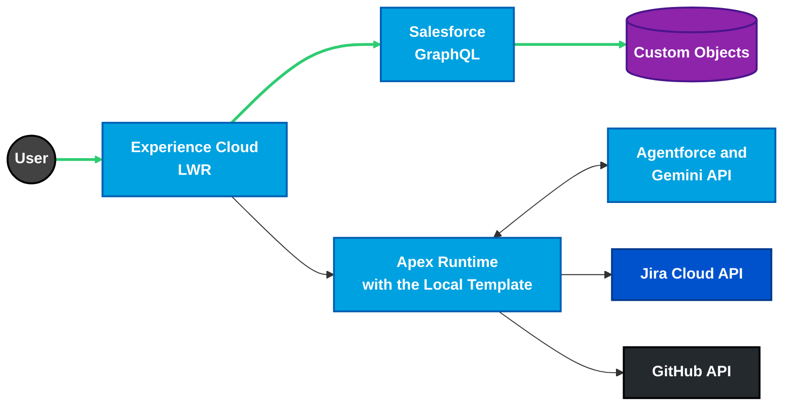

# Ryan Bumstead: Salesforce Platform Architect Portfolio

**Live App:** [https://ryanbumstead.com](https://ryanbumstead.com), which redirects to the Experience Cloud site and keeps the path

> [!IMPORTANT]
> **Project Status:** Live since October 2026. 6 enterprise docs and 39 ADRs. This README describes what runs in production.

> [!TIP]
> **Non-Salesforce Reader?** This is a public website built on the Salesforce CRM platform. It shows live data from the org, writes cover letters with an AI model, and is deployed by an automated pipeline with quality gates.

**Documentation:** [**View the Governance Hub**](https://rdbumstead.github.io/salesforce-platform-architect-portfolio/) (Rendered Specs, ADRs, & Guides)

[](https://rdbumstead.github.io/salesforce-platform-architect-portfolio/)
[](https://github.com/rdbumstead/salesforce-platform-architect-portfolio/actions/workflows/deploy.yml)
[](https://github.com/rdbumstead/salesforce-platform-architect-portfolio/actions/workflows/pr.yml)
[](https://github.com/rdbumstead/salesforce-platform-architect-portfolio/actions/workflows/keep-alive.yml)
[](https://linkedin.com/in/ryanbumstead)
[](https://www.salesforce.com/trailblazer/rbumstead)
[](https://www.salesforce.com/trailblazer/rbumstead)
[](LICENSE)

---

## How to Evaluate This Portfolio

### What This Demonstrates

Salesforce platform architecture, including:

- **DevOps Maturity**: delta deployments, automated quality gates, and JWT-based CI/CD.
- **Contract-First APIs**: OpenAPI 3.0 specs for a System API and a Process API, written before the Apex REST classes that serve them.
- **Applied AI Governance**: one provider dispatch behind `POST /papi/v1/ai/generate`. Agentforce, which runs a Prompt Builder template, writes the cover letters, with Gemini 2.5 Flash through the Gemini API and a records based Local Template behind it. Cover letters are grounded on portfolio records. The site's cover letter page asks Agentforce through the API and runs Gemini and the template in process, under its own AI rate limit of 10 a minute, and shows which provider wrote each letter.
- **Observability**: the Glass Box footer shows live governor limits, the org's daily quotas, and the AI provider and circuit breaker states.

### Portfolio Overview

**By The Numbers:**

- **6 Enterprise Documents**: SAS, Charter, Technical Guide, Ops Guide, Governance, Overview.
- **39 Architectural Decisions (ADRs)**: documented rationale for performance, security, and AI.
- **15 Core Competencies**: mapped to verifiable artifacts and validation methods.
- **8 CI/CD Workflows**: delta deploys that also refresh the docs cache after a push that changes the docs, PR gates (including a check only validation against production), an internal reference check for pull requests that change only the docs, a read only live smoke test after each deploy and once a day, a Postman sync that pushes the public collection after each green production deploy, the daily heartbeat, the cache warmer worker deploy, and a Lighthouse audit run on demand.

**Quick Navigation:** [Evidence Matrix](#evidence-matrix) • [Architecture Diagram](#architecture) • [Full Docs](#full-architecture-documentation)

---

## Evidence Matrix

<details>
<summary><strong>Skills-to-Artifacts Evidence Matrix</strong> (Click to expand. Maps competencies to verifiable deliverables)</summary>

| Core Competency                 | Demonstrated By                                                                                                                            | Artifact/Evidence                                                                                                                                                                                                                                                                                                                           | Verification Method                                                                                                                                                                                                                                                                                                                                                                                                                                                                                                                                                                                             |
| :------------------------------ | :----------------------------------------------------------------------------------------------------------------------------------------- | :------------------------------------------------------------------------------------------------------------------------------------------------------------------------------------------------------------------------------------------------------------------------------------------------------------------------------------------ | :-------------------------------------------------------------------------------------------------------------------------------------------------------------------------------------------------------------------------------------------------------------------------------------------------------------------------------------------------------------------------------------------------------------------------------------------------------------------------------------------------------------------------------------------------------------------------------------------------------------- |
| **API Design & Contract-First** | Twin API Pattern with OpenAPI 3.0                                                                                                          | [SAPI v2 Specification](packages/integration-api/specs/salesforce-sapi-v2.yaml) • [PAPI v2 Specification](packages/integration-api/specs/portfolio-papi-v2.yaml) • [ADR-039](docs/adr/039-api-v2-and-the-v1-sunset.md) • [ADR-024](docs/adr/024-twin-api-pattern-contract-first-parity.md) • [`scripts/api-smoke.sh`](scripts/api-smoke.sh) | Review spec vs. Apex parity, then run the [evaluator curl flow](#evaluator-curl-flow): a token from `POST /papi/v1/auth/token`, then every GET path ([ADR-028](docs/adr/028-evaluator-access-via-token-vending.md))                                                                                                                                                                                                                                                                                                                                                                                             |
| **Enterprise DevOps & CI/CD**   | Delta deployments with quality gates                                                                                                       | [GitHub Actions Workflows](https://github.com/rdbumstead/salesforce-platform-architect-portfolio/actions) • [ADR-006](docs/adr/006-jwt-bearer-flow-for-ci-cd.md)                                                                                                                                                                            | Check pipeline badges and deployment history: every PR also validates check only against production, and every deploy that changes production is followed by a read only live smoke test ([Maintenance Guide §3.2](docs/guides/05-Maintenance-Guide.md#32-pipeline-triggers))                                                                                                                                                                                                                                                                                                                                   |
| **AI/ML Governance**            | One dispatch, Agentforce, Gemini, then the Local Template                                                                                  | [AI Strategy Section](docs/guides/03-SAS.md#541-feature-spotlight-generative-cover-letter-engine) • [ADR-015](docs/adr/015-strategy-pattern-for-generative-ai.md)                                                                                                                                                                           | Open `/ai-lab`, generate a letter, and open the panel that shows the provider, the attempts and the prompt that was sent                                                                                                                                                                                                                                                                                                                                                                                                                                                                                        |
| **Security Architecture**       | Zero Trust with Guest User restrictions                                                                                                    | [Data Security Matrix](docs/guides/03-SAS.md#46-data-security-matrix) • [ADR-012](docs/adr/012-guest-user-security-restriction-rules.md) • [ADR-027](docs/adr/027-platform-native-api-authentication.md)                                                                                                                                    | Examine FLS, guest restrictions, and OAuth client-credentials auth                                                                                                                                                                                                                                                                                                                                                                                                                                                                                                                                              |
| **Resilience Engineering**      | Circuit breaker pattern with degraded mode                                                                                                 | [Contingency Plans](docs/guides/03-SAS.md#8-contingency--rollback-plans) • [ADR-022](docs/adr/022-resilience-engineering-resilience-simulation-toggle.md)                                                                                                                                                                                   | Turn on "Simulate an outage" on the Delivery page's changelog or roadmap and watch the cached data carry a "Simulated" badge (status `SIMULATED`)                                                                                                                                                                                                                                                                                                                                                                                                                                                               |
| **Performance Optimization**    | Mobile-first with measured LCP                                                                                                             | [NFRs Section](docs/guides/03-SAS.md#21-core-nfrs) • [ADR-020](docs/adr/020-mobile-performance-static-svg-fallback-strategy.md)                                                                                                                                                                                                             | Read the measured mobile numbers in the Technical Guide §2.11, or run the Lighthouse workflow on demand against any URL                                                                                                                                                                                                                                                                                                                                                                                                                                                                                         |
| **Data Modeling**               | Persona-based resume generation schema                                                                                                     | [ERD Diagram](docs/guides/03-SAS.md#41-logical-data-model-simplified-erd) • [Data Dictionary](docs/guides/03-SAS.md#appendix-d-data-dictionary-detailed-schema)                                                                                                                                                                             | Examine junction object strategy and filtering logic                                                                                                                                                                                                                                                                                                                                                                                                                                                                                                                                                            |
| **Observability & Monitoring**  | Live telemetry in the Glass Box footer                                                                                                     | [Observability Section](docs/guides/03-SAS.md#9-observability--glass-box-telemetry) • [ADR-014](docs/adr/014-deferred-telemetry-loading-performance.md)                                                                                                                                                                                     | Open any page and read the footer: live CPU, heap and SOQL use, the org's daily API and async Apex quotas, the AI provider and circuit breaker states, and the CI badges for the deploy, the live smoke test and the Postman sync                                                                                                                                                                                                                                                                                                                                                                               |
| **Event-Driven Architecture**   | Executable governance: CI publishes a platform event, an Apex trigger persists it                                                          | [Pillar E](docs/guides/03-SAS.md#55-pillar-e-agile-delivery--devops-roadmap) • [ADR-019](docs/adr/019-executable-governance-platform-events-for-documentation-logic.md)                                                                                                                                                                     | Open the Delivery page and compare the checklist's commit and run link with the GitHub Actions history                                                                                                                                                                                                                                                                                                                                                                                                                                                                                                          |
| **Integration Patterns**        | Server-side caching for external APIs                                                                                                      | [GitHub Integration](docs/guides/03-SAS.md#appendix-a-engineering-implementation-notes) • [ADR-007](docs/adr/007-github-api-server-side-caching.md)                                                                                                                                                                                         | Open the Delivery page: the changelog and the roadmap read GitHub and Jira data that a scheduled job caches, so a page view never makes a callout                                                                                                                                                                                                                                                                                                                                                                                                                                                               |
| **Business Architecture**       | Pillar A, an employer hub for an education provider                                                                                        | [Pillar A](docs/guides/03-SAS.md#51-pillar-a-business-architecture-employer-hub) • [ADR-029](docs/adr/029-schema-visualizer-scope-discovery-and-caching.md)                                                                                                                                                                                 | Open `/business-architecture`: the process map and dashboard gallery (redrawn from the original demo, with no names and sample values), the live data model with its Employer Hub and portfolio toggle, and the walkthrough                                                                                                                                                                                                                                                                                                                                                                                     |
| **Solution Architecture**       | Pillar B, a platform choice for a regional adult literacy nonprofit                                                                        | [Pillar B](docs/guides/03-SAS.md#52-pillar-b-solution-architecture-nonprofit-literacy-platform) • [ADR-030](docs/adr/030-decision-matrix-as-custom-metadata.md)                                                                                                                                                                             | Open `/nonprofit-solutions` (titled Solution Architecture): move the weights in the three-way decision matrix and watch the ranking and the sensitivity line                                                                                                                                                                                                                                                                                                                                                                                                                                                    |
| **Data Visualization**          | Skills matrix with years from linked roles, and a d3-force graph on demand                                                                 | [Technical Guide 2.1](docs/guides/04-Technical-Guide.md#21-c-skill-network-visualization) • [ADR-020](docs/adr/020-mobile-performance-static-svg-fallback-strategy.md)                                                                                                                                                                      | Open `/skills`: the matrix first, then Graph on a desktop, and check in the network log that `D3_Library` loads only then                                                                                                                                                                                                                                                                                                                                                                                                                                                                                       |
| **Evaluator Experience**        | Case studies with headline numbers, the pillar cards, a career line of roles, certifications and the school, and verifiable certifications | [Technical Guide 2.12](docs/guides/04-Technical-Guide.md#212-home-page) • [Technical Guide 2.2](docs/guides/04-Technical-Guide.md#22-c-resume-builder-resume-generation)                                                                                                                                                                    | Open `/`: the hero, up to three case study cards, the career line, up to three case study cards, the testimonials once three are approved, "How this site is built", the pillars and card numbers computed from live sources (the ERD's objects, the spec paths, the AI providers, the latest CI test run), and a contact call. Use the selector on the career line to show All, Work, Education or Certifications and open a point for its detail. Open `/resume`: pick a persona and the skills follow it and download a PDF that looks like the preview. Retired certifications sit below the Trailhead link |
| **Technical Documentation**     | Enterprise-grade architecture suite                                                                                                        | [6 Architecture Guides](#full-architecture-documentation) • [SAS](docs/guides/03-SAS.md)                                                                                                                                                                                                                                                    | Review documentation structure and C4 model diagrams                                                                                                                                                                                                                                                                                                                                                                                                                                                                                                                                                            |

</details>

#### Evaluator curl flow

Token vending is live, so any reviewer can call the APIs without a shared secret ([ADR-028](docs/adr/028-evaluator-access-via-token-vending.md)). Every reviewer gets the same session token, so all reviewers share one rate limit per tier. The token request goes to the Experience Cloud site domain. Every other call goes to My Domain, at the `instance_url` returned with the token.

```bash
# 1. Request a short-lived token (no credentials required)
curl -s -X POST "https://ryan-bumstead-dev-ed.develop.my.site.com/portfoliovforcesite/services/apexrest/papi/v1/auth/token" \
  -H "Content-Type: application/json" -H "X-Request-Id: $(uuidgen)" \
  -d '{"email":"<your email address>","purpose":"Evaluating API design"}'

# 2. Call any path on the returned instance_url with the returned token
# X-API-Version: v2 returns public keys only. A missing header means v1, which is deprecated.
curl -si "<instance_url>/services/apexrest/sapi/v1/skills?limit=5" \
  -H "Authorization: Bearer <access_token>" -H "X-API-Version: v2" -H "X-Request-Id: $(uuidgen)"

# Or run every GET path in both specifications and print status and key headers per path
EVALUATOR_EMAIL="<your email address>" EVALUATOR_PURPOSE="Evaluating API design" ./scripts/api-smoke.sh
```

**Correlation id on live responses.** The platform echoes a caller-supplied `X-Request-Id` exactly once, on My Domain and on the site domain (site domain observed in a scratch org copy of the site, including on an Apex 503), and Apex does not set it again (`ApiRequestContext.applyRequestRules`). With no `X-Request-Id`, the platform returns its own 32-character hex id (no dashes) on responses it generates before Apex runs, such as a 401. [unverified] Whether an authenticated PAPI response to a request without an id then carries one id or two (the platform's and the UUID Apex generates) is not yet established, so check it in your own first call. Send your own UUID to get a single, predictable id back.

---

### Verification Checklist for Evaluators

**Available Now:**

- [Architecture decisions documented with rationale](docs/adr/): 39 ADRs covering performance, security and AI. Each one in the [index below](#architectural-decision-records) says whether it is built, superseded, or a design only
- [CI/CD pipelines green with delta deployment strategy](https://github.com/rdbumstead/salesforce-platform-architect-portfolio/actions): 8 workflows (deploy, PR validation, the docs internal reference check, the live smoke test, the Postman sync, the heartbeat, the cache warmer worker deploy, plus a Lighthouse audit run on demand)
- [API contracts OpenAPI 3.0 compliant](packages/integration-api/specs/salesforce-sapi.yaml): Twin API pattern with SAPI + PAPI specifications
- [Mobile performance targets quantified](docs/guides/03-SAS.md#21-core-nfrs): an LCP target of 2.5 s and a gate at the best the LWR shell allows, measured: mobile LCP medians of 7.5 to 9.6 s (Lighthouse 11 mobile, October 2026) on the six main routes, with the skills matrix on phones and the graph engine loaded only on demand
- [Zero Trust security model enforced](docs/guides/03-SAS.md#46-data-security-matrix): Guest user FLS restrictions + OAuth 2.0 client-credentials auth (External Client App) + read-only endpoints
- [AI governance with failover strategy](docs/guides/03-SAS.md#541-feature-spotlight-generative-cover-letter-engine): one dispatch from Agentforce to the Gemini API to a Local Template built from the records, grounded on portfolio records

**Live on the site:**

- **Real-time observability**: the Glass Box footer shows live governor limits (Heap, CPU, SOQL), the org's daily API request and async Apex quotas, AI provider health and the GitHub and Jira circuit breakers
- **Resilience simulation**: a "Simulate an outage" switch on the changelog and the roadmap shows the cached fallback, and a real outage opens a circuit breaker that the footer and the page report. The before and after beside the switch reads the breaker's failure threshold and open minutes from the settings, so it never states a number I have changed
- **Executable governance**: a checklist on the Delivery page ticks "production deploy green", "org heartbeat today" (within 26 hours) and "caches under 30 minutes" only from pipeline evidence, written by a platform event that CI publishes
- **Interactive API testing**: a built-in developer console calls REST endpoints through a Named Credential proxy, compares the response with the OpenAPI spec and shows the `X-Request-Id` and rate-limit headers. External reviewers can request a short-lived token and `curl` the APIs directly, or download a Postman collection of the Process API (`PAPI_Postman_Collection`, generated from the spec) and copy three curl examples filled with their own token. A Run in Postman button appears once a public workspace exists
- **View source**: eight components, the footer and the cover letter page among them, open their own code in the page, with syntax highlighting, from a cache a daily job fills from GitHub
- **Live data marker**: nine sections, from the resume and the home page to the Delivery page and the cover letter page, carry a "Live from Salesforce" marker. Its panel names the records the section reads with their counts in plain labels, and "See this section's data model" draws the full data model with those objects highlighted, described live by `SchemaService`
- **Operational settings in custom metadata**: API rate tiers, page sizes, form limits, cache windows and display counts live in `Portfolio_Setting__mdt` records with safe ranges, and the code keeps its own defaults as fallbacks ([ADR-032](docs/adr/032-operational-settings-in-custom-metadata.md))
- **Contact page and analytics**: a native contact form on `/contact` with spam guards, and GA4 events for how visitors use the site, with no personal data in any event
- **Mobile performance validation**: on a phone the skills page shows the matrix and requests no graph engine. Mobile LCP medians were 7.5 to 9.6 s on the six main routes (Lighthouse 11 mobile, October 2026), the best the LWR shell allows against a 2.5 s target. In October 2026 I measured production at 7.6 to 10.6 s. The first site component renders at about 5 s, after about 850 KB of framework scripts, so site changes alone cannot reach 2.5 s. Lab medians move about 1.5 s from run to run, so the only gain I claim from the October 2026 performance work is home layout shift, 0.33 to 0 (Technical Guide 2.11)
- **The architecture docs on the site**: `/docs` renders 32 documents, the Executive Overview, the SAS, the Program Charter, the Technical Guide, Guardrails and Executable Governance, then the 27 full ADRs, read from the same cache that View source uses, never from GitHub on page load. The cache refreshes once a day, and a push that changes the docs refreshes them in production after the deploy. The page builds every element itself, so no HTML from a document is ever parsed, and GitHub alert blocks show as titled callouts. The footer, the "How it's built" menu and a "Read the design" link on each pillar page lead there
- **Queries in custom metadata**: each read of portfolio content, in the APIs and on the site, is a `Query_Definition__mdt` record, checked against the query in its class, so an edit can narrow a read and never widen it ([ADR-033](docs/adr/033-queries-in-custom-metadata.md))
- **API Lab filters to pick from**: each name and Id filter is a picklist of values read from the org on page load, and on phones the lab opens with the endpoint and Execute showing and the rest in sections a visitor opens
- **Cover letters of 250 to 350 words**: one prompt builder for both cover letter paths, its instruction in an `AI_Prompt__mdt` record, a word limit line with 350 as a hard maximum and a fixed five paragraph shape, a generation config on every Gemini request, and Agentforce held to an hourly budget under the Developer Edition's cap. Six letters in a row came back at 277 to 322 words in a scratch org loaded with production's records (2026-10-27). Production lengths after the deploy are not measured yet
- **The cover letter as a page and a PDF**: the letter shows on one centred sheet like the resume preview, with Download PDF (selectable text, the same header as the resume PDF) and Copy text, both PDFs from one shared module (`c/documentPdf`)
- **The 10 minute tour**: opt in only, five stops on the five pillar pages, a bar with the stop's task as a Show me button, Back, Next and End tour. It starts from the hero link ("Have 10 minutes? Take the guided tour") or the first row of the header's "How it's built" menu and keeps one session storage key
- **Native form controls**: the site's form fields and buttons are native controls drawn by one shared CSS module at 44 px, in place of Salesforce's 32 px base components ([ADR-037](docs/adr/037-native-form-controls-site-wide.md))
- **Storage in the footer**: one row in Quotas and limits with the org's data and file storage that opens a small panel by area, read from one stored snapshot (aggregates only). The data by area is an estimate, record counts times 2 KB
- **Layout**: motion that follows the visitor's system "reduce motion" setting, with no button of its own, the footer readings under one caption with View source, in labelled groups (CI with the deploy, live smoke test and Postman sync badges, Platform, Integrations, and Quotas and limits with storage), page intros on the five pillar pages, and the Delivery checklist's times in UTC and in the visitor's own time
- **By the numbers**: the Delivery page opens its content with counts read from records, the production deploys recorded with the newest Apex and Jest test counts and what each proves, the evaluator tokens issued, the cover letters written and API Lab requests sent, and the testimonials approved by vibe once one is approved. Only counts reach the page, and my private reports and dashboard sit in the org
- **Owner emails and testimonial approval**: each contact form Lead sends its owner one email with the visitor's message and a link to the Lead, and each new testimonial goes to me as an approval request that can be answered by reply. Approval puts it on the site. Both emails go to a user, never to an address in source
- **Link previews**: the head markup carries a description, Open Graph and Twitter card tags on every route, with a 1200 by 630 share image, so a shared link can show a title, a summary and a picture
- **Home page, recruiter first** ([ADR-034](docs/adr/034-recruiter-first-home-page.md)): the hero with a title line and a value sentence and a link that starts the 10 minute tour ("Have 10 minutes? Take the guided tour"), a career line of every employer with its span and each title under it, certifications grouped by issuer and year with every name shown, and the school, with a selector and a link to the full details on the resume, up to three compact case studies chosen by a sort number, each with its own number (the "How this site is built" cards keep theirs, so the two sections no longer repeat the same three), a "What people say" section that shows once three testimonials are approved, "How this site is built" (the tour now starts from the hero link and the first row of the header's "How it's built" menu), and a contact call that says references are available on request. The header reads Home, Resume, Skills, How it's built, Testimonials and Contact, with a Back to top arrow. On a phone the career line shows the newest 4 points of the chosen filter and a "Show all" button. The case study text and the value sentence are records I load after the deploy, so they show only once loaded

---

## Architectural Decision Records

<details>
<summary><strong>Architectural Decision Records (ADR) Index</strong> (Click to expand. 39 documented decisions)</summary>

| ID                                                                                       | Subject                                  | Strategic Driver                | Status                            |
| :--------------------------------------------------------------------------------------- | :--------------------------------------- | :------------------------------ | :-------------------------------- |
| [ADR-001](docs/adr/001-experience-cloud-lwr-vs-aura.md)                                  | Experience Cloud (LWR) vs. Aura          | Performance (LCP target 2.5 s)  | Built                             |
| [ADR-002](docs/adr/002-custom-objects-vs-standard-objects.md)                            | Custom Objects vs. Standard Objects      | Security / Guest Access         | Built                             |
| [ADR-003](docs/adr/003-apex-rest-vs-external-service.md)                                 | Apex REST vs. External Service           | Budget                          | Built                             |
| [ADR-004](docs/adr/004-static-resource-code-rendering.md)                                | Static Resource Code Rendering           | Rate Limiting                   | Built, from a GitHub cache        |
| [ADR-005](docs/adr/005-gamified-testimonial-ui.md)                                       | Gamified Testimonial UI                  | User Engagement                 | Built                             |
| [ADR-006](docs/adr/006-jwt-bearer-flow-for-ci-cd.md)                                     | JWT Bearer Flow for CI/CD                | DevOps Automation               | Built                             |
| [ADR-007](docs/adr/007-github-api-server-side-caching.md)                                | GitHub API Server-Side Caching           | Resilience                      | Built                             |
| [ADR-008](docs/adr/008-jira-integration-vs-agile-accelerator.md)                         | Jira Integration vs. Accelerator         | ALM Maturity                    | Built                             |
| [ADR-009](docs/adr/009-granular-resume-data-model.md)                                    | Granular Resume Data Model               | Persona-Based Filtering         | Built                             |
| [ADR-010](docs/adr/010-visualization-engine-vis-js-vs-antv-g6.md)                        | Graph engine (now d3-force)              | UI/UX Animation                 | Superseded by ADR-020             |
| [ADR-011](docs/adr/011-context-grounding-strategy-direct-crm-vs-data-360.md)             | Direct CRM vs. Data 360                  | AI Architecture                 | Design only, not built            |
| [ADR-012](docs/adr/012-guest-user-security-restriction-rules.md)                         | Guest User Restriction Rules             | Zero Trust Security             | Built                             |
| [ADR-013](docs/adr/013-structured-logging-framework-nebula-logger.md)                    | Nebula Logger Implementation             | Observability                   | Built, Nebula an optional install |
| [ADR-014](docs/adr/014-deferred-telemetry-loading-performance.md)                        | Deferred Telemetry Loading               | Performance                     | Built                             |
| [ADR-015](docs/adr/015-strategy-pattern-for-generative-ai.md)                            | Strategy Pattern for Generative AI       | High Availability               | Built                             |
| [ADR-016](docs/adr/016-cloudflare-worker-as-edge-ai-proxy.md)                            | Cloudflare Worker as AI Proxy            | Edge Proxy                      | Design only, not built            |
| [ADR-017](docs/adr/017-system-api-security-and-dual-sided-auth-pattern.md)               | API Security                             | Security Governance             | Superseded by ADR-027             |
| [ADR-018](docs/adr/018-finops-constraint-aws-lambda-function-urls-vs-api-gateway.md)     | AWS Lambda URLs vs. API Gateway          | Cost Control                    | Design only, not built            |
| [ADR-019](docs/adr/019-executable-governance-platform-events-for-documentation-logic.md) | Platform Events for Documentation        | Executable Governance           | Built                             |
| [ADR-020](docs/adr/020-mobile-performance-static-svg-fallback-strategy.md)               | Mobile: matrix first, graph on open      | Performance                     | Built                             |
| [ADR-021](docs/adr/021-native-graphql-door-1-vs-apex-rest-for-ui.md)                     | Native GraphQL vs. Apex REST             | Frontend Orchestration          | Built, in three components        |
| [ADR-022](docs/adr/022-resilience-engineering-resilience-simulation-toggle.md)           | Resilience Simulation Toggle             | Trust / Resilience              | Built                             |
| [ADR-023](docs/adr/023-client-side-pdf-generation-jspdf-for-mvp.md)                      | Client-Side PDF Generation (jsPDF)       | Tooling / MVP Speed             | Built                             |
| [ADR-024](docs/adr/024-twin-api-pattern-contract-first-parity.md)                        | Twin API Pattern                         | Contract First                  | Built                             |
| [ADR-025](docs/adr/025-papi-fan-out-throttling-capacity-planning.md)                     | PAPI Fan-Out Throttling                  | Capacity Planning               | Built                             |
| [ADR-026](docs/adr/026-header-based-api-versioning-strategy.md)                          | Header-Based API Versioning              | Versioning Strategy             | Built                             |
| [ADR-027](docs/adr/027-platform-native-api-authentication.md)                            | Platform-Native API Authentication       | Zero Trust / Security           | Built                             |
| [ADR-028](docs/adr/028-evaluator-access-via-token-vending.md)                            | Evaluator Access via Token Vending       | Developer Experience            | Built                             |
| [ADR-029](docs/adr/029-schema-visualizer-scope-discovery-and-caching.md)                 | Schema visualizer without Platform Cache | Data Architecture               | Built                             |
| [ADR-030](docs/adr/030-decision-matrix-as-custom-metadata.md)                            | Decision matrix as Custom Metadata       | Solution Design                 | Built                             |
| [ADR-031](docs/adr/031-native-contact-form.md)                                           | Native contact form                      | Lead Capture / Abuse Protection | Built                             |
| [ADR-032](docs/adr/032-operational-settings-in-custom-metadata.md)                       | Operational settings in custom metadata  | Operability                     | Built                             |
| [ADR-033](docs/adr/033-queries-in-custom-metadata.md)                                    | Queries in custom metadata               | Operability                     | Built                             |
| [ADR-034](docs/adr/034-recruiter-first-home-page.md)                                     | Recruiter first home page                | Audience / Information Design   | Built                             |
| [ADR-035](docs/adr/035-diagrams-rendered-in-ci.md)                                       | Diagrams rendered in CI                  | Docs / Delivery                 | Built                             |
| [ADR-036](docs/adr/036-portfolio-guide-agent.md)                                         | Portfolio Guide Agent                    | AI / Agentforce                 | In source, inactive               |
| [ADR-037](docs/adr/037-native-form-controls-site-wide.md)                                | Native form controls site wide           | Frontend / Accessibility        | Built                             |
| [ADR-038](docs/adr/038-stable-public-keys-in-the-api.md)                                 | Stable public keys in the API            | API Design                      | Built                             |
| [ADR-039](docs/adr/039-api-v2-and-the-v1-sunset.md)                                      | API v2 and the v1 sunset                 | API Design                      | Built                             |

</details>

---

<details>
<summary><strong>Glossary of Terms</strong> (Click to expand)</summary>

| Term          | Meaning                                                                                                                   | Status                          |
| :------------ | :------------------------------------------------------------------------------------------------------------------------ | :------------------------------ |
| **LWR**       | Lightning Web Runtime: Modern Salesforce frontend framework                                                               | Live                            |
| **ADR**       | **Architectural Decision Record**. A short document explaining a significant decision. **Status:** Complete (39 records). |
| **Glass Box** | Real-time system telemetry and observability UI pattern                                                                   | Live                            |
| **RAG**       | Retrieval-Augmented Generation, an AI grounding technique                                                                 | Apex grounding on cover letters |
| **SAPI**      | System API: Direct data access layer (API-led connectivity)                                                               | Live                            |
| **PAPI**      | Process API: Orchestration layer (API-led connectivity)                                                                   | Live                            |

</details>

---

## Architecture



> **Diagram Description (for accessibility):** The diagram shows a user reaching the Experience Cloud LWR site, live since October 2026. The site reads some records through the native Salesforce GraphQL API and the rest through the Apex runtime. Apex asks Agentforce for cover letters through the API, falls back to the Gemini API, and then to its own Local Template. Scheduled Apex jobs read GitHub and Jira into caches, and everything is backed by custom Salesforce objects.

---

## Full Architecture Documentation

> [!TIP]
> **View these documents in the [Governance Hub](https://rdbumstead.github.io/salesforce-platform-architect-portfolio/) for the best reading experience.**

| Document                                    | Link                                                                   |
| :------------------------------------------ | :--------------------------------------------------------------------- |
| 01 Executive Overview                       | [Read in Repo](docs/guides/01-Executive-Overview.md)                   |
| 02 Program Charter and Roadmap              | [Read in Repo](docs/guides/02-Program-Charter.md)                      |
| 03 Systems Architecture Specification (SAS) | [Read in Repo](docs/guides/03-SAS.md)                                  |
| 04 Technical Implementation Guide           | [Read in Repo](docs/guides/04-Technical-Guide.md)                      |
| 05 Maintenance and Operations Guide         | [Read in Repo](docs/guides/05-Maintenance-Guide.md)                    |
| 06 Guardrails and Executable Governance     | [Read in Repo](docs/guides/06-Guardrails-and-Executable-Governance.md) |

> **For Non-Salesforce Readers:** Document 06 includes plain-English explanations of Salesforce governor limits and constraint-based design principles. No prior platform knowledge required.

---

## API & Integration Contracts (Contract-First Design)

> [!NOTE]
> This project uses a **Twin API Pattern** ([ADR-024](docs/adr/024-twin-api-pattern-contract-first-parity.md)): a System API and a Process API, each described by an OpenAPI 3.0 file. A change is made in the YAML first, then in Apex, and the Apex REST classes are the only runtime.
>
> **Security:** All APIs require OAuth 2.0 Client Credentials via an External Client App, consumed on-platform through a Named Credential ([ADR-027](docs/adr/027-platform-native-api-authentication.md)). External evaluators obtain short-lived tokens from a vending endpoint ([ADR-028](docs/adr/028-evaluator-access-via-token-vending.md)).

| Spec                | Role                            | Standard    | Documentation                                     | Source                                                           |
| :------------------ | :------------------------------ | :---------- | :------------------------------------------------ | :--------------------------------------------------------------- |
| **Salesforce SAPI** | **System API** (Data Access)    | OpenAPI 3.0 | [View Docs (MD)](docs/api/oas/salesforce-sapi.md) | [View YAML](packages/integration-api/specs/salesforce-sapi.yaml) |
| **Portfolio PAPI**  | **Process API** (Client-Facing) | OpenAPI 3.0 | [View Docs (MD)](docs/api/oas/portfolio-papi.md)  | [View YAML](packages/integration-api/specs/portfolio-papi.yaml)  |

---

## Repo Structure

```
├── packages/               # Multi-package monorepo (LWR, Apex Services, GraphQL)
├── docs/guides/            # Full enterprise documentation set
├── scripts/                # CI/CD utility scripts
├── .github/workflows/      # PR validation + delta deploy pipelines
└── config/                 # Linting, formatting, DevOps configs
```

> Repo is source-driven: no build artifacts, only clean source and configs.

---

**Owner:** Ryan Bumstead | **License:** MIT

**Contact:** [LinkedIn](https://linkedin.com/in/ryanbumstead) • [ryan@ryanbumstead.com](mailto:ryan@ryanbumstead.com)

_Delivered with enterprise rigor._
