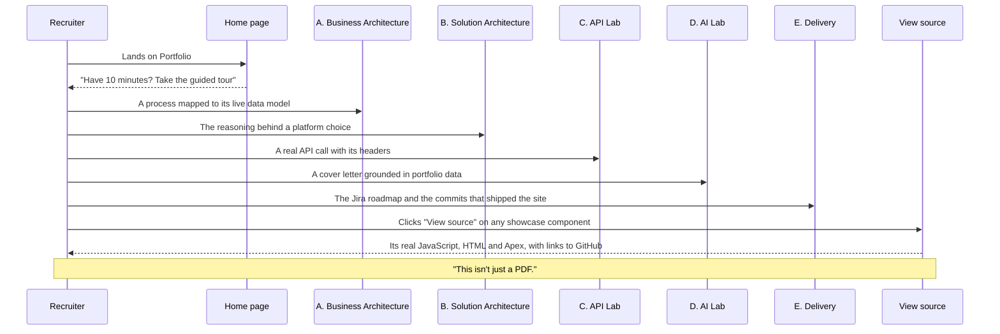

# Executive Overview

**Table of Contents**

- [1. Strategic Summary (Read This First)](#1-strategic-summary-read-this-first)
- [2. Strategic Intent](#2-strategic-intent)
- [3. Business Value: Why Build This Complexity?](#3-business-value-why-build-this-complexity)
  - [3.1 The "5-Minute Tour" User Journey](#31-the-5-minute-tour-user-journey)
- [4. Terminology & Acronyms](#4-terminology--acronyms)
- [5. Success Criteria (Definition of Done)](#5-success-criteria-definition-of-done)

---

Project: Salesforce Platform Architect Portfolio

Version: 1.0

Owner: Ryan Bumstead

Launch target: Q1 2027

## 1. Strategic Summary (Read This First)

**The Problem:** Enterprise Salesforce implementations often go wrong in three quiet ways: costs nobody watches (FinOps), slow pages, and guest users who can see more than they should.

**The Solution:** This portfolio is a **zero budget architecture** built to enterprise habits. It runs on a free Salesforce Developer Edition org, calls the Gemini API through a Named Credential for cover letters, keeps every guest grant in one permission set in source, and shows its own limits on every page.

**Why It Matters:**

> [!TIP]
> **For Non-Salesforce Readers:** It shows that a fixed budget can be respected without giving up capability.

- **For Architects:** It demonstrates "Glass Box Telemetry". The footer reports each visit's own CPU, heap and SOQL use against their limits, the org's daily API and async Apex quotas, and the state of the AI, GitHub and Jira circuit breakers.
- **For Recruiters:** It is a living proof of work, with its mobile load time measured and published rather than claimed.

If you only inspect one thing, look at the **[Systems Architecture Specification (SAS)](./03-SAS.md)** to see the "North Star" diagram.

## 2. Strategic Intent

This Executive Overview sums up why the Salesforce Platform Architect Portfolio exists, what it is worth to the people who read it, and how to judge it. It is the entry point to the other guides. The scope and the plan live in the [Program Charter](./02-Program-Charter.md).

## 3. Business Value: Why Build This Complexity?

The primary problem this portfolio solves is that Recruiters and Hiring Managers struggle to verify an architect's hands-on skills through static PDFs.

- **The Need:** A verified, interactive demonstration of complex capabilities like API design, LWC, and AI.
- **The Value:** This system intentionally mirrors a real enterprise architecture so evaluators can see architecture quality, integration patterns and DevOps discipline, all within a controlled, demonstrable environment. It shows that "Enterprise Grade" is a way of working, not a license tier.

### 3.1 The "5-Minute Tour" User Journey

How a recruiter or architect experiences this portfolio. The tour has one stop per pillar, one minute each, so its length is worked out from the number of stops (`c-site-build-section`, `MINUTES_PER_STEP`, over the pillars in `c/pillarData`). On the way, each showcase component has a View source button. It opens a dialog with the component's JavaScript, HTML and main Apex class, highlighted by the shared Prism module, with a link to each file on GitHub. The files are listed in the Source File custom metadata, so they can change without a deploy. A scheduled job reads them from GitHub at most once a day per file into an admin only cache. Visitors read only the cache, never GitHub ([ADR-004 amendment](../adr/004-static-resource-code-rendering.md)):

## 4. Terminology & Acronyms

To clarify Salesforce-specific terms used throughout this portfolio:

| Term                  | Definition                                                                                                                                                                                                        |
| :-------------------- | :---------------------------------------------------------------------------------------------------------------------------------------------------------------------------------------------------------------- |
| **LWR**               | **Lightning Web Runtime**. A high-performance, standards-based framework for building fast Salesforce sites.                                                                                                      |
| **SAPI**              | **System API**. The interface that directly touches the database/backend (Salesforce Core).                                                                                                                       |
| **PAPI**              | **Process API**. The layer that combines several portfolio objects into one response for a client, such as the full profile or the resume as text. It runs its own queries. Only its health check calls the SAPI. |
| **FORM_FACTOR**       | A Salesforce constant that automatically detects the user's device type (Large, Medium, Small).                                                                                                                   |
| **Developer Edition** | The free, zero-cost Salesforce environment used to host this portfolio.                                                                                                                                           |

## 5. Success Criteria (Definition of Done)

This project holds itself to functional and technical acceptance criteria. Two of them: performance, where the target is a 2.5 s mobile LCP and the gate is the best the LWR shell allows (mobile LCP medians of 7.5 to 9.6 s across the six main routes, measured with Lighthouse 11 mobile on a scratch copy of the site, and 7.57 to 10.62 s on production in the Round 17 baseline, where the first site component alone renders at about 5 s), and code quality, where org wide Apex coverage must be 90% or more on every pull request.

For the authoritative definition of all success metrics, quality gates, and "Definition of Done", please refer to the **[Program Charter: Success Criteria](./02-Program-Charter.md#22-success-criteria-definition-of-done)**.
