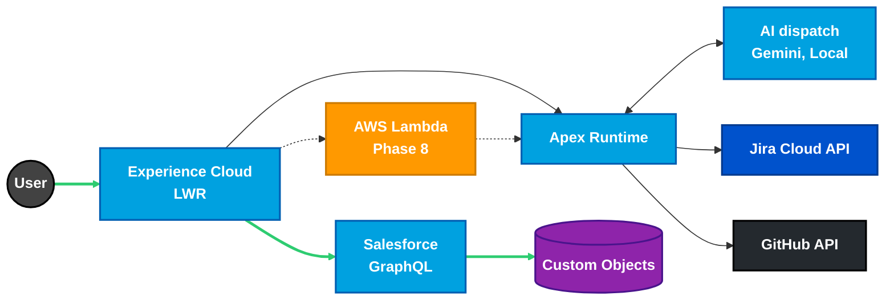
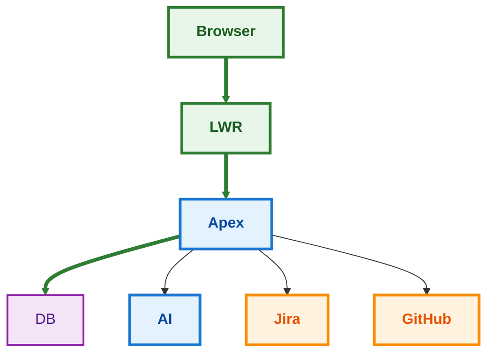
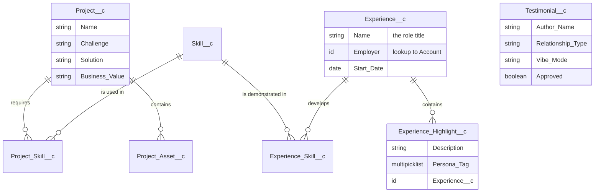
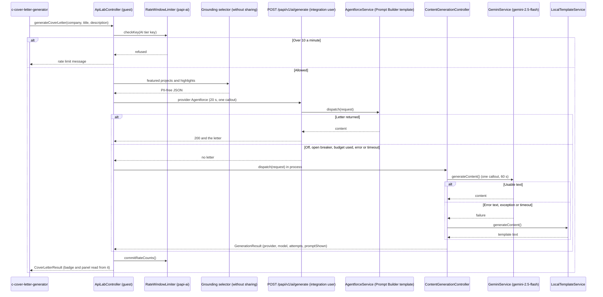
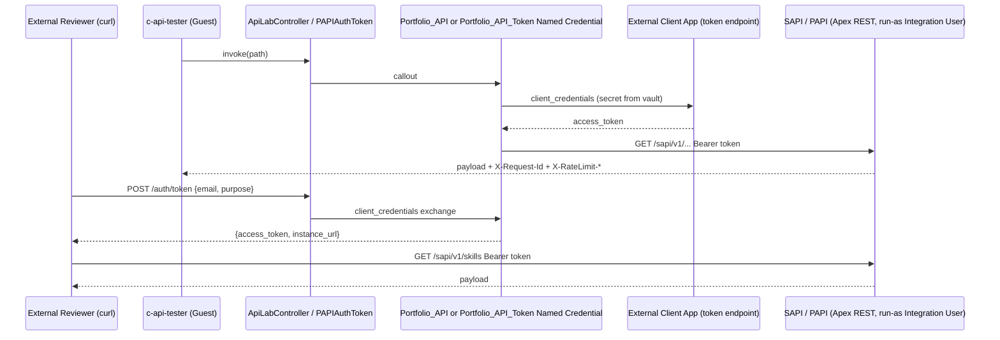

# Systems Architecture Specification (SAS)

**Table of Contents**

- [1. System Context & Architecture](#1-system-context--architecture)
  - [1.1 Architectural "North Star"](#11-architectural-north-star)
  - [1.2 Architecture at a Glance](#12-architecture-at-a-glance)
  - [1.3 Key Salesforce Features Used](#13-key-salesforce-features-used)
  - [1.4 Visual Architecture Standard (C4 Model)](#14-visual-architecture-standard-c4-model)
  - [1.5 Quality Gates (Technical Acceptance)](#15-quality-gates-technical-acceptance)
- [2. Non-Functional Requirements (NFRs)](#2-non-functional-requirements-nfrs)
  - [2.1 Core NFRs](#21-core-nfrs)
  - [2.2 Platform Constraints (Developer Edition)](#22-platform-constraints-developer-edition)
- [3. Risk & Security Architecture](#3-risk--security-architecture)
  - [3.1 Threat Model Summary](#31-threat-model-summary)
- [4. Data Architecture & Schema](#4-data-architecture--schema)
  - [4.1 Logical Data Model (Simplified ERD)](#41-logical-data-model-simplified-erd)
  - [4.2 Core Entities](#42-core-entities)
  - [4.3 Junction Objects (The Glue)](#43-junction-objects-the-glue)
  - [4.4 Asset Management](#44-asset-management)
  - [4.5 Social Proof Engine (Gamified Data)](#45-social-proof-engine-gamified-data)
  - [4.6 Data Security Matrix](#46-data-security-matrix)
- [5. Solution Components (The Pillars)](#5-solution-components-the-pillars)
  - [5.1 Pillar A: Business Architecture (Employer Hub)](#51-pillar-a-business-architecture-employer-hub)
  - [5.2 Pillar B: Solution Architecture (Nonprofit Literacy Platform)](#52-pillar-b-solution-architecture-nonprofit-literacy-platform)
  - [5.3 Pillar C: Work Experience Verification API (Twin API Pattern)](#53-pillar-c-work-experience-verification-api-twin-api-pattern)
  - [5.4 Pillar D: AI & Innovation (Agentforce)](#54-pillar-d-ai--innovation-agentforce)
  - [5.5 Pillar E: Agile Delivery & DevOps (Roadmap)](#55-pillar-e-agile-delivery--devops-roadmap)
- [6. Front-End Architecture (Experience Cloud)](#6-front-end-architecture-experience-cloud)
  - [6.1 Technology Stack](#61-technology-stack)
  - [6.2 Lightning Web Components (LWC)](#62-lightning-web-components-lwc)
- [7. Architectural Decision Records (ADRs)](#7-architectural-decision-records-adrs)
- [8. Contingency & Rollback Plans](#8-contingency--rollback-plans)
  - [8.1 Deployment Failure](#81-deployment-failure)
  - [8.2 Agentforce Unavailable](#82-agentforce-unavailable)
  - [8.3 API Rate Limit Exhaustion](#83-api-rate-limit-exhaustion)
  - [8.4 Resilience Simulation Operations](#84-resilience-simulation-operations)
- [9. Observability & Glass Box Telemetry](#9-observability--glass-box-telemetry)
- [Appendices](#appendices)
  - [Appendix A: Engineering Implementation Notes](#appendix-a-engineering-implementation-notes)
  - [Appendix B: API Specification (OpenAPI/Swagger)](#appendix-b-api-specification-openapiswagger)
  - [Appendix C: MuleSoft Code, Governance, & Proxy Configuration (Reference)](#appendix-c-mulesoft-code-governance--proxy-configuration-reference)
  - [Appendix D: Data Dictionary (Detailed Schema)](#appendix-d-data-dictionary-detailed-schema)
  - [Appendix E: Environment Strategy](#appendix-e-environment-strategy)
  - [Appendix F: Testing Strategy](#appendix-f-testing-strategy)
  - [Appendix G: Accessibility Strategy (A11y)](#appendix-g-accessibility-strategy-a11y)
  - [Appendix H: Deployment Architecture View](#appendix-h-deployment-architecture-view)
  - [Appendix I: Org & Package Structure](#appendix-i-org--package-structure)
  - [Appendix J: Cloud FinOps Strategy (Phase 8 - 2027-2028)](#appendix-j-cloud-finops-strategy-phase-8---2027-2028)
  - [Appendix K: Validation Rules & Logic](#appendix-k-validation-rules--logic)
  - [Appendix L: Reference Artifacts](#appendix-l-reference-artifacts)
  - [Appendix M: Cross-Cutting Pattern - Dual-Door Integration Strategy](#appendix-m-cross-cutting-pattern---dual-door-integration-strategy)

---

Project: Salesforce Platform Architect Portfolio

Version: 1.0

Owner: Ryan Bumstead

Date: MVP – Q1 2027

## 1. System Context & Architecture

### 1.1 Architectural "North Star"

The high-level data flow demonstrating the multi-cloud, API-led strategy.



> [!TIP]
> **Scalability Escape Hatch:** While this system is constrained to the Free Tier (Developer Edition), the architecture is designed to scale. If traffic exceeded limits, the **Phase 8** design moves the heavy lifting (Resume Generation, API Gateway) to AWS Serverless equivalents, allowing the Salesforce Core to remain a lightweight orchestration layer. This ensures the system could handle enterprise-scale traffic with minimal refactoring.

**Architecture Implementation Status (MVP – Q1 2027 Launch)**

Live MVP (Door 1)

- `@AuraEnabled` Apex controllers, the main path for site components (resume and timeline, home case studies and pillar cards, footer, Delivery page, ERD, decision matrix, API Lab and cover letter)
- Native Salesforce GraphQL through the `lightning/uiGraphQLApi` wire adapter, used by three components only: `c-skill-network`, `c-project-asset-gallery` and the footer's `c-graphql-probe` ([ADR-021 amendment](../adr/021-native-graphql-door-1-vs-apex-rest-for-ui.md#amendment-2026-10-23-scope))
- Apex REST services (the SAPI and PAPI), for outside callers and the API Lab
- Direct integrations (GitHub, Jira via Named Credentials)

Phase 8 – 2027-2028 (Design Complete)

| Phase       | Status                                         | Rationale                                                               |
| :---------- | :--------------------------------------------- | :---------------------------------------------------------------------- |
| **Phase 8** | **Design Complete • Implementation 2027-2028** | Fully architected to prove "Scale Up" capability, but deferred for MVP. |

- AWS Lambda Polyglot Gateway (Function URL), "Door 2"
- Enterprise API governance layer
- Resume Engine offload

### 1.2 Architecture at a Glance

10-second overview for executive stakeholders.



### 1.3 Key Salesforce Features Used

- **Experience Cloud (LWR):** High-performance, pixel-perfect frontend.
- **Apex REST Services:** Custom API layer for external integrations.
- **Custom Metadata Types:** Configuration management.
- **Generative AI:** one Apex dispatch (`ContentGenerationController.dispatch`) over Agentforce (a Prompt Builder template), Gemini 2.5 Flash through the Gemini API and a local template. The site reaches Agentforce through `POST /papi/v1/ai/generate` and runs Gemini and the template in process (section 5.4).
- **Package directories:** the source is split into five package directories in `sfdx-project.json` and deployed as source. No unlocked package is built (Appendix I).

#### 1.3.1 Technology Selection Rationale

Why specific technologies were chosen over alternatives.

| Requirement             | Finalist Options                               | Selected     | Rejection Reason                                                                                                                                                                                                                                                                                                                                      |
| :---------------------- | :--------------------------------------------- | :----------- | :---------------------------------------------------------------------------------------------------------------------------------------------------------------------------------------------------------------------------------------------------------------------------------------------------------------------------------------------------- |
| **Frontend Framework**  | Aura vs. LWR                                   | **LWR**      | Aura's 3-5s LCP violates UX requirements for public sites.                                                                                                                                                                                                                                                                                            |
| **Graph Visualization** | Vis.js vs. the AntV graph library vs. d3-force | **d3-force** | The AntV library is 1.57 MB and its force layout tangled the 59 skills production held in October 2026. Four d3 modules are about 18.5 KB and draw both the skills graph and the ERD ([ADR-020 amendment](../adr/020-mobile-performance-static-svg-fallback-strategy.md#amendment-2026-10-22-matrix-first-the-graph-on-open-d3-force-as-the-engine)). |
| **API Documentation**   | Swagger UI vs. Redoc                           | **Redoc**    | Redoc's single-file static HTML works without Node.js server.                                                                                                                                                                                                                                                                                         |
| **CI/CD Auth**          | Username/Pass vs. JWT                          | **JWT**      | Username/Password is fragile and requires rotation. JWT is headless.                                                                                                                                                                                                                                                                                  |

### 1.4 Visual Architecture Standard (C4 Model)

All architectural artifacts adhere to the C4 Model (Context, Containers, Components, Code) standard to ensure clarity across abstraction levels.

- **Level 1 (Context):** Defines system boundaries and interactions (Recruiters, GitHub, Jira, the Gemini API).
- **Level 2 (Container):** Illustrates high-level technical building blocks (LWR, Apex Runtime, Data Layer, AI Agent).
- **Level 3 (Component):** Details LWC composition and event-driven interactions.
- **Level 4 (Deployment):** Infrastructure view (See Appendix H).

### 1.5 Quality Gates (Technical Acceptance)

Refer to **[Guardrails & Executable Governance: Quality Gates & DevOps Discipline](./06-Guardrails-and-Executable-Governance.md#4-quality-gates--devops-discipline)** for the authoritative definition of LCP and Coverage thresholds.

- **No Critical or High violations** from Salesforce Code Analyzer (`npm run scan`, `sf code-analyzer` at `--severity-threshold 2`, run by the `quality-check` job of `pr.yml`).
- **Apex tests pass with org wide coverage of 90% or more** (`scripts/coverage-gate.js --min 90` after a full test run in a scratch org, `pr.yml`).
- **Reference:** See **[Guardrails & Executable Governance: Quality Gates](./06-Guardrails-and-Executable-Governance.md#4-quality-gates--devops-discipline)** for authoritative technical acceptance thresholds.

## 2. Non-Functional Requirements (NFRs)

### 2.1 Core NFRs

- **Availability:** Organization persistence maintained via external CI/CD "Keep-Alive" heartbeat (GitHub Actions).
- **Maintainability:** Codebase governed by automated quality gates (Prettier/PMD) ensuring architectural standards.
- **Performance:** LCP target 2.5 s, pursued through Static Resource caching and a minimal DOM footprint. The gate is the best the LWR shell allows, measured: mobile LCP medians of 7.5 to 9.6 s (Lighthouse 11 mobile, measured 2026-10-22) on the six main routes ([Technical Guide §2.11](./04-Technical-Guide.md#211-mobile-performance)).
  - **Latency:** measured with the Lighthouse mobile profile, which simulates a slow 4G network.
  - **AI Generation Timeout:** 60 seconds for the Gemini callout, read from the `Gemini` record of `AI_Provider_Config__mdt` (`Timeout_Ms__c`, owner decision 2026-10-21). A reasoning model can take most of that time to answer a full cover letter prompt, and the earlier 2 second hard stop was dropped for that reason. Gemini 2.5 Flash answered one in about 11 seconds in a scratch org.
  - **Total CPU Budget:** < 5000ms per request (Allocating 50% of the 10,000ms Synchronous Limit to ensure headroom for platform overhead).
  - **Schema describe budget:** an uncached `SchemaService.getSchemaGraph` call stays under 1,000 ms of CPU per scope. Measured in a scratch org on 2026-10-22: 141 ms for the portfolio scope and 96 ms for the Employer Hub scope, asserted by `SchemaServiceTest.eachScopeStaysUnderTheCpuBudget` ([ADR-029](../adr/029-schema-visualizer-scope-discovery-and-caching.md)).
- **Security:** the guest has object permissions on custom objects only (apart from read on `UserExternalCredential`). Standard records a page needs, such as the owner's Contact for the resume header, are read by Apex in system mode with a fixed list of public fields (section 4.6). No email, phone or address reaches the site.
- **Scalability:** Data model supports 10,000+ records via indexed Junction Objects.

### 2.2 Platform Constraints (Developer Edition)

The architecture is designed to operate within the specific limits of the Salesforce Developer Edition.

- **Storage Limits:** 5MB Data Storage / 20MB File Storage limit requires strict data hygiene. Images ship as static resources, and cleanup batches keep the cache and rate window objects small. Off-platform storage in AWS is a design only and is not built.
- **API Limits:** 15,000 API requests/24hr requires caching strategies for high-traffic external integrations.
- **Guest User:** the guest gets no object permission on standard objects, so the portfolio data lives in a custom schema, and the few standard records a page needs are read by Apex in system mode (section 4.6).
- **No Shield:** Lack of Event Monitoring requires custom telemetry implementation for analytics.
- **Middleware Constraints:** Heroku and paid AWS resources are unavailable. The AWS Free Tier proxy and storage patterns are a Phase 8 design and are not built. The only service outside Salesforce that runs today is the Cloudflare redirect and the `portfolio-cache-warmer` Worker ([Technical Guide §2.13](./04-Technical-Guide.md#213-cloudflare-cache-warmer-worker)).

## 3. Risk & Security Architecture

### 3.1 Threat Model Summary

- **Injection Attacks:** Mitigated by strict SOQL bind variable usage.
- **Data Exposure:** Mitigated by one guest permission set (`Portfolio_Guest`) with read on six portfolio objects and create and read on `Testimonial__c`, sharing rules for the guest on `Project__c`, `Experience__c`, `Skill__c` and `Testimonial__c`, and a restriction rule that hides unapproved testimonials. The guest has no Lead access: the contact form's Lead is saved by a platform event trigger as the Automated Process user ([ADR-031](../adr/031-native-contact-form.md)). No visitor IP is used, because Apex cannot read one in a guest request. Records the guest cannot read are reached only through `without sharing` Apex selectors with fixed field lists (section 4.6).
- **API Abuse:** Mitigated by read-only endpoints and hardcoded query limits in the SAPI layer.
- **Service Unavailability (AI):** Mitigated by the Strategy Pattern ([ADR-015](../adr/015-strategy-pattern-for-generative-ai.md)): a cover letter falls back from Agentforce to the Gemini API and then to a deterministic Local Template built from the records. Agentforce is held to an hourly budget under the Developer Edition's cap of 150 generations an hour ([ADR-015 amendment of 2026-10-26](../adr/015-strategy-pattern-for-generative-ai.md#amendment-2026-10-26-agentforce-is-built-and-the-deferral-is-lifted)).

### 3.2 How a guest reaches Apex

Nobody logs in to this site. Every visitor is the Experience Cloud site's guest user, so everything a visitor sees comes through five steps, each granted on purpose.

1. **A component calls a method.** A Lightning Web Component imports an `@AuraEnabled` method, for example `getResume` from `ResumeController`, and wires or calls it. Reads are marked `cacheable=true`.
2. **The guest may run only 16 classes.** The `Portfolio_Guest` permission set lists them, among them `ResumeController`, `ProjectCardController`, `SkillGraphController`, `FooterController`, `ContactFormController`, `TestimonialController` and `ApiLabController`. Any other class refuses a guest even if its method is `@AuraEnabled`.
3. **The controller is the boundary.** Each method returns a fixed shape built for the page, never a raw record. Its reads run through `QueryDefinitions` ([ADR-033](../adr/033-queries-in-custom-metadata.md)), and most of them run in system mode inside a small private `without sharing` selector, because the data sits on objects the guest has no access to (roles look up to Account, certifications and education are children of Contact). Each selector names its fields and selects no email, phone, address or owner field, so system mode widens what the controller can read, never what the visitor gets. `ResumeController.ResumeSelector` is the pattern.
4. **Where the guest reads records directly, the guest's own access applies.** The project gallery and the skills graph read through the UI API GraphQL adapter, so the guest needs its own permission and record access: `Portfolio_Guest` grants read on six portfolio objects and create and read on `Testimonial__c`, sharing rules for the guest open `Project__c`, `Experience__c`, `Skill__c` and `Testimonial__c` read only, and the restriction rule `Block_Unapproved_Testimonials` hides any testimonial that is not approved ([ADR-012](../adr/012-guest-user-security-restriction-rules.md)). The two testimonial reads run in user mode, so that rule applies to them too.
5. **Writes and shared state go through narrow stores.** Counters, rate windows, circuit breakers, caches and audit rows live in small `without sharing` classes that each touch one object and return only what the page shows, such as a count or a cached feed. The contact form's Lead is saved by a platform event trigger, never by the guest. The API Lab calls the REST API through the `Portfolio_API` Named Credential as the integration user, whose `Integration_Access` permission set is read only ([ADR-027](../adr/027-platform-native-api-authentication.md)).

So the guest can run 16 classes and read what sharing allows, and anything wider happens inside a class that decides exactly what leaves it.

## 4. Data Architecture & Schema

This section defines the structured metadata model that underpins portfolio rendering, AI grounding, and cross-object relationships. For the detailed field-level definition, see Appendix D.

### 4.1 Logical Data Model (Simplified ERD)

> _What This Diagram Shows: The entity-relationship diagram representing the custom schema. It highlights the use of Junction Objects (`Project_Skill__c`) for many-to-many relationships and the persona-based tagging system in `Experience_Highlight__c`._



### 4.2 Core Entities

- **`Project__c`:** The central hub. Stores Challenge, Solution, and Business Value narratives.
- **`Skill__c`:** The competency library. Supports polymorphic rendering (SLDS standard icons vs. Custom Brand SVGs).
- **`Experience__c`:** Employment history records (Header Info Only).
- **`Experience_Highlight__c`:** Child object of `Experience__c`. Contains granular bullet points tagged by persona (Admin, Dev, Architect) to enable dynamic resume generation.

### 4.3 Junction Objects (The Glue)

- **`Project_Skill__c`:** Connects Skills to Projects (for example, linking "Flow" to the Employer Hub project).
- **`Experience_Skill__c`:** Connects Skills to Job History.

### 4.4 Asset Management

- **`Project_Asset__c`:** Stores references to visual artifacts (Flowcharts, Dashboards) to decouple heavy media from the Project record itself.

### 4.5 Social Proof Engine (Gamified Data)

- **`Testimonial__c`:** Stores structured feedback.
  - `Author_Name__c` (Text): Stores the name of the submitter. Note: Standard `Contact` lookups are avoided to ensure Guest User compatibility.
  - `Relationship_Type__c` (Picklist): Manager, Peer, Client, Recruiter, Fan/Visitor.
  - `Context__c` (Text 255): the finished sentence, "I'm a [relationship], and Ryan [strength]. The result? [outcome]", composed on the server from `Testimonial_Fragment__mdt` records ([ADR-005 amendment](../adr/005-gamified-testimonial-ui.md)).
  - `Strength_Fragment__c` and `Outcome_Fragment__c` (Text 80): the fragment names chosen, and `Note__c` (Text Area): the optional note.
  - `Vibe_Mode__c` (Picklist): Professional vs. Casual. It chooses the fragment set on the form and drives the wall's "Professional / All" filter and the API feed.
  - `Approved__c` (Checkbox): Default false. Security gate for public display.

### 4.6 Data Security Matrix

The following matrix records the object permissions in the two permission sets in source, `Portfolio_Guest` (the site guest) and `Integration_Access` (the API integration user), and how each object reaches the guest. The Admin column is the org administrator.

| Object                                 | Admin (System) | Guest User (Public)                                                                                                                                                                                                                                                                                                                                                       | Integration User (API) |
| :------------------------------------- | :------------- | :------------------------------------------------------------------------------------------------------------------------------------------------------------------------------------------------------------------------------------------------------------------------------------------------------------------------------------------------------------------------ | :--------------------- |
| **`Project__c`**                       | CRED / Full    | Read, shared by the guest sharing rule `Guest_Read_All_Projects`                                                                                                                                                                                                                                                                                                          | Read-Only              |
| **`Experience__c`**                    | CRED / Full    | Read, shared by `Guest_Read_All_Experience`                                                                                                                                                                                                                                                                                                                               | Read-Only              |
| **`Experience_Highlight__c`**          | CRED / Full    | **No object permission.** Read in Apex through `without sharing` selectors with a fixed field list (`ResumeController.ResumeSelector`, `PortfolioGroundingService.Selector`)                                                                                                                                                                                              | Read-Only              |
| **`Skill__c`**                         | CRED / Full    | Read, shared by `Guest_Read_All_Skills`                                                                                                                                                                                                                                                                                                                                   | Read-Only              |
| **`Testimonial__c`**                   | CRED / Full    | **Create and Read.** `TestimonialController` inserts the visitor's submission `as user`. The guest sharing rule `Guest_Read_Testimonials` shares every row, and the restriction rule `Block_Unapproved_Testimonials` limits reads to `Approved__c = true` for anyone without the `View_Unapproved_Testimonials` custom permission, as `TestimonialGuestAccessTest` proves | Read-Only              |
| **`Source_Cache__c`**                  | CRED / Full    | **No object permission.** `SourceController` reads the cached source in system mode and returns only the configured files                                                                                                                                                                                                                                                 | No Access              |
| **`Github_Cache__c`, `Jira_Cache__c`** | CRED / Full    | **No object permission.** `DeliveryController.CacheSelector` reads the newest row in system mode                                                                                                                                                                                                                                                                          | Read-Only              |
| **`Storage_Snapshot__c`**              | CRED / Full    | **No object permission.** `FooterController.getSystemSnapshot` reads the one stored row through a `without sharing` inner class in `StorageSnapshot` and returns only the aggregates in its payload (storage totals, data by area, file sizes by kind and, when the traffic switch is on, site usage). `Portfolio_Admin` holds the object and its fields                  |
| **`Contact`, `Account`**               | CRED / Full    | **No object permission.** `ResumeController.ResumeSelector` reads the owner's Contact (name, title, objective and profile links, never email, phone or address) and employer names in system mode                                                                                                                                                                         | Read-Only              |
| **`Portfolio_Config__mdt`**            | CRED / Full    | No custom metadata grant. Apex reads it and returns selected fields only (`FooterController.getLinks` returns the GitHub and LinkedIn URLs)                                                                                                                                                                                                                               | Read in Apex           |
| **`Portfolio_Setting__mdt`**           | CRED / Full    | No custom metadata grant. `PortfolioSettings` reads the records with `getAll()` and returns one value at a time to its callers                                                                                                                                                                                                                                            |
| **`API_Access_Request__c`**            | CRED / Full    | **No Access.** `TokenExchangeService.AuditStore` writes one row per token request in system mode                                                                                                                                                                                                                                                                          | No Access              |

> [!NOTE]
> **Why system mode for these reads.** The guest sees only rows shared to it, so a `with sharing` read of a highlight, the owner's Contact or a cache row returns nothing. Granting the guest those objects would expose every field it can read through GraphQL. Instead each controller stays `with sharing`, and a private `without sharing` inner class runs one query with a fixed field list and hands back a fixed shape. The guest reaches that data only through the controller's return type. The rule is written into each selector's doc header (for example `ResumeController.cls` line 260 and `PortfolioGroundingService.cls` line 293).
>
> The Guest User holds **no execute access** on any `SAPI*` or `PAPI*` REST class except `PAPIAuthToken` ([ADR-028](../adr/028-evaluator-access-via-token-vending.md)). Its one other REST class is `OpenApiDocument`, which serves the specs read only (Appendix B.3).
>
> **Contact form objects.** The guest has no Lead permission. `Submission_Block__c` (the blocklist) and `Contact_Form_Failure__c` (messages that failed to save) are admin only, through `Portfolio_Admin`. `SubmissionGuard` reads the blocklist and writes its hit counts in system mode, and returns only its decision flags. Site components reach data through `@AuraEnabled` controllers or the API Lab proxy. The Integration User is the only identity that executes the REST classes, via OAuth 2.0 Client Credentials ([ADR-027](../adr/027-platform-native-api-authentication.md)).

## 5. Solution Components (The Pillars)

The system is segmented into five distinct logical capabilities, each demonstrating a specific architectural discipline. **Pillar Relationships:** Pillar A (Business) → Pillar B (Solution Architecture) → Pillar C (Integration) → Pillar D (AI) → Pillar E (DevOps)

### 5.1 Pillar A: Business Architecture (Employer Hub)

> [!NOTE]
> **Live on the site.** The process flows and dashboards on the page are redrawn from the original demo deck with no names, and the dashboards carry sample values. The client is described as "an education provider" and never named (owner decision, reworded later so the page cannot be tied to the owner's employer).

- **Objective:** Demonstrate Business Analysis and Process Mapping.
- **Page:** `/business-architecture`. An introduction to the problem (departments of an education provider shared employer partners with no shared view) and the Employer Hub, a working demo design that centralizes, routes and reports on the relationship, then the process map and dashboard gallery, then the live data model, then an eight step walkthrough of a partner inquiry.
- **Artifacts:** Sanitized Process Flow Diagrams and Executive Dashboard mockups, rendered by `c-project-asset-gallery` from the `Project_Asset__c` rows of the Pillar A project. The images ship in the `EH_Assets` static resource and are addressed as `resource:EH_Assets/<file>` (Technical Guide section 2.10).
- **Component:** `c-schema-visualizer`, fed by `SchemaService.getSchemaGraph(scope)`.
- **Data Source:** Apex `Schema.getGlobalDescribe()` ensures the diagram never drifts from the actual deployment. A two-button toggle switches between the Employer Hub schema (the default on this page) and the portfolio's own schema. The internal objects `API_Rate_Window__c`, `API_Access_Request__c`, `Github_Cache__c` and `Jira_Cache__c` are hidden by `Schema_Visualizer_Object__mdt` records. There is no Platform Cache: the only cache is the browser's, through `cacheable=true` ([ADR-029](../adr/029-schema-visualizer-scope-discovery-and-caching.md)).
- **Reuse Signal:** the diagram draws with the same d3-force engine as the skills page (`c/graphEngine` and the `D3_Library` static resource), loaded only on desktop and tablet ([ADR-020 amendment](../adr/020-mobile-performance-static-svg-fallback-strategy.md#amendment-2026-10-22-matrix-first-the-graph-on-open-d3-force-as-the-engine)).

### 5.2 Pillar B: Solution Architecture (Nonprofit Literacy Platform)

> [!NOTE]
> **Live on the site.** The owner reviewed every score and set the starting weights on 2026-10-22, so no placeholder banner shows. The client is described as "a regional adult literacy nonprofit" and never named. Pillar B is content and analysis: nothing from NPSP, PMM or Education Cloud runs in production.

- **Objective:** Demonstrate ROI analysis and Solution Design.
- **Page:** `/nonprofit-solutions`. `c-pillar-b-story` tells the pre-sales story in seven sections (the client, discovery, the decision matrix, ROI and cost, solution design, the outcome, what I would revisit), then `c-decision-matrix`, then `c-project-asset-gallery` for the Pillar B media, which renders nothing while Pillar B has no published assets.
- **Comparative Decision Matrix:** three-way, NPSP with the Program Management Module, Education Cloud, and Nonprofit Cloud. The client's own two-way decision (NPSP and PMM against Education Cloud, which chose NPSP and PMM) is the dated baseline. The starting weights are the owner's, set from what the client said mattered most. Options, criteria and scores are Custom Metadata in the `nonprofit-literacy` package, read once by `DecisionMatrixController.getMatrix()`. The visitor moves labelled weight sliders, and the browser recomputes the ranking and a sensitivity line naming the single weight change that would swap the top two. "Reset to the starting weights" restores them ([ADR-030](../adr/030-decision-matrix-as-custom-metadata.md)).
- **ROI analysis:** a cost and effort table built from public licence facts only, with a source per row. Effort is a relative band, and no client rates or totals appear.
- **Solution design:** the minimalist object model redrawn from public object names (`NL_Assets` static resource), one line per architecture decision, and what was deliberately not built.
- **No video prototype.** None was recorded (owner decision, 2026-10-22), so the page has no video section and no video row is loaded.
- **Framing of the comparison:** pre-sales. The comparison was made before the nonprofit chose a platform and before any build began, and the page says so at the start of the discovery section (owner decision, 2026-10-22).

### 5.3 Pillar C: Work Experience Verification API (Twin API Pattern)

- **Objective:** Demonstrate Enterprise Integration Patterns and Developer Experience (DX).
- **Design:** OpenAPI Specification (OAS 3.0) hosted on GitHub.
- **Implementation:** Native Apex REST Class (`SAPIExperience`).
- **Query definitions:** each content read of the SAPI, the Process API, the API Lab and the site is a `Query_Definition__mdt` record checked against the query in its class, so an edit to a record can narrow a read and never widen it ([ADR-033](../adr/033-queries-in-custom-metadata.md)).
- **API Lab:** each name and Id filter is a picklist of values read from the org on page load, with the free text Advanced field kept. On phones the Lab opens with the endpoint and Execute showing, and the filters, Advanced, the response details and the token form are closed sections ([Technical Guide §2.15](./04-Technical-Guide.md#215-api-lab-and-api-reference)).
- **Technical Detail:** For the complete breakdown of the caching strategy, caching patterns, and API tooling, refer to the **[Technical Guide: Integration Service Implementation](./04-Technical-Guide.md#1-integration-service-implementation)**.

### 5.4 Pillar D: AI & Innovation (Agentforce)

> [!NOTE]
> **Agentforce is built and its switch ships on** (the deferral of 2026-10-02 is lifted, [ADR-015 amendment of 2026-10-26](../adr/015-strategy-pattern-for-generative-ai.md#amendment-2026-10-26-agentforce-is-built-and-the-deferral-is-lifted)). `AgentforceService` runs the Prompt Builder template `Portfolio_Cover_Letter`. `ContentGenerationController.dispatch` consults Agentforce only when the `Agentforce` record of `AI_Provider_Config__mdt` is switched on, and never in process for a site guest, who reaches it through the API. Grounding is built in Apex and reads the CRM directly (`PortfolioGroundingService.build`, section 5.4.1). Data 360 grounding is deferred ([ADR-011 amendment, 2026-10-22](../adr/011-context-grounding-strategy-direct-crm-vs-data-360.md#amendment-2026-10-22-deferred)), and nothing in the site or the API reads Data 360.

- **Objective:** Demonstrate grounded generation with a visible fallback chain. The original objective, hybrid search (vector and keyword) over Data 360, is deferred with ADR-011.
- **Mechanism as built:** `PortfolioGroundingService.build` ranks featured `Project__c` rows and `Experience_Highlight__c` text by keywords from the job title and description and passes them to the prompt as JSON (section 5.4.1).
- **Data 360 today:** the production org has 14 data streams, one per portfolio object, fed by the CRM connector. It has no search index and no retriever, so no prompt is grounded on Data 360 (read-only queries on `DataStream` and `DataSemanticSearch`, 2026-10-22).
- **What would reopen it:** a need to search text that keyword ranking cannot reach (ADR-011 amendment). The Agentforce provider ADR-011 waited for now exists, so the open question is the search need alone.
- **Show your work** (formerly "Mirror Mode"): a panel under the letter, off until the visitor opens it, shows the serving provider and model, the latency, every attempt and the prompt that was sent. Apex and the component fill it from the generation result (`ContentGenerationController.GenerationResult`). The model is never asked to reveal its own prompt, because that is unreliable and invites prompt injection.

#### 5.4.1 Feature Spotlight: Generative Cover Letter Engine

> [!IMPORTANT]
> **As built, the cover letter page is written by Agentforce through the API, or by Gemini 2.5 Flash through the Gemini API when Agentforce gives no letter, or by the local template when both fail.** A letter is attributed to the provider that wrote it ([ADR-015 amendment of 2026-10-26](../adr/015-strategy-pattern-for-generative-ai.md#amendment-2026-10-26-agentforce-is-built-and-the-deferral-is-lifted)).

- **The Concept:** Instead of a static "About Me," recruiters enter a company name, a job title and, optionally, the job description. The system writes a cover letter explaining why this candidate fits that role.
- **The Architecture as built:**
  - **Input Layer:** the LWC form `c-cover-letter-generator` calls `ApiLabController.generateCoverLetter`, which checks the AI tier limit on the key `papi-ai:site-cover-letter` (10 requests per minute, one bucket shared by every site visitor). While the Agentforce switch is on and its breaker is closed, it first posts the letter to `/papi/v1/ai/generate` with `provider` set to `Agentforce` through the `Portfolio_API` Named Credential, so the template runs as the integration user, because a guest may not run generative AI. A 200 is the letter. Anything else runs `ContentGenerationController.dispatch` in process as the site guest, from Gemini on, then the template, and the count is written afterwards. The guest holds the `Gemini_Auth-Gemini_Principal` principal for Gemini and no other AI grant. Gemini is never asked through the API, because a request that arrives as a callout from the same org may not call out again, so Gemini could never answer it ([ADR-015 amendment on the in process dispatch](../adr/015-strategy-pattern-for-generative-ai.md#amendment-2026-10-21-the-site-cover-letter-dispatches-in-process)). `/papi/v1/ai/generate` also serves outside callers.
  - **Retrieval Layer:** `PortfolioGroundingService` reads featured `Project__c` records (name, challenge, solution, business value, skills) and `Experience_Highlight__c` text with its role and employer, ranks them by keywords from the job title and description, and adds them to the prompt as JSON. It never selects Email, Phone or an owner field, strips anything shaped like an email address or phone number, and stays under 8,000 characters. Its reads go through a `without sharing` selector with a fixed field list, because the site guest sees only rows shared to it. This is direct CRM retrieval in Apex. No Data 360 index exists (section 5.4).
  - **Prompt Layer:** `ContentGenerationController.coverLetterPrompt` builds the one cover letter prompt for both cover letter paths: the instruction from the `AI_Prompt__mdt` record `Cover_Letter` (the same text in code as the fallback), a word limit line, 250 to 350 words from two settings with 350 as a hard maximum, plus a fixed shape of five paragraphs (an opening of two sentences, three body paragraphs of three sentences each, a closing of two sentences), the job, the persona (Architect, Developer or Admin) inferred from the job, and the grounding. Highlights tagged with that persona rank first. Email and phone shapes are removed from the visitor's text. The letter is never cut.
  - **Generation Layer:** `ContentGenerationController.dispatch`, described below. Agentforce runs a template that adds one line holding the letter to the prompt's word range, on the model `sfdc_ai__DefaultGPT41`. Every Gemini request sends a `generationConfig` with the output token limit and the temperature from two settings.
  - **Header:** every letter opens with the owner's header and the profile links shared with the resume (LinkedIn, GitHub, Trailhead, Portfolio and Contact last).
  - **Show your work:** the page shows the whole letter with its word count beside the badge, which shows the provider and model from the response. A panel the visitor opens shows whether a fallback happened, the round trip and generation time, every attempt and the prompt that was sent.

**Generation strategy as built.** Providers implement `IAIGenerationService` (`generateContent`, `isAvailable`). One dispatch method, `ContentGenerationController.dispatch`, serves both `PAPIAiGenerate.generate` and the page (in process, as the guest):

| Order       | Provider                                                                                                         | Consulted when                                                                                                                                                                                                | Result today                                                                                                                                                                           |
| :---------- | :--------------------------------------------------------------------------------------------------------------- | :------------------------------------------------------------------------------------------------------------------------------------------------------------------------------------------------------------ | :------------------------------------------------------------------------------------------------------------------------------------------------------------------------------------- |
| First       | Agentforce (`AgentforceService`)                                                                                 | The `Agentforce` record of `AI_Provider_Config__mdt` has `Enabled__c` set, the running user is not a site guest, its breaker is closed and the hourly budget is not used. The site reaches it through the API | The letter, within a 20 second timeout capped to fit the 120 seconds a transaction may spend on callouts. Past `Hourly_Budget__c` (120 per UTC hour) the attempt is `budget_exhausted` |
| Second      | Gemini 2.5 Flash (`gemini-2.5-flash`, the model on the `Gemini` record) through the Gemini API (`GeminiService`) | Unless the `gemini` circuit breaker is open                                                                                                                                                                   | The letter, within a 60 second callout timeout. A reasoning model can use most of it, and Flash answered in about 11 seconds in a scratch org                                          |
| Last resort | Local Template (`LocalTemplateService`)                                                                          | Cover letters only                                                                                                                                                                                            | A letter built in Apex from the records with no model, saying so in its last line. Other types answer 503 `ALL_PROVIDERS_UNAVAILABLE`                                                  |

Every attempt is recorded with its outcome (`served`, `skipped_off`, `skipped_open_circuit`, `budget_exhausted`, `failed`), its time and, on a failure, a short `detail` (an HTTP status or the exception type, never a key), and the API returns them as `attempts` beside `provider`, `model`, `fallbackOccurred`, `latencyMs` and `promptShown`. Three failures in a row open that provider's circuit breaker (`CircuitBreaker`, keys `gemini` and `agentforce`) for 30 minutes, and the provider is skipped until the next try succeeds. A 429 or a 401 never counts as an Agentforce failure. Breaker state is written after every provider has been tried, never before a callout. `GeminiService.generateContent` reports a failure as text starting `Error: Unable to generate content.` or `Exception: `, which the dispatch treats as a failed attempt.

<details>
<summary>Click to view Sequence Diagram</summary>

> _What This Diagram Shows: a cover letter from the site page as built. Agentforce is asked through the API, then Gemini and the template run in process._



</details>

- **Privacy:** Inputs are processed transiently and never stored in Salesforce. The prompt shown to the visitor holds only what they typed and public portfolio facts.

#### 5.4.2 Optional Edge Layer Integration (Future Scope)

Cloudflare Workers provides a fourth path for content generation. The Worker acts as an AI proxy and edge cache that reduces total cost, decreases latency, and shields Salesforce from external API rate limits. Integration uses the same IAIGenerationService interface with a new CloudflareService provider class.

### 5.5 Pillar E: Agile Delivery & DevOps (Roadmap)

- **Objective:** Demonstrate ALM, CI/CD Maturity, and External System Integration.
- **Tooling:** Atlassian Jira + GitHub Actions (CI/CD).
- **Technical Detail:** For the refresh jobs, the caches and the governance event, refer to the **[Technical Guide: Jira Integration](./04-Technical-Guide.md#12-jira-integration-roadmap)** and **[Executable Governance](./04-Technical-Guide.md#25-c-smart-checklist-executable-governance)**.
- **Mechanism:** the CI/CD pipeline publishes the `Governance_Event__e` platform event, an Apex trigger persists it as a `Pipeline_Run__c` record, and the `c-smart-checklist` component reads the result through cacheable Apex ([ADR-019 amendment of 2026-10-21](../adr/019-executable-governance-platform-events-for-documentation-logic.md#amendment-2026-10-21-the-event-the-subscriber-and-the-page)).
- **Workflow:** after a production deploy (`deploy.yml`) and after the daily heartbeat (`keep-alive.yml`), the workflow's existing JWT user publishes one event with the run's status, id, URL, commit and time. The trigger upserts `Pipeline_Run__c` by `Run_Key__c`, so a replayed event changes nothing. The component reads `GovernanceController.getPipelineStatus()` when the page is viewed and again when the tab becomes visible. There is no timer and no polling. Each item shows its evidence (the commit linking to the run, and the time), and an item with no data shows "No signal yet". A third workflow, the Live Smoke Test that runs after every deploy that changed production, publishes only on a failure, as workflow `smoke`. The checklist does not read those rows ([ADR-019 amendment](../adr/019-executable-governance-platform-events-for-documentation-logic.md#amendment-2026-10-23)).
- **Page text:** the Delivery page's introduction describes this in the present tense: after every production deploy and every daily heartbeat the pipeline publishes the result, passed or failed, and the checklist says so when a run failed or is out of date (`sfdc_cms__view/Delivery/content.json`).
- **Times:** each time shows in UTC and then in the visitor's own time and zone.
- **What it claims:** the production deploy is green, the org heartbeat ran today (within 26 hours, the `Heartbeat_Stale_Hours` setting), and the integration caches are under 30 minutes old (`Governance_Cache_Minutes`).
- **Why no browser subscription:** `lightning-emp-api` is unsupported in LWR sites, and each subscribed browser would count against the org's 20 concurrent streaming clients. The event-driven part is server-side: publish, an asynchronous subscriber and idempotent handling of a replayed event.
- **Roadmap and changelog:** `c-roadmap-viewer` and `c-changelog` read cached Jira and GitHub data through `DeliveryController` (cacheable Apex). Scheduled Queueable jobs refresh the caches every 15 minutes, so a visitor never triggers a callout ([ADR-007 amendment of 2026-10-21](../adr/007-github-api-server-side-caching.md#amendment-2026-10-21-the-cache-objects-and-the-scheduled-refresh)). The roadmap shows only `SPAP` issues labelled `portfolio-roadmap`. The site's CDN caching of guest Apex stays off (owner decision), so every visit reads the org.
- **By the numbers:** the panel after the page's intro, with counts read from records: the deploys recorded with the newest deploy's Apex and Jest test counts and coverage, the evaluator tokens issued, the cover letters written and the API Lab requests sent, and the testimonials approved by vibe once one is approved. Only counts reach the guest ([Technical Guide §2.19](./04-Technical-Guide.md#219-by-the-numbers-c-by-the-numbers)).
- **Architectural Signal:** event-driven architecture with a server-side subscriber, and external system integration through Named Credentials.

#### 5.5.1 The Governance Model

For the detailed "Three-Gate Approval Process" (Technical Feasibility, Security, DoR) governing these pillars, refer to **[Guardrails & Executable Governance: The Three-Gate Approval Process](./06-Guardrails-and-Executable-Governance.md#6-the-three-gate-approval-process)**.

- Acceptance criteria defined (Gherkin syntax preferred).
- Test data generation script written.
- Rollback plan documented (Section 9.X).

## 6. Front-End Architecture (Experience Cloud)

The front-end uses a lightweight, high-performance delivery model through Lightning Web Runtime (LWR), avoiding Aura events and heavy DOM frameworks.

### 6.1 Technology Stack

- **Framework:** LWR.
- **Domain Strategy:** `ryanbumstead.com` is a Cloudflare 301 redirect to https://ryan-bumstead-dev-ed.develop.my.site.com/portfolio/ that keeps the path and the query string, so `ryanbumstead.com/skills` lands on `/portfolio/skills`. A Developer Edition org cannot have a Salesforce custom domain, so the redirect is the domain.
- **Navigation Strategy:** a header with Home, Resume, Skills, a "How it's built" menu (the pillars, Docs and the API reference), Testimonials and Contact, a Back to top arrow in the header, and the 10 minute tour, an opt in journey across the five pillar pages that starts from the hero link and from the first row of the "How it's built" menu and runs in a bar under the header (`c-tour-bar`, [Technical Guide §2.20](./04-Technical-Guide.md#220-the-10-minute-tour-c-tour-bar)). The footer links to Contact, Docs and the profiles.

### 6.2 Lightning Web Components (LWC)

- **`c-hero-banner`:** The hero: the name, the employer title and location, the title line, one value sentence, a proof strip and two buttons, "See the case studies" (shown only when a home case study exists) and "View the resume", then the GitHub, LinkedIn and Trailhead profile links ([Technical Guide §2.12](./04-Technical-Guide.md#212-home-page), [ADR-034](../adr/034-recruiter-first-home-page.md)).
- **`c-career-line`:** Every role, current certification and the school on one line under the hero from `ResumeController.getTimeline`, newest first, with the roles that ended before the `Salesforce_Start_Year` setting (2017) folded into "Earlier roles". A selector (All, Work, Education, Certifications) narrows the line in place, and each point with something to show opens it in place: a role its Architect highlights, a certification its issuer, date and verify link ([Technical Guide §2.12](./04-Technical-Guide.md#212-home-page)).
- **`c-case-study-grid`:** Up to three case study cards from `ProjectCardController.getHomeCaseStudies`, chosen by `Home_Sort__c` alone and never by the featured flag ([Technical Guide §2.12](./04-Technical-Guide.md#212-home-page)).
- **`c-site-build-section`:** "How this site is built", the last section of the home page: the live pillars with their case studies, the newest deploy's test counts, and a link to the design docs. The tour is not in this section ([Technical Guide §2.12](./04-Technical-Guide.md#212-home-page)).
- **`c-testimonial-submit`:** The accessible "Mad Libs" sentence builder, gated by vibe ([ADR-005 amendment](../adr/005-gamified-testimonial-ui.md)).
- **`c-testimonial-wall`:** Approved testimonials on `/testimonials` with a "Professional / All" filter. It renders nothing when there are none.
- **`c-home-testimonials`:** Up to three approved testimonials on the home page, Professional ones first, once the `Home_Testimonials_Min` setting's count is approved, and nothing before that ([Technical Guide §2.12](./04-Technical-Guide.md#212-home-page)).
- **`c-contact-form`:** The contact form on the `/contact` page, saved as a Lead ([ADR-031](../adr/031-native-contact-form.md)).
- **`c-contact-call`:** The home page's contact call, "Get in touch", with a link to `/contact`. It sends an old `/#contact` address on to `/contact`.
- **`c-api-tester`:** Developer console LWC. It makes no browser `fetch()`: it calls the Apex proxy `ApiLabController.invoke`, which calls the APIs through the `Portfolio_API` Named Credential (Appendix B.3). Under the token form it offers a download of the generated Process API Postman collection (`PAPI_Postman_Collection`), a Run in Postman button that shows once `Portfolio_Setting.Postman_Run_Url` holds a postman.com link, and three copyable curl examples built in the page ([Technical Guide §2.15](./04-Technical-Guide.md#215-api-lab-and-api-reference)).
- **`c-changelog`:** "Latest Updates" on the Delivery page: recent commits from the GitHub cache (`DeliveryController.getRecentCommits`) as plain updates, merge commits left out and a leading type such as "feat(lwc):" shown as a tag, with the cache's age.
- **`c-skill-network`:** The skills page. A matrix by category with "years used" from linked roles, and a graph view drawn with d3-force that loads only when opened on desktop or tablet. Certifications are nodes beside roles and projects, and a skill backed by more kinds of evidence draws a heavier ring and heavier lines. The graph opens fitted to its content with no label on another label or node ([ADR-020 amendment](../adr/020-mobile-performance-static-svg-fallback-strategy.md#amendment-2026-10-22-matrix-first-the-graph-on-open-d3-force-as-the-engine)).
- **`c-docs-viewer`:** Twenty nine documents at `/docs`, the Executive Overview, the SAS, the Program Charter, Guardrails and Executable Governance, then the 25 full ADRs, from the source cache that refreshes daily and after a push that changes the docs, rendered without parsing any HTML ([Technical Guide §2.17](./04-Technical-Guide.md#217-docs-page-c-docs-viewer)).
- **`c-page-intro`:** The opening of each of the five pillar pages: the pillar, the page's one heading, a lead paragraph and a "Read the design" link to its section of this document ([Technical Guide §2.18](./04-Technical-Guide.md#218-page-intro-c-page-intro)).
- **`c-code-viewer`:** Shows one source file highlighted by `c/prismHighlighter`. It fetches nothing itself.
- **`c-data-source`:** The live data marker on every data driven section. It says the section is rebuilt from Salesforce records on each load, with the sources and live counts from `DataSourceController` ([Technical Guide §2.24](./04-Technical-Guide.md#224-live-data-marker-c-data-source)).
- **`c-view-source`:** The View source button and dialog on the showcase components. It reads cached GitHub source through `SourceController.getSourceFiles` and never calls GitHub ([Technical Guide §2.14](./04-Technical-Guide.md#214-view-source-c-view-source)).
- **`c-resume-builder`:** The resume preview and its one click PDF through jsPDF, both read from one layout spec so the download looks like the preview ([ADR-023](../adr/023-client-side-pdf-generation-jspdf-for-mvp.md)). The PDF code is a shared module, `c/documentPdf`, that the cover letter page also uses for its own Download PDF ([Technical Guide §2.22](./04-Technical-Guide.md#222-the-cover-letter-page-and-pdf)).
- **`c-roadmap-viewer`:** Displays the roadmap from the Jira cache (`DeliveryController.getRoadmap`), in To Do, In Progress and Done columns by Jira status category, each capped at 8 cards with its own "Show all N" button. It makes no callout.
- **`c-footer`:** Contains the GitHub Actions deploy badge, the Glass Box telemetry in four labelled groups and a storage line that opens a panel by area (section 9), a Docs link to `/docs` and a Contact link to the `/contact` page.
- **`c-smart-checklist`:** Executable governance on the Delivery page (section 5.5).
- **`c-by-the-numbers`:** The "By the numbers" panel on the Delivery page, after its intro: deploys recorded, the newest deploy's Apex and Jest test counts with what each proves, evaluator tokens issued, cover letters written and API Lab requests sent, a closed "What the tests cover" list, and approved testimonials by vibe once one is approved, as counts only ([Technical Guide §2.19](./04-Technical-Guide.md#219-by-the-numbers-c-by-the-numbers)).
- **`c-schema-visualizer`:** The live ERD on the Pillar A page, drawn with the shared d3-force engine (section 5.1).
- **`c-project-asset-gallery`:** The image, document, video and link gallery for any pillar's project, from `Project_Asset__c`.
- **`c-decision-matrix`** and **`c-pillar-b-story`:** The Pillar B story and the reweightable matrix (section 5.2).

> [!TIP]
> **Technical Implementation:** For detailed performance strategies (lazy-loading), mobile fallbacks, and accessibility patterns for these components, please refer to the **[Technical Guide: Frontend Component Logic](./04-Technical-Guide.md#2-frontend-lwr-component-logic)**.

## 7. Architectural Decision Records (ADRs)

Full architectural decisions are documented in the `docs/adr/` directory.

<details>
<summary>Click to view full list of Architectural Decision Records (ADRs)</summary>

| ID                                                                                     | Title                                                           | Status                   |
| :------------------------------------------------------------------------------------- | :-------------------------------------------------------------- | :----------------------- |
| [ADR-001](../adr/001-experience-cloud-lwr-vs-aura.md)                                  | Experience Cloud (LWR) vs. Aura                                 | Accepted                 |
| [ADR-002](../adr/002-custom-objects-vs-standard-objects.md)                            | Custom Objects vs. Standard Objects                             | Accepted                 |
| [ADR-003](../adr/003-apex-rest-vs-external-service.md)                                 | Apex REST vs. External Service                                  | Accepted                 |
| [ADR-004](../adr/004-static-resource-code-rendering.md)                                | Static Resource Code Rendering                                  | Accepted                 |
| [ADR-005](../adr/005-gamified-testimonial-ui.md)                                       | Gamified Testimonial UI                                         | Accepted                 |
| [ADR-006](../adr/006-jwt-bearer-flow-for-ci-cd.md)                                     | JWT Bearer Flow for CI/CD                                       | Accepted                 |
| [ADR-007](../adr/007-github-api-server-side-caching.md)                                | GitHub API Server-Side Caching                                  | Accepted                 |
| [ADR-008](../adr/008-jira-integration-vs-agile-accelerator.md)                         | Jira Integration vs. Agile Accelerator                          | Accepted                 |
| [ADR-009](../adr/009-granular-resume-data-model.md)                                    | Granular Resume Data Model                                      | Accepted                 |
| [ADR-010](../adr/010-visualization-engine-vis-js-vs-antv-g6.md)                        | Visualization Engine (Vis.js vs. the AntV Graph Library)        | Superseded by d3-force   |
| [ADR-011](../adr/011-context-grounding-strategy-direct-crm-vs-data-360.md)             | Context Grounding Strategy (Direct CRM vs. Data 360)            | Deferred (2026-10-22)    |
| [ADR-012](../adr/012-guest-user-security-restriction-rules.md)                         | Guest User Security (Restriction Rules)                         | Accepted                 |
| [ADR-013](../adr/013-structured-logging-framework-nebula-logger.md)                    | Structured Logging Framework (Nebula Logger)                    | Accepted                 |
| [ADR-014](../adr/014-deferred-telemetry-loading-performance.md)                        | Deferred Telemetry Loading (Performance)                        | Accepted                 |
| [ADR-015](../adr/015-strategy-pattern-for-generative-ai.md)                            | Strategy Pattern for Generative AI                              | Accepted                 |
| [ADR-016](../adr/016-cloudflare-worker-as-edge-ai-proxy.md)                            | Cloudflare Worker as Edge AI Proxy                              | Deferred to V2.0         |
| [ADR-017](../adr/017-system-api-security-and-dual-sided-auth-pattern.md)               | System API Security & Dual-Sided Auth Pattern                   | Superseded (ADR-027)     |
| [ADR-018](../adr/018-finops-constraint-aws-lambda-function-urls-vs-api-gateway.md)     | FinOps Constraint – AWS Lambda Function URLs vs. API Gateway    | Deferred (2026-10-23)    |
| [ADR-019](../adr/019-executable-governance-platform-events-for-documentation-logic.md) | Executable Governance – Platform Events for Documentation Logic | Accepted                 |
| [ADR-020](../adr/020-mobile-performance-static-svg-fallback-strategy.md)               | Mobile Performance – Static SVG Fallback Strategy               | Amended 2026-10-22       |
| [ADR-021](../adr/021-native-graphql-door-1-vs-apex-rest-for-ui.md)                     | Native GraphQL (Door 1) vs. Apex REST for UI                    | Amended 2026-10-23       |
| [ADR-022](../adr/022-resilience-engineering-resilience-simulation-toggle.md)           | Resilience Engineering – Resilience Simulation Toggle           | Accepted                 |
| [ADR-023](../adr/023-client-side-pdf-generation-jspdf-for-mvp.md)                      | Client-Side PDF Generation (jsPDF) for MVP                      | Accepted (Transitionary) |
| [ADR-024](../adr/024-twin-api-pattern-contract-first-parity.md)                        | Twin API Pattern – Contract-First Parity                        | Amended 2026-10-23       |
| [ADR-025](../adr/025-papi-fan-out-throttling-capacity-planning.md)                     | PAPI Fan-Out Throttling (Capacity Planning)                     | Accepted (Amended)       |
| [ADR-026](../adr/026-header-based-api-versioning-strategy.md)                          | Header-Based API Versioning Strategy                            | Accepted (Amended)       |
| [ADR-027](../adr/027-platform-native-api-authentication.md)                            | Platform-Native API Authentication (ECA + Named Credential)     | Accepted                 |
| [ADR-028](../adr/028-evaluator-access-via-token-vending.md)                            | Evaluator Access via Token Vending                              | Accepted                 |
| [ADR-029](../adr/029-schema-visualizer-scope-discovery-and-caching.md)                 | Schema Visualizer Scope, Discovery and Caching                  | Accepted (2026-10-22)    |
| [ADR-030](../adr/030-decision-matrix-as-custom-metadata.md)                            | Decision Matrix as Custom Metadata                              | Accepted (2026-10-22)    |
| [ADR-031](../adr/031-native-contact-form.md)                                           | Native Contact Form                                             | Accepted (2026-10-23)    |
| [ADR-032](../adr/032-operational-settings-in-custom-metadata.md)                       | Operational Settings in Custom Metadata                         | Accepted (2026-10-23)    |
| [ADR-033](../adr/033-queries-in-custom-metadata.md)                                    | Queries in Custom Metadata                                      | Accepted (2026-10-24)    |
| [ADR-034](../adr/034-recruiter-first-home-page.md)                                     | A Recruiter First Home Page                                     | Accepted (2026-10-26)    |
| [ADR-035](../adr/035-diagrams-rendered-in-ci.md)                                       | Diagrams Rendered in CI                                         | Accepted (2026-10-26)    |
| [ADR-036](../adr/036-portfolio-guide-agent.md)                                         | The Portfolio Guide Agent                                       | Accepted (2026-10-27)    |
| [ADR-037](../adr/037-native-form-controls-site-wide.md)                                | Native Form Controls Site Wide                                  | Accepted (2026-10-27)    |

</details>

## 8. Contingency & Rollback Plans

### 8.1 Deployment Failure

- **Symptom:** GitHub Actions deploy.yml job fails or turns red.
- **Detection:** Automated email notification from GitHub Actions, and the run's step summary ("Deployment Status" in `deploy.yml`) reports the failure.
- **Mitigation:**
  1. Check GitHub Action logs for specific metadata error.
  2. If environment issue: Manually deploy via CLI: sf project deploy start.
- **Detection:** Automated email notification from GitHub Actions.
- **Rollback:** See **[Maintenance & Operations Guide: Disaster Recovery](./05-Maintenance-Guide.md#4-disaster-recovery)** for the definitive rollback procedure.

### 8.2 Agentforce Unavailable

> [!NOTE]
> The Agentforce provider is a Prompt Builder template and its switch ships on ([ADR-015 amendment of 2026-10-26](../adr/015-strategy-pattern-for-generative-ai.md#amendment-2026-10-26-agentforce-is-built-and-the-deferral-is-lifted)). When it fails, is skipped or its hourly budget is used, the dispatch records the attempt and Gemini serves, so the visitor still gets a letter. The scenario below is the target design for an Agentforce Service Agent. One is in source and inactive (ADR-036), and it is not on the site.

- **Symptom:** Agentforce Service Agent fails to load or returns generic errors (common in some **Developer Edition** regions).
- **Detection:** `<agentforce-service-agent>` LWC fails to render during manual testing.
- **Mitigation:**
  1. Enable "Fallback Mode" in Custom Metadata.
  2. Display static "AI Interaction Preview" video instead of live agent.
  3. Document as "Platform Limit" in the footer.

### 8.3 API Rate Limit Exhaustion

- **Symptom:** GitHub Commits or Portfolio API returns status 429.
- **Mitigation (GitHub):** guests never call GitHub. The changelog serves the newest `Github_Cache__c` row (a custom object) with its age, and a failed refresh inserts nothing, so the last good list stays until the next refresh succeeds.
- **Mitigation (Portfolio API):** the 429 comes from `RateWindowLimiter` (SAPI 120, PAPI 15, `/ai/*` 10 requests per minute per caller key). The caller waits for `Retry-After`, which is the seconds left in the current minute ([ADR-025](../adr/025-papi-fan-out-throttling-capacity-planning.md#amendment-2026-10-21)). Every vended evaluator token is the same session, so all evaluators share one key per tier, and one busy evaluator can use up the minute for everyone ([ADR-028 amendment on the shared token pool](../adr/028-evaluator-access-via-token-vending.md#amendment-2026-10-21-a-shared-token-pool-no-expiry-no-disposable-list)).

### 8.4 Resilience Simulation Operations

Ensuring the system fails gracefully during outage events ([ADR-022 amendment of 2026-10-21](../adr/022-resilience-engineering-resilience-simulation-toggle.md#amendment-2026-10-21-the-breaker-state-and-the-toggle)).

| Failure Scenario                 | Detection Method                                                                                 | User Experience                                                                                                                                                                      | Auto-Recovery                                                                                                     |
| :------------------------------- | :----------------------------------------------------------------------------------------------- | :----------------------------------------------------------------------------------------------------------------------------------------------------------------------------------- | :---------------------------------------------------------------------------------------------------------------- |
| **GitHub or Jira refresh fails** | The refresh job's callout fails. Three in a row open that source's breaker                       | The last good commits or roadmap with its age. `DEGRADED` while the breaker is open                                                                                                  | After 30 minutes the next refresh is tried. A success closes the breaker, a failure keeps it open 30 more minutes |
| **No usable cache row**          | `DeliveryController` finds no row, or a payload that does not parse                              | "No recent updates found." for commits, and for the roadmap "Nothing on the roadmap yet. It fills in from Jira after the next sync."                                                 | The next successful refresh                                                                                       |
| **Gemini fails**                 | An error, an exception or a timeout in `GeminiService`. Three in a row open the `gemini` breaker | The cover letter comes from the Local Template, and the attempts list shows why                                                                                                      | After 30 minutes the next letter tries Gemini again. A success closes the breaker                                 |
| **Graph engine fails to load**   | `loadScript()` Promise rejection in `c/graphEngine.loadGraphEngine`                              | Skills page: "The graph could not load. The matrix still shows every skill." ERD: "The diagram could not load, so the object list is shown instead." Phones never request the engine | The next open of the graph view tries again, because a failed load is not cached                                  |
| **User-Triggered Simulation**    | The "Simulate an outage" switch on the changelog or the roadmap passes `simulate`                | The cached data with a "Simulated" badge (status `SIMULATED`). No callout, nothing stored                                                                                            | Switch it off                                                                                                     |

## 9. Observability & Glass Box Telemetry

The footer (`c-footer`) shows its telemetry in four labelled groups, Deploy, Platform, Integrations, and Quotas and limits, plus a Storage group between the last two once a snapshot is stored, to demonstrate "Glass Box Telemetry". Rules separate the groups on wide screens, and they stack on phones. It loads after the first paint ([ADR-014](../adr/014-deferred-telemetry-loading-performance.md)) from `FooterController.getSystemSnapshot()`, which is not cacheable, so the values are current.

- **Limits:** CPU time, heap size and SOQL queries used against their governor limits, read from `Limits` in that transaction.
- **Org quotas:** daily API requests and daily async Apex executions against their limits, from `OrgLimits`. A quota the org does not report is left out, never guessed.
- **Integration breakers:** the GitHub and Jira circuit breakers, closed or open until a time, beside the AI providers.
- **AI provider health:** each provider's switch and state from `ContentGenerationController.providerStatus()`, including when an open circuit closes again.
- **AI requests today:** the sum of today's AI tier counts in `API_Rate_Window__c` (the site cover letter and `/papi/v1/ai/generate` both count). It counts requests, not Gemini calls, so it is never labelled as a Gemini quota (owner decision, 2026-10-21). Hovering over or focusing it sends the GA4 event `finops_quota_visibility`.
- **Deploy status:** the GitHub Actions badge for `deploy.yml` on `main`, with a text link when the image cannot load.
- **Storage:** one line, such as "Data 1 of 5 MB, Files 5 of 20 MB", that opens a small panel grouped by area (not by object): the data estimate by area, the files by kind and, only when the traffic switch is on, the site's page views. It reads one stored snapshot in `Storage_Snapshot__c`, written by `StorageSnapshotJob` when the 15 minute integration scheduler finds it older than the `Storage_Snapshot_Hours` setting. Only aggregates are stored, and the data by area is an estimate at about 2 KB a record. The footer reads the snapshot and no permission was added for the guest ([Technical Guide §2.23](./04-Technical-Guide.md#223-storage-snapshot-and-site-usage)).
- **Site usage:** the `Site_Usage_History` report type and the "Site usage, last 30 days" report in the owner's private report folder. Read on production on 2026-10-27, the Visualforce API site showed at most 625,486 origin bandwidth in a day and the LWR site that serves every page showed no rows. **Whether LWR traffic counts toward the Developer Edition's 500 MB a day is open**, and no Salesforce source says. "Site traffic today" is off in the footer.
- **Logs:** Apex writes one line per API request through a logging seam that uses Nebula Logger when it is installed and debug logs when it is not (section A.3).

## Appendices

### Appendix A: Engineering Implementation Notes

- **A.1 CI/CD Pipeline Configuration:** Authentication via Connected App with "Use Digital Signatures." Stores keys in GitHub Secrets. Use pr.yml for quality gates and deploy.yml for production push. `pr.yml` also runs the internal reference gate (`scripts/check-internal-refs.js`) over `packages/`, the docs, README and STATUS in `quality-check`, and the Docs Internal References workflow runs the same gate on a pull request that changes only the docs, README or STATUS. The gate skips the generated API pages in `docs/api/oas`. `pr.yml` gives the scratch site guest `Portfolio_Guest` before the tests, and validates the PR's delta check only against production with the local tests. `deploy.yml` runs the read only Live Smoke Test (`smoke.yml`, `scripts/live-smoke.js`) after a deploy that changed production, refreshes the docs cache in production after a push that changes `docs/**` (its `docs-cache` job), and has a hand run destructive mode for a manifest committed under `manifest/destructive/`. The Live Smoke Test also runs on its own once a day at 09:30 UTC ([Maintenance Guide §3.2](./05-Maintenance-Guide.md#32-pipeline-triggers)).
- **A.2 CORS & Security:** Whitelist custom domain, enable LWS. The site runs on **Relaxed CSP** (owner decision, 2026-10-21), because the GA4 tag needs a third-party script host and inline script. Relaxed CSP lets inline scripts and `eval()` run on the site, so only reviewed head markup may add scripts. Third-party hosts are trusted in source: `GitHub_Badge` for the deploy badge and the GA4 image and connect hosts as CSP trusted sites, and `https://www.googletagmanager.com` for scripts in the site bundle's `sfdc_cms__trustedSites/trustedSites/content.json` (Experience Builder "Trusted Sites for Scripts"), which deploys with the site. Log retention policy: Zero-Persistence.
- **A.3 Code Reusability:** One shared Prism module, `c/prismHighlighter`, which loads `Prism_JS` once per page. Logging goes through one seam, `PortfolioLog`, which writes to Nebula Logger when the owner has installed it and to debug logs otherwise ([ADR-013 amendment of 2026-10-21](../adr/013-structured-logging-framework-nebula-logger.md#amendment-2026-10-21-an-optional-install-behind-a-seam)).
- **A.4 GitHub API Integration:** Uses Named Credential `GitHub_API`. Caches commits to the `Github_Cache__c` custom object, and the source files that View source shows to `Source_Cache__c` (one row per path, each read at most once a day by `SourceCacheRefreshJob`, and the docs again after a push that changes them). Refreshed every 15 minutes by `GitHubCacheRefreshJob` (Queueable, enqueued by `IntegrationCacheRefreshScheduler`).
- **A.5 Hero Banner Navigation:** (Refer to UI specs).
- **A.6 Agentforce Configuration:** the Portfolio Guide Agent is in source with four topics and three read only actions, ships to production inactive and is not on the site ([ADR-036](../adr/036-portfolio-guide-agent.md)). It reads through `QueryDefinitions` and has no search index behind it. The cover letter provider runs a Prompt Builder template, not this agent (section 5.4). The "Show your work" panel (section 5.4) replaces the Mirror Mode system instruction, so no instruction asks a model to reveal its prompt.
- **A.7 Architecture Diagram Hosting:** not built. No C4 diagram is exported or uploaded as a static resource. The architecture diagrams are the Mermaid blocks in these guides, and the live data model is drawn by `c-schema-visualizer` (section 5.1).
- **A.8 Jira Integration:** Endpoint: ryanbumstead.atlassian.net. Auth: Basic Auth with Named Credential.
- **A.9 Advanced Visualization Strategy:**
  - **Mobile Guardrail:** on `FORM_FACTOR` `Small` or a viewport under 768 px the skills page shows its matrix and the ERD its accessible list, and neither requests the graph engine.
  - **Lazy Loading:** `c/graphEngine.loadGraphEngine` loads the `D3_Library` static resource through `loadScript` the first time a graph view opens, once per page. A failed load is not cached.
  - **Library Version:** d3-force 3.0.0 with d3-dispatch, d3-quadtree and d3-timer 3.0.1, and then d3-selection, d3-color, d3-interpolate, d3-ease, d3-transition, d3-drag and d3-zoom for pan, zoom and node drag, 81,482 bytes in source (the AntV graph library was removed earlier).
  - **Pan, zoom and drag:** the skills graph pans at any zoom by a background drag or the arrow keys on the focused graph, up to 120 units past its edge, zooms from 1x to 4x with Ctrl and the wheel or a pinch while a plain wheel scrolls the page, and lets a node be dragged, with Zoom in, Zoom out and Reset view buttons and a polite zoom announcement (Technical Guide §2.1).

### Appendix B: API Specification (OpenAPI/Swagger)

The portfolio implements a layered API architecture following the Anypoint API-led connectivity pattern:

#### B.1 System API (SAPI) - salesforce-sapi.yaml

**Purpose:** Provides direct access to Salesforce core objects with minimal transformation.

**Base URL:** `https://ryan-bumstead-dev-ed.develop.my.salesforce.com/services/apexrest/sapi/v1` (My Domain; Bearer-token callers use the `instance_url` returned with their token)

**Version:** 1.3.0

**Security:** OAuth 2.0 Client Credentials issued by an External Client App; every call carries `Authorization: Bearer <token>`. The platform rejects unauthenticated calls before Apex executes. See [ADR-027](../adr/027-platform-native-api-authentication.md) and [B.5](#b5-authentication--evaluator-access).

**Key Design Principles:**

- **Zero Trust Architecture:** All endpoints require a Bearer token minted by the External Client App; authorisation is bounded by the integration user's single read-only permission set. The guest user holds no execute access on any SAPI class
- **Distributed Tracing:** Mandatory `X-Request-Id` header (UUID format) in all requests for correlation across log aggregation systems
- **Contract-First Design:** OpenAPI 3.0 specification defines the interface before implementation
- **Explicit Caching:** `Cache-Control` headers distinguish between cacheable configuration (`max-age=300`) and dynamic data (`no-store`)
- **Rate Limiting:** `RateWindowLimiter` allows 120 requests per minute per caller key, with no burst allowance. Every evaluator token is the same session, so all evaluators share that one limit ([ADR-028 amendment on the shared token pool](../adr/028-evaluator-access-via-token-vending.md#amendment-2026-10-21-a-shared-token-pool-no-expiry-no-disposable-list))
- **Versioning:** `X-API-Version` is optional. A request without it is served as `v1`, any value other than `v1` gets 400 `Unsupported X-API-Version`, and every response Apex writes carries `X-API-Version: v1` (`ApiRequestContext.applyRequestRules`, `SUPPORTED_VERSION`)

**Core Endpoints:**

| Endpoint                 | Method | Purpose                                        | Cache Strategy          |
| :----------------------- | :----- | :--------------------------------------------- | :---------------------- |
| `/contacts`              | GET    | Retrieve Contact records                       | No-Cache (PII)          |
| `/experience`            | GET    | Retrieve `Experience__c` records               | No-Cache (Dynamic)      |
| `/experience-highlights` | GET    | Retrieve resume bullets with persona filtering | No-Cache (Dynamic)      |
| `/projects`              | GET    | Retrieve `Project__c` records                  | Cacheable (5 min)       |
| `/projects/{id}`         | GET    | Retrieve single Project by ID                  | Cacheable (5 min)       |
| `/projects`              | POST   | Create Project (Future - Currently 405)        | N/A                     |
| `/project-assets`        | GET    | Retrieve media assets linked to projects       | Cacheable (5 min)       |
| `/testimonials`          | GET    | Retrieve approved testimonials                 | No-Cache (Social Proof) |
| `/skills`                | GET    | Retrieve `Skill__c` records                    | Cacheable (5 min)       |
| `/certifications`        | GET    | Retrieve certification records                 | Cacheable (5 min)       |
| `/education`             | GET    | Retrieve education records                     | Cacheable (5 min)       |
| `/portfolio-config`      | GET    | Retrieve global configuration singleton        | Cacheable (5 min)       |
| `/project-skills`        | GET    | Retrieve Project-Skill junction records        | Cacheable (5 min)       |
| `/experience-skills`     | GET    | Retrieve Experience-Skill junction records     | Cacheable (5 min)       |
| `/certification-skills`  | GET    | Retrieve Certification-Skill junction records  | Cacheable (5 min)       |

**Query Parameters:**

All list endpoints support:

- `limit` (default: 50, max: 200) - Pagination limit
- `offset` (default: 0) - Pagination offset
- Domain-specific filters (e.g., `persona`, `status`, `employerName`)

**Error Handling:**

| Status Code | Meaning                                       | Retryable | Response Header               |
| :---------- | :-------------------------------------------- | :-------- | :---------------------------- |
| 400         | Bad Request (Invalid parameters)              | No        | `X-Request-Id`                |
| 401         | Unauthorized (Missing/invalid token)          | No        | `X-Request-Id`                |
| 403         | Forbidden (Integration user lacks permission) | No        | `X-Request-Id`                |
| 404         | Not Found (Invalid record ID)                 | No        | `X-Request-Id`                |
| 429         | Too Many Requests (Rate limit exceeded)       | Yes       | `X-Request-Id`, `Retry-After` |
| 500         | Internal Server Error (Apex/Platform fault)   | Yes       | `X-Request-Id`                |

**Schema Highlights:**

Responses are camelCase JSON built field by field in Apex (for example `SAPIExperience.transformExperiences` returns `id`, `name`, `employerId`, `employerName`, the dates and flags). They carry no Salesforce `attributes` block, no audit timestamps and no HATEOAS `_links`: the specification defines none of these.

**Governance Features:**

- **No idempotency header:** every SAPI path is a read, so no `X-Idempotency-Key` is defined or read
- **Observability:** All error responses include `correlationId` for incident tracking (the `Error` schema in `salesforce-sapi.yaml` requires it)
- **Future-Proof Versioning:** API version negotiation via header prevents breaking changes for existing consumers

#### B.2 Process API (PAPI) - portfolio-papi.yaml

**Purpose:** Process layer that combines several portfolio objects into one response shaped for a client. PAPI and SAPI remain distinct logical API layers. PAPI composes the shared data access engine (`QueryDefinitions`) and request framework (`ApiRequestContext`) in process, with its own query definitions and transformer, so its reads are SOQL in one Apex transaction and never HTTP requests to a SAPI path. HTTP loopback was rejected because of the same org callout constraint, the added latency and the shared API capacity it would spend ([ADR-025 amendment of 2026-10-28](../adr/025-papi-fan-out-throttling-capacity-planning.md#amendment-2026-10-28-papi-composes-in-process-and-http-fan-out-was-rejected)). The deliberate exception is `PAPIHealth`, which calls `/sapi/v1/health` through `Portfolio_API` once to prove the credential works. The site does not load through the PAPI either: its components call `@AuraEnabled` controllers or GraphQL (section 1.1).

**Base URL:** `https://ryan-bumstead-dev-ed.develop.my.salesforce.com/services/apexrest/papi/v1` (My Domain). `POST /auth/token` alone is served on the site domain: `https://ryan-bumstead-dev-ed.develop.my.site.com/portfoliovforcesite/services/apexrest/papi/v1/auth/token`.

**Version:** 1.3.0

**Layer Classification:** Process API (API-led connectivity pattern, implemented on-platform in Apex REST; see [ADR-024](../adr/024-twin-api-pattern-contract-first-parity.md))

**Security:** Same OAuth 2.0 Client Credentials scheme as SAPI ([ADR-027](../adr/027-platform-native-api-authentication.md)). `/auth/token` is the only unauthenticated path; the guest user may execute `PAPIAuthToken` and no other REST class ([ADR-028](../adr/028-evaluator-access-via-token-vending.md)).

**Key Design Principles:**

- **Aggregation:** `/profile/full` returns the owner, roles, skills, projects, certifications, education and testimonials in one response. A caller that used the SAPI instead would need one request per object. Each section that fails to read is named in `integrityNote`, and the `X-Data-Integrity` header reads `partial` (`PAPITransformer.Aggregation`)
- **Business Logic Encapsulation:** Applies "Vibe Mode" filtering, persona-based resume generation, and social proof curation
- **Frontend Optimization:** Returns nested, denormalized JSON structures ready for immediate rendering
- **Transformation Layer:** Converts Salesforce field names to frontend-friendly camelCase conventions

**Core Endpoints:**

| Endpoint              | Purpose                                                                               | What it reads (its own SOQL, no SAPI call)                                                                                                                                                                                                                                                          | Benefit                                                                        |
| :-------------------- | :------------------------------------------------------------------------------------ | :-------------------------------------------------------------------------------------------------------------------------------------------------------------------------------------------------------------------------------------------------------------------------------------------------- | :----------------------------------------------------------------------------- |
| `/profile/full`       | Complete portfolio payload                                                            | The owner Contact and `Portfolio_Config__mdt`, roles with highlights, skills, projects, certifications, education and testimonials (`PAPIProfile.getFullPortfolio`)                                                                                                                                 | One request instead of one per object                                          |
| `/profile/summary`    | Employment profile only                                                               | The owner Contact, roles with highlights, skills, certifications and education (`PAPIProfile.getProfileSummary`)                                                                                                                                                                                    | Lightweight profile for resume generation                                      |
| `/resume/generate`    | ATS-optimized plain text resume                                                       | The owner Contact, roles with highlights filtered by persona, the skills linked to those roles, certifications and education (`PAPIResume`)                                                                                                                                                         | Server-side text formatting eliminates client complexity                       |
| `/projects/featured`  | Enriched project showcase                                                             | Projects with their skills and assets (`PAPIProjects`)                                                                                                                                                                                                                                              | Projects arrive already joined to their skills and assets                      |
| `/testimonials/feed`  | Curated social proof                                                                  | Approved testimonials with the vibe rule below (`PAPITestimonialFeed`)                                                                                                                                                                                                                              | Server-side filtering ensures brand consistency                                |
| `/ai/generate` (POST) | Generative content (cover letter, bio, skill blurb)                                   | `ContentGenerationController.dispatch`: Agentforce (a Prompt Builder template, `provider` Agentforce asks for it alone), then Gemini 2.5 Flash (`gemini-2.5-flash`) through the Gemini API, then the Local Template for cover letters ([ADR-015](../adr/015-strategy-pattern-for-generative-ai.md)) | Real model output with a deterministic fallback, `ai` rate tier (10 req/min)   |
| `/auth/token` (POST)  | Evaluator token vending ([ADR-028](../adr/028-evaluator-access-via-token-vending.md)) | Server-side client-credentials exchange via `Portfolio_API` Named Credential                                                                                                                                                                                                                        | External reviewers can `curl` the APIs without ever seeing the consumer secret |

**Transformation Examples:**

**SAPI Response (one record per row, `SAPIExperience.transformExperiences`):**

```json
{
  "id": "a00xx000001",
  "name": "Technical Architect",
  "employerId": "001xx000003",
  "employerName": "Salesforce",
  "startDate": "2023-01-15",
  "endDate": null,
  "isCurrentRole": true,
  "isRemote": true,
  "sortOrder": 1
}
```

The role title is the record's `Name`, and `Employer__c` is a lookup to Account, so the employer's name comes from `Employer__r.Name`. The response also carries `contactId`, `contactName` and the deprecated `accomplishments`.

**PAPI Response (Frontend-Optimized, `PAPITransformer.transformExperience`):**

```json
{
  "id": "a00xx000001",
  "employer": "Salesforce",
  "role": "Technical Architect",
  "dateRange": "Jan 2023 - Present",
  "isCurrent": true,
  "isRemote": true,
  "skillsUsed": ["Apex", "LWC", "Event Bus"],
  "highlights": [
    "Designed multi-cloud architectures",
    "Led DevOps transformation"
  ]
}
```

**Persona-Based Resume Generation:**

The `/resume/generate?persona=architect` endpoint applies server-side filtering logic:

1. Reads up to 10 roles, current first, each with its highlights in `Sort_Order__c` order (`PAPIResume`)
2. Keeps a highlight when its multi-select `Persona_Tag__c` contains the persona. The values are Admin, Developer and Architect. There is no General value, and a blank persona keeps every highlight
3. Prints at most 5 highlights per role
4. Prints the skills linked to the printed roles, each once, by category. With a persona, a skill prints when its `Persona_Tag__c` includes the persona or it has no tag, so an untagged skill prints under every persona. The site's resume uses the same rule ([ADR-009 amendment](../adr/009-granular-resume-data-model.md#amendment-2026-10-23))
5. Formats as ATS-compliant plain text with proper spacing and bullet points

The per-persona sort fields (`Admin_Sort_Order__c`, `Developer_Sort_Order__c`, `Architect_Sort_Order__c`) exist on `Experience_Highlight__c` and are read by the site's resume (`ResumeController`), not by this endpoint.

**Vibe Mode Social Proof:**

The `/testimonials/feed` endpoint applies business logic (`PAPITestimonialFeed.queryApproved`):

- **Professional Mode** (`mode=professional`, the default): `Approved__c = true`, `Vibe_Mode__c = 'Professional'` and `Relationship_Type__c` in Manager, Client or Peer
- **Casual Mode** (`mode=casual`): every approved testimonial, whatever its vibe or relationship
- Any other `mode` gets 400

**Performance:** no page load, payload or Time to Interactive comparison between the PAPI and the SAPI has been measured, so none is claimed. The site itself does not load through the PAPI.

**Future Enhancements (Documented for Phase 8):**

- Server-side PDF generation (eliminating client-side jsPDF dependency)
- GraphQL query language support for selective field fetching
- Real-time WebSocket subscriptions for live testimonial updates

#### B.3 API Documentation Access

- **Interactive Documentation:** the Redoc 2.5.4 bundle (`Redoc_Script` static resource) renders both specifications on a full-width page at `/api-lab/reference`, with a SAPI and PAPI switch, linked from the API Lab. Deep links (`#tag/...`, `#operation/...`, `?spec=`) land on their section below the header. On desktop the menu sticks below the header and the switch and scrolls on its own. A tag row opens and closes and keeps focus, and an operation row moves focus to its section (Technical Guide §2.15). Redoc does not render in WebKit (Safari), so after 15 seconds the page says so and links the hosted documentation.
- **Machine-Readable Spec:** `GET https://ryan-bumstead-dev-ed.develop.my.site.com/portfoliovforcesite/services/apexrest/openapi.json` returns the Process API's OpenAPI 3 document, and `?spec=sapi` the System API's (`OpenApiDocument`). It needs no token, answers with `Cache-Control: public, max-age=3600`, and returns 400 for an unknown spec. The Apex mapping is `/openapi`, because Salesforce reads a `.json` suffix as the response format. The body is the `PAPI_OpenAPI` or `SAPI_OpenAPI` static resource, generated from the same YAML the API reference shows
- **Developer Console:** Custom `c-api-tester` LWC component provides live endpoint testing. It calls an Apex proxy (`ApiLabController`) that invokes the APIs through the `Portfolio_API` Named Credential, so no secret reaches the browser. Responses are syntax highlighted and checked against the path's OpenAPI response schema (documented keys present, missing, and not in the spec). Query parameters are controls built from the spec, and the path list comes from the specs' GET operations ([Technical Guide §2.15](./04-Technical-Guide.md#215-api-lab-and-api-reference)).
- **Evaluator Access:** `POST /papi/v1/auth/token` returns a short-lived Bearer token for external testing ([ADR-028](../adr/028-evaluator-access-via-token-vending.md)).

#### B.4 Reference Implementation

Complete OpenAPI specifications available in repository:

- `packages/integration-api/specs/salesforce-sapi.yaml` - System API contract
- `packages/integration-api/specs/portfolio-papi.yaml` - Process API contract
- `docs/api/postman/portfolio-api.postman_collection.json` - a Postman collection of every operation in both specs, generated by `npm run specs:sync`. Run `POST /auth/token` first: it stores the token and instance URL for the other requests

#### B.5 Authentication & Evaluator Access

Authentication is platform-native on both sides of the API boundary ([ADR-027](../adr/027-platform-native-api-authentication.md)); external reviewers obtain short-lived tokens through a vending endpoint ([ADR-028](../adr/028-evaluator-access-via-token-vending.md)).

| Side                    | Construct                                                                             | Role                                                                                                                                                                                                                 |
| :---------------------- | :------------------------------------------------------------------------------------ | :------------------------------------------------------------------------------------------------------------------------------------------------------------------------------------------------------------------- |
| **Provider (inbound)**  | External Client App, OAuth 2.0 Client Credentials flow                                | Issues Bearer tokens; runs API calls as a dedicated integration user holding only `Integration_Access` (read-only)                                                                                                   |
| **Consumer (outbound)** | External Credential (Client Credentials principal) + `Portfolio_API` Named Credential | Holds the consumer key/secret in the platform vault; used by the API Lab proxy and the PAPI health check                                                                                                             |
| **Evaluator**           | `POST /papi/v1/auth/token` (`PAPIAuthToken`) + `Portfolio_API_Token` Named Credential | Only REST class the guest user may execute; `TokenExchangeService` performs the exchange server-side with the `Portfolio_API_Token_Auth` principal's `Client_Id` and `Client_Secret` and returns a short-lived token |

> _What this diagram shows: the three ways a request reaches the APIs. The secret never leaves the org; the only thing that crosses the browser boundary is an expiring Bearer token._



**Controls (in order of importance):**

1. **Least privilege:** a client-credentials token is valid for any REST API as the integration user, so the integration user's permission set is the real boundary: read-only on portfolio objects, execute on SAPI/PAPI classes, nothing else.
2. **Expiry:** every evaluator token is the integration user's one shared session, which ends after 30 minutes without use (the profile's idle timeout). The token response carries no `expires_in`, because the token endpoint reports no expiry.
3. **Kill switch:** deactivating the External Client App revokes every outstanding token.
4. **Quota protection:** rate limiting by `RateWindowLimiter` ([ADR-025](../adr/025-papi-fan-out-throttling-capacity-planning.md#amendment-2026-10-21)), shared by every evaluator because every vended token is the same session ([ADR-028 amendment on the shared token pool](../adr/028-evaluator-access-via-token-vending.md#amendment-2026-10-21-a-shared-token-pool-no-expiry-no-disposable-list)), 15 token requests per minute per email and source IP, and a daily cap on issued tokens (`Token_Daily_Cap__c`, default 50) guard the Developer Edition API request limit (15,000/day).
5. **Audit:** every token request writes an `API_Access_Request__c` record.

**Evaluator flow:**

The token request goes to the Experience Cloud site domain, where Apex REST is served to the guest user under `/portfoliovforcesite/services/apexrest/`. Every other call goes to My Domain, at the `instance_url` returned with the token. [`scripts/api-smoke.sh`](../../scripts/api-smoke.sh) runs the whole flow against every GET path in both specifications.

```bash
# 1. Request a token (no credentials required)
curl -s -X POST "https://ryan-bumstead-dev-ed.develop.my.site.com/portfoliovforcesite/services/apexrest/papi/v1/auth/token" \
  -H "Content-Type: application/json" -H "X-Request-Id: $(uuidgen)" \
  -d '{"email":"<your email address>","purpose":"Evaluating API design"}'

# 2. Call any endpoint on the returned instance_url with the returned token
curl -s "<instance_url>/services/apexrest/sapi/v1/skills?limit=5" \
  -H "Authorization: Bearer <access_token>" -H "X-API-Version: v1" -H "X-Request-Id: $(uuidgen)"
```

```bash
# Or run every GET path and print status and key headers per path
EVALUATOR_EMAIL="<your email address>" EVALUATOR_PURPOSE="Evaluating API design" ./scripts/api-smoke.sh
```

**Correlation id on live responses.** The platform echoes a caller-supplied `X-Request-Id` exactly once, on My Domain and on the site domain (site domain observed in an integration scratch org, including on an Apex 503), and Apex does not set it again (`ApiRequestContext.applyRequestRules`). With no `X-Request-Id`, the platform returns its own 32-character hex id (no dashes) on responses it generates before Apex runs, such as a 401. On My Domain the platform also injects that id into the request when the caller sends none. The first live smoke found PAPI then answered 400 with two ids. Since 2026-10-21, PAPI treats a 32-character hex id as missing, generates a UUID as its correlation id, and adds no header of its own (`ApiRequestContext.applyRequestRules`, owner decision). The response should then carry one id, the platform's, while an error body's `correlationId` carries the UUID. [unverified] until the next live smoke confirms it. SAPI still requires a UUID. Send your own UUID to get a single, predictable id back.

### Appendix C: MuleSoft Code, Governance, & Proxy Configuration (Reference)

> [!NOTE]
> This architecture represents the "Ideal Enterprise State" designed during the Anypoint Platform trial period (November 2025). The live deployment has expired, and the Anypoint Studio project (`packages/integration-api/AnypointStudio`) was removed from the repository on 2026-10-20; it remains in the git history before that change. The design and policy configuration below are kept as a reference for enterprise API governance practice. The Apex REST implementation is the only runtime.
>
> **Superseded controls (2026-10-01):** the Client ID Enforcement policy (C.2 §1) and the `client_id`/`client_secret` CORS headers (C.2 §3) are replaced on-platform by OAuth 2.0 Client Credentials via an External Client App ([ADR-027](../adr/027-platform-native-api-authentication.md)). SLA-based rate limiting (C.2 §2) is enforced in Apex per [ADR-025](../adr/025-papi-fan-out-throttling-capacity-planning.md). This appendix is retained as the reference design it was, not as the current control set.

**C.1 API Proxy Pattern**

To ensure security and scalability, the System API was not exposed directly. Access was mediated through Anypoint API Manager Proxy to decouple implementation from consumption.

**Architecture Flow:** Client Request → API Manager Proxy (Policy Enforcement) → Mule Application (CloudHub) → Salesforce Org (Data Source)

**Endpoint Mapping:**

- Proxy Endpoint: https://salesforce-sapi.us-e2.cloudhub.io/api
- Implementation Endpoint: https://salesforce-sapi-mg-obidw.5sc6y6-1.usa-e2.cloudhub.io/api/sfdc/v1

**C.2 Policy Enforcement**

The following policies were configured in API Manager to demonstrate enterprise governance:

1. **Client ID Enforcement**
   - Policy Type: Client ID Enforcement (API Key)
   - Requirement: All requests must include valid client_id and client_secret headers
   - Rejection Response: 401 Unauthorized for missing or invalid credentials

2. **SLA-Based Rate Limiting**
   - Free Tier: 100 req/hr (Automatic Approval). Best for portfolio demos and testing.
   - Standard Tier: 1,000 req/hr (Manual Review). Intended for production integrations.
   - Premium Tier: 10,000 req/hr (Contract Required). Reserved for high-volume enterprise consumers.

3. **CORS Policy**
   - Allowed Origins: https://ryanbumstead.com, http://localhost:\* (dev only)
   - Allowed Methods: GET, OPTIONS
   - Allowed Headers: client_id, client_secret, Content-Type

### Appendix D: Data Dictionary (Detailed Schema)

#### D.1 Object: `Experience__c`

Represents an employment period.

| Field Label         | API Name             | Type              | Length | Required | Description                                       |
| :------------------ | :------------------- | :---------------- | :----- | :------- | :------------------------------------------------ |
| **Position Title**  | `Name`               | Text (name field) | 80     | Yes      | Job title. There is no `Position_Title__c` field. |
| **Employer**        | `Employer__c`        | Lookup (Account)  | -      | No       | The employer, read as `Employer__r.Name`.         |
| **Contact**         | `Contact__c`         | Lookup (Contact)  | -      | No       | The person the role belongs to.                   |
| **Start Date**      | `Start_Date__c`      | Date              | -      | No       | Employment start.                                 |
| **End Date**        | `End_Date__c`        | Date              | -      | No       | Employment end (Null if current).                 |
| **Is Current Role** | `Is_Current_Role__c` | Checkbox          | -      | No       | Logic flag for "Present".                         |
| **Is Remote**       | `Is_Remote__c`       | Checkbox          | -      | No       | Remote work flag.                                 |
| **Accomplishments** | `Accomplishments__c` | Rich Text         | 131072 | No       | Summary text. (Deprecated)                        |
| **Sort Order**      | `Sort_Order__c`      | Number            | 3,0    | Yes      | Custom sort logic.                                |

#### D.2 Object: `Experience_Highlight__c`

Granular bullet points for resume generation.

| Field Label          | API Name                       | Type                  | Length | Required | Description                                                    |
| :------------------- | :----------------------------- | :-------------------- | :----- | :------- | :------------------------------------------------------------- |
| **Name**             | `Name`                         | Text (name field)     | 80     | Yes      | Record name.                                                   |
| **Experience**       | `Experience__c`                | Master-Detail         | -      | Yes      | Parent record.                                                 |
| **Description**      | `Description__c`               | Long Text             | 5000   | No       | The bullet point text.                                         |
| **Persona Tag**      | `Persona_Tag__c`               | Multi-select Picklist | -      | Yes      | Target audience filter (Admin, Developer, Architect).          |
| **Sort (Universal)** | `Sort_Order__c`                | Number                | 3,0    | Yes      | Default order within a role.                                   |
| **Admin Sort**       | `Admin_Sort_Order__c`          | Number                | 3,0    | No       | Sort order for Admin resume.                                   |
| **Dev Sort**         | `Developer_Sort_Order__c`      | Number                | 3,0    | No       | Sort order for Dev resume.                                     |
| **Architect Sort**   | `Architect_Sort_Order__c`      | Number                | 3,0    | No       | Sort order for Architect resume.                               |
| **Lock Sort**        | `Lock_Sort_Across_Personas__c` | Checkbox              | -      | No       | Field description: changing one persona sort syncs the others. |

#### D.3 Object: `Project__c`

Portfolio case studies.

| Field Label         | API Name                    | Type           | Length | Required | Description                                                                                          |
| :------------------ | :-------------------------- | :------------- | :----- | :------- | :--------------------------------------------------------------------------------------------------- |
| **Project Name**    | `Name`                      | Text           | 80     | Yes      | Project Title.                                                                                       |
| **Challenge**       | `Challenge__c`              | Rich Text      | 32k    | No       | The "Problem".                                                                                       |
| **Solution**        | `Solution__c`               | Rich Text      | 32k    | No       | The "Fix".                                                                                           |
| **Business Value**  | `Business_Value__c`         | Rich Text      | 32k    | No       | The "ROI".                                                                                           |
| **Status**          | `Status__c`                 | Picklist       | -      | Yes      | Project state.                                                                                       |
| **Hero Image**      | `Hero_Image_URL__c`         | URL            | 255    | No       | Main display image.                                                                                  |
| **Live URL**        | `Live_URL__c`               | URL            | 255    | No       | Link to demo.                                                                                        |
| **Repository**      | `Repository_URL__c`         | URL            | 255    | No       | Link to code.                                                                                        |
| **Headline Source** | `Headline_Metric_Source__c` | Picklist       | -      | No       | Where the card number is computed from: Employer Hub objects, API paths, AI providers or Apex tests. |
| **Pillar Label**    | `Pillar_Label__c`           | Formula (Text) | -      | -        | "Pillar B: Solution Architecture" and so on, kept equal to `c/pillarData` by a Jest test.            |

#### D.4 Object: `Testimonial__c`

Social proof records.

| Field Label      | API Name               | Type      | Length | Required | Description               |
| :--------------- | :--------------------- | :-------- | :----- | :------- | :------------------------ |
| **Author Name**  | `Author_Name__c`       | Text      | 255    | Yes      | Submitter Name.           |
| **Author Title** | `Author_Title__c`      | Text      | 255    | No       | Submitter Job Title.      |
| **Relationship** | `Relationship_Type__c` | Picklist  | -      | Yes      | Connection type.          |
| **Context**      | `Context__c`           | Text      | 255    | No       | The composed sentence.    |
| **Strength**     | `Strength_Fragment__c` | Text      | 80     | No       | Chosen strength fragment. |
| **Outcome**      | `Outcome_Fragment__c`  | Text      | 80     | No       | Chosen outcome fragment.  |
| **Note**         | `Note__c`              | Text Area | 255    | No       | Optional free text note.  |
| **Vibe Mode**    | `Vibe_Mode__c`         | Picklist  | -      | Yes      | Display filter.           |
| **Approved**     | `Approved__c`          | Checkbox  | -      | No       | Security gate.            |

#### D.5 Object: `GitHub_Cache__c`

Stores transient API responses to avoid rate limits.

| Field Label      | API Name          | Type      | Length | Required | Description                        |
| :--------------- | :---------------- | :-------- | :----- | :------- | :--------------------------------- |
| **Name**         | `Name`            | Text      | 80     | Yes      | Cache Key (e.g., 'RecentCommits'). |
| **JSON Payload** | `JSON_Payload__c` | Long Text | 131072 | Yes      | The raw JSON response from GitHub. |

#### D.6 Object: `Portfolio_Config__mdt` (Custom Metadata)

Global configuration settings.

| Field Label     | API Name                | Type      | Length | Required | Description             |
| :-------------- | :---------------------- | :-------- | :----- | :------- | :---------------------- |
| **Label**       | `MasterLabel`           | Text      | 40     | Yes      | Configuration Set Name. |
| **Owner Email** | `Owner_Email__c`        | Email     | 80     | Yes      | Contact email.          |
| **LinkedIn**    | `LinkedIn_URL__c`       | URL       | 255    | Yes      | Profile URL.            |
| **GitHub**      | `GitHub_Profile_URL__c` | URL       | 255    | Yes      | Repo URL.               |
| **Career Obj**  | `Career_Objective__c`   | Text Area | 255    | No       | Short bio header.       |

#### D.7 Object: `Project_Skill__c` (Junction)

Links Projects to Skills for the skills matrix and graph.

| Field Label | API Name     | Type                        | Required | Description       |
| :---------- | :----------- | :-------------------------- | :------- | :---------------- |
| **Project** | `Project__c` | Master-Detail(`Project__c`) | Yes      | Parent Project.   |
| **Skill**   | `Skill__c`   | Master-Detail(`Skill__c`)   | Yes      | Associated Skill. |

#### D.8 Object: `Experience_Skill__c` (Junction)

Links Experience to Skills.

| Field Label    | API Name        | Type                           | Required | Description         |
| :------------- | :-------------- | :----------------------------- | :------- | :------------------ |
| **Experience** | `Experience__c` | Master-Detail(`Experience__c`) | Yes      | Parent Experience.  |
| **Skill**      | `Skill__c`      | Master-Detail(`Skill__c`)      | Yes      | Skill Demonstrated. |

#### D.9 Object: `Skill__c`

Competency library.

| Field Label     | API Name         | Type     | Length | Required | Description                        |
| :-------------- | :--------------- | :------- | :----- | :------- | :--------------------------------- |
| **Skill Name**  | `Name`           | Text     | 80     | Yes      | Display name (e.g., "Apex").       |
| **Category**    | `Category__c`    | Picklist | -      | Yes      | "Frontend, Backend, Cloud, Data."  |
| **Icon Name**   | `Icon_Name__c`   | Text     | 100    | No       | SLDS icon reference or custom SVG. |
| **Proficiency** | `Proficiency__c` | Number   | 2,0    | No       | Self-assessed skill level 1-5.     |

#### D.10 Object: `Project_Asset__c`

Media gallery assets, read by `c-project-asset-gallery`.

| Field Label      | API Name          | Type          | Length | Required | Description                                                                                                                                                |
| :--------------- | :---------------- | :------------ | :----- | :------- | :--------------------------------------------------------------------------------------------------------------------------------------------------------- |
| **Asset Name**   | `Name`            | Text          | 80     | Yes      | Descriptive label.                                                                                                                                         |
| **Project**      | `Project__c`      | Master-Detail | -      | Yes      | Parent Project.                                                                                                                                            |
| **Type**         | `Type__c`         | Picklist      | -      | No       | Image, Video, Link, Document.                                                                                                                              |
| **External URL** | `External_URL__c` | URL           | 255    | No       | An `http` or `https` address, or `resource:<Static Resource>/<path>` for a file shipped in a static resource. A row with no URL shows "Not available yet". |
| **Alt Text**     | `Alt_Text__c`     | Text          | 255    | Yes      | Alternative text for an image.                                                                                                                             |
| **Sort Order**   | `Sort_Order__c`   | Number        | -      | No       | Order in the gallery.                                                                                                                                      |

#### D.11 Picklist Value Enumeration

| Field                       | Object                    | Values                                                                               |
| :-------------------------- | :------------------------ | :----------------------------------------------------------------------------------- |
| `Persona_Tag__c`            | `Experience_Highlight__c` | Admin, Developer, Architect (multi-select, no General value)                         |
| `Relationship_Type__c`      | `Testimonial__c`          | Manager, Peer, Client, Recruiter, Fan                                                |
| `Vibe_Mode__c`              | `Testimonial__c`          | Professional (Clean/Corporate), Casual (Fun/Raw)                                     |
| `Status__c`                 | `Project__c`              | Live - In Production, Live - Demo / Reference, Active Development, On Hold, Archived |
| `Pillar__c`                 | `Project__c`              | A, B, C, D, E (Business, Solution Architecture, Integration, AI, DevOps)             |
| `Type__c`                   | `Project_Asset__c`        | Image, Video, Link, Document                                                         |
| `EH_Academic_Focus_Area__c` | `Account`                 | Business, Health Sciences, Information Technology, Skilled Trades, General Studies   |

#### D.12 Index & Query Optimization

No custom index is defined in source or requested from Salesforce Support. The portfolio objects hold one person's portfolio, so they stay small and no query has needed one.

- **Pillar filters:** two reads filter `Project__c` by `Pillar__c`: `ProjectCardController` (`WHERE Pillar__c IN :PILLAR_LETTERS`) and `c-project-asset-gallery` (GraphQL `where: { Pillar__c: { eq: $pillar } }`). The API tester does not filter by pillar.
- **Status values:** the `Status__c` picklist values use an en dash, for example `Live – In Production` and `Live – Demo / Reference`, so a query must use that character exactly.
- **Testimonials:** reads filter on `Approved__c = true`, and `Context__c` is never filtered.
- **When to revisit:** if a table grew to thousands of rows, a custom index on `Project__c.Pillar__c` would be the first request.

#### D.13 Object: `Portfolio_Setting__mdt` (Custom Metadata)

One operational value per record, read by `PortfolioSettings` with the code default as the fallback ([ADR-032](../adr/032-operational-settings-in-custom-metadata.md), [Technical Guide §1.6](./04-Technical-Guide.md#16-operational-settings-portfolio_setting__mdt)).

| Field Label      | API Name          | Type          | Length | Required | Description                                             |
| :--------------- | :---------------- | :------------ | :----- | :------- | :------------------------------------------------------ |
| **Label**        | `MasterLabel`     | Text          | 40     | Yes      | The setting's plain name.                               |
| **Number Value** | `Number_Value__c` | Number (18,4) | -      | No       | The value of a number setting.                          |
| **Text Value**   | `Text_Value__c`   | Text          | 255    | No       | The value of a text setting.                            |
| **Min Value**    | `Min_Value__c`    | Number (18,4) | -      | No       | Lowest safe number. Below it the code default applies.  |
| **Max Value**    | `Max_Value__c`    | Number (18,4) | -      | No       | Highest safe number. Above it the code default applies. |
| **Description**  | `Description__c`  | Text Area     | 255    | No       | What the setting controls and its safe range.           |

#### D.14 Object: `Query_Definition__mdt` (Custom Metadata)

One content read per record, run by `QueryDefinitions` only when it passes the checks of its class's code default ([ADR-033](../adr/033-queries-in-custom-metadata.md), [Technical Guide §1.7](./04-Technical-Guide.md#17-query-definitions-query_definition__mdt)). The DeveloperName is the read's name, `Class_Purpose`.

| Field Label     | API Name         | Type           | Length | Required | Description                                                                     |
| :-------------- | :--------------- | :------------- | :----- | :------- | :------------------------------------------------------------------------------ |
| **Object**      | `Object__c`      | Text           | 80     | No       | The object read. Must equal the default's.                                      |
| **Fields**      | `Fields__c`      | Long Text Area | 4000   | No       | Comma list of fields, relationship paths allowed, inside the class's allowlist. |
| **Filter**      | `Filter__c`      | Long Text Area | 4000   | No       | WHERE body joined to the default's with AND. Named binds only.                  |
| **Order By**    | `Order_By__c`    | Text           | 255    | No       | ORDER BY body.                                                                  |
| **Row Limit**   | `Row_Limit__c`   | Number (6,0)   | -      | No       | 1 to 50000. The smaller of this and the default's applies.                      |
| **Access Mode** | `Access_Mode__c` | Text           | 20     | No       | `USER_MODE` or `SYSTEM_MODE`, never weaker than the default's.                  |
| **Active**      | `Active__c`      | Checkbox       | -      | No       | Default true. An inactive record is not used.                                   |
| **Description** | `Description__c` | Text Area      | 255    | No       | What the read is for.                                                           |

#### D.15 Object: `AI_Prompt__mdt` (Custom Metadata)

One prompt instruction per record. `Cover_Letter` holds the cover letter instruction, with the same text in `ContentGenerationController` as the fallback.

| Field Label     | API Name         | Type           | Length | Required | Description                             |
| :-------------- | :--------------- | :------------- | :----- | :------- | :-------------------------------------- |
| **Instruction** | `Instruction__c` | Long Text Area | 8000   | No       | The instruction the prompt starts with. |
| **Description** | `Description__c` | Text Area      | 255    | No       | What the prompt is for.                 |

### Appendix E: Environment Strategy

- **Strategy:** Refer to **[Maintenance & Operations Guide: Environment Hygiene](./05-Maintenance-Guide.md#2-environment-hygiene-the-clean-sweep)** for the comprehensive environment strategy, including org separation and authorized code rules.

### Appendix F: Testing Strategy

- **Strategy:** Refer to **[Guardrails & Executable Governance: Quality Gates & DevOps Discipline](./06-Guardrails-and-Executable-Governance.md#4-quality-gates--devops-discipline)** for the comprehensive testing strategy (Unit, LWC, Integration).

### Appendix G: Accessibility Strategy (A11y)

- **G.1 The "Shadow Structure" Pattern:** every graph has a list beside it that holds the same content. On the skills page the graph's SVG is `aria-hidden` and a visually hidden list names every node and its connections, so its length equals the node count. On the Pillar A page the object list mirrors every node and edge, and on phones it is the visible view. The skills matrix itself is native buttons (`aria-pressed`) in rows by category.
- **G.2 Motion Sensitivity:** the graphs never move on their own: the d3-force layout runs to completion before anything is drawn. The view eases for about 250 ms only after the visitor presses Fit, Reset layout, Zoom in or Zoom out, and moves at once under "reduce motion". The site has no motion button: the smooth scrolls, the menus, the count up on the numbers panel, the case study and tour openings and the timeline's reveal follow the visitor's system "reduce motion" setting alone (`c/motionPreference`).
- **G.3 Keyboard Navigation:** the "Matrix | Graph" switch is two 44 px buttons in a labelled group. Skill chips, the ERD's object list, the scope toggle and the gallery links are reachable by keyboard. Skip links function normally.
- **G.4 Decision matrix:** a table with a caption, `scope` on every header, and a labelled range slider per criterion ("Weight for" and the criterion, 0 to 10). The ranking and the sensitivity line are text, not colour.
- **G.5 Compliance Checklist:** (WCAG 2.1 AA compliant).

### Appendix H: Deployment Architecture View

C4 Level 4: Infrastructure & Network Flow.

Browser → Akamai CDN → LWR Runtime → Apex Controller → DB.

Apex → Named Credential → External APIs (Jira/GitHub).

### Appendix I: Org & Package Structure

A monorepo of five package directories, declared in `sfdx-project.json` and deployed as source (`sf project deploy start --source-dir packages`, or a delta manifest). They are not built as unlocked packages: the project has no `packageAliases`, and the declared dependencies form a cycle, because `portfolio-site` declares `integration-api` while `integration-api` calls `ContentGenerationController` in `portfolio-site` (`PAPIAiGenerate`, `ApiLabController`). Packaging them would first need that cycle broken.

- `/packages/portfolio-site`: Configurations, declarative, and programmatic resources focused on adding features to the Salesforce Architect Portfolio. Every pillar component and class lives here too (`SchemaService`, `DecisionMatrixController`, `c-schema-visualizer`, `c-project-asset-gallery`, `c-decision-matrix`, `c-pillar-b-story`), because Jest runs only on this package.
- `/packages/integration-api`: the OpenAPI specifications (`specs/`), the Apex REST classes for the SAPI and PAPI, and the integration user's profile.
- `/packages/shared-modules`: a placeholder for modules shared across packages. Today it holds only `main/default/lwc/jsconfig.json`, and no component lives there.
- `/packages/demos/employer-hub`: the inert Employer Hub data model of a demonstration built for an education provider: `EH_Partner_Engagement__c`, `EH_Job_Posting__c` (master-detail to Partner Engagement), `EH_Sponsorship__c` and `EH_Letter_of_Support__c`, with lookups to Account, Contact, Case, Opportunity and Contract, and the Account picklist `EH_Academic_Focus_Area__c`. No automation, tabs, layouts or records. Also the `EH_Demo_Read` permission set (read on the four objects, optional for administrators) and the `EH_Assets` static resource (two process flows and two dashboards, redrawn from the original demo with no names and sample values).
- `/packages/demos/nonprofit-literacy`: the analysis of a platform choice for a regional adult literacy nonprofit: the three decision matrix Custom Metadata Types (`Decision_Option__mdt`, `Decision_Criterion__mdt`, `Decision_Score__mdt`), their 43 records, and the `NL_Assets` static resource with the redrawn object model. It references no managed package, so it deploys to production and to CI's scratch orgs unchanged.

### Appendix J: Cloud FinOps Strategy (Phase 8 - 2027-2028)

- **FinOps Strategy:** Refer to **[Guardrails & Executable Governance: AWS FinOps & Serverless Guardrails](./06-Guardrails-and-Executable-Governance.md#3-aws-finops--serverless-guardrails-phase-8)** for the detailed cost governance model ($0.00 Forever architecture).

### Appendix K: Validation Rules & Logic

- **K.1 `Experience__c`:** one validation rule, `End_Date_Validation`: a role cannot have an end date while `Is_Current_Role__c` is checked. There is no rule comparing the end date with the start date.
- **K.2 `Experience_Highlight__c`:** no validation rule. `Persona_Tag__c` is a required field instead.
- **K.3 `Testimonial__c`:** no validation rule. `TestimonialController` validates a submission in Apex (required fields, allowed picklist values, a known fragment of the chosen vibe, the note's length) and runs `SubmissionGuard` before it inserts. `ContactFormController` does the same for the contact form.
- **K.4 Sharing Rules:** guest sharing rules give Read on `Project__c`, `Experience__c` and `Skill__c` (`Guest_Read_All_Projects`, `Guest_Read_All_Experience`, `Guest_Read_All_Skills`). `Guest_Read_Testimonials` shares every `Testimonial__c` row with the guest, and the restriction rule in K.5 hides the unapproved ones.
- **K.5** Restriction Rules on Guest User Profile verified compatible in Spring '26. Fallback to Criteria-Based Sharing Rule (`Approved__c = true`) remains documented if needed.

### Appendix L: Reference Artifacts

- OpenAPI Specifications: `packages/integration-api/specs/salesforce-sapi.yaml` and `packages/integration-api/specs/portfolio-papi.yaml`
- Rendered API documentation: `docs/api/oas/`
- MuleSoft artifacts (Mule flows, DataWeave, Exchange and API Manager material) from the November 2025 Anypoint trial are no longer in the repository (see Appendix C).

### Appendix M: Cross-Cutting Pattern - Dual-Door Integration Strategy

| Feature               | Door 1: Native Salesforce GraphQL (lightning/uiGraphQLApi)                                                                                                                       | Door 2: AWS Lambda Polyglot BFF (Function URL)          |
| :-------------------- | :------------------------------------------------------------------------------------------------------------------------------------------------------------------------------- | :------------------------------------------------------ |
| **Timeline**          | Live                                                                                                                                                                             | Phase 8, 2027 to 2028 (design only, not built)          |
| **Primary Consumers** | Three components: `c-skill-network`, `c-project-asset-gallery` and the footer's `c-graphql-probe`. Every other component reads through `@AuraEnabled` Apex, the roadmap included | Future API Lab mode and mobile apps (none built)        |
| **Technology**        | lightning/uiGraphQLApi wire adapter                                                                                                                                              | Single Lambda Function URL + in-function governance     |
| **Latency**           | Lowest possible (LDS + UI cache)                                                                                                                                                 | Single external round-trip                              |
| **Caching**           | Automatic via Lightning Data Service                                                                                                                                             | In-memory or DynamoDB inside Lambda                     |
| **Governance**        | Platform-managed                                                                                                                                                                 | Full enterprise policies (keys, rate limits, analytics) |
| **Payload Reduction** | Platform-optimized                                                                                                                                                               | Not measured, since nothing is built                    |
| **Cost**              | $0                                                                                                                                                                               | $0.00 forever (no API Gateway, no VPC)                  |
| **Current Status**    | Live on the three components above ([ADR-021 amendment](../adr/021-native-graphql-door-1-vs-apex-rest-for-ui.md#amendment-2026-10-23-scope))                                     | Designed, not built. Activation in Phase 8              |
