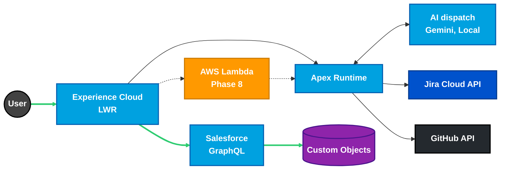
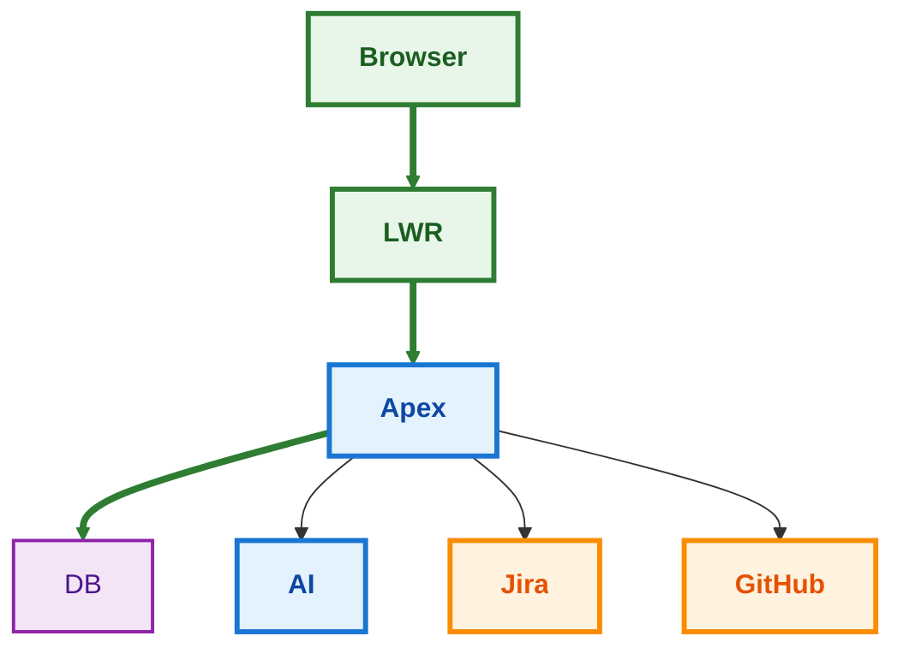
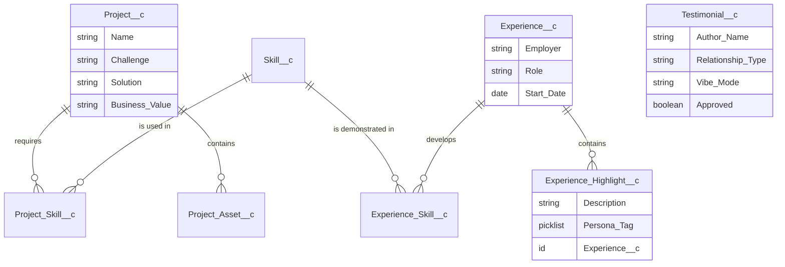
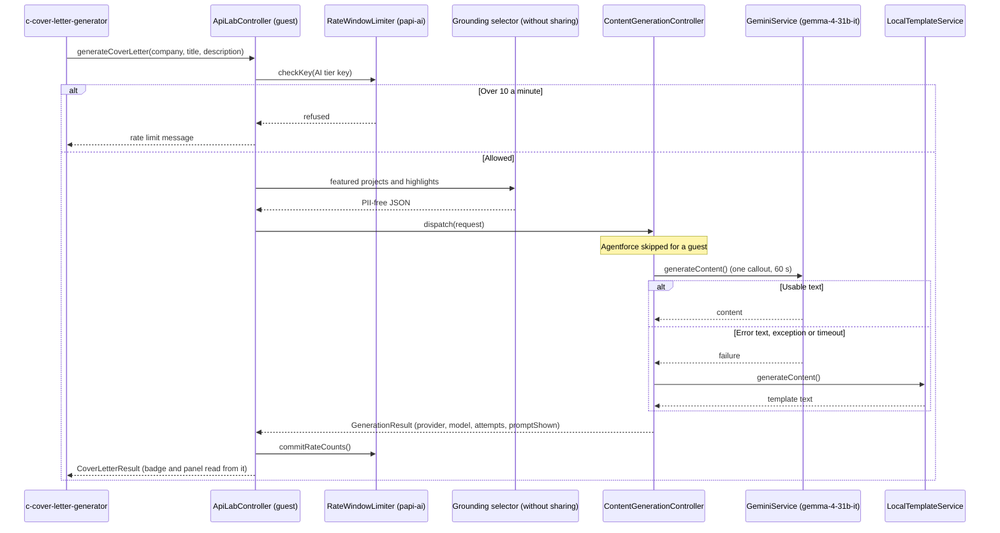
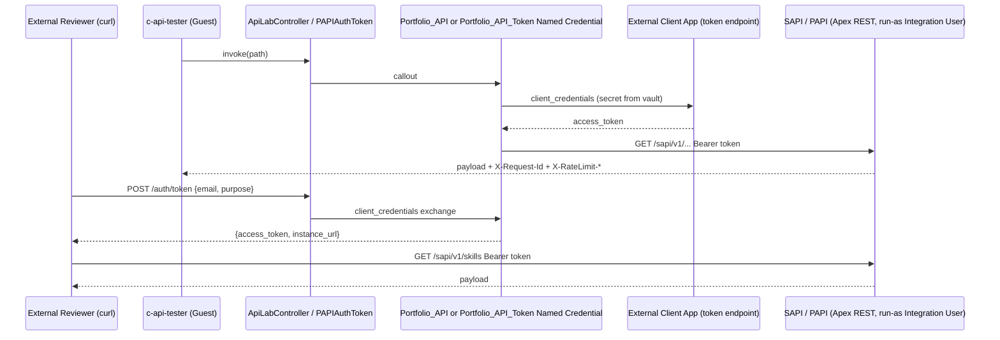

# Systems Architecture Specification (SAS)

**Table of Contents**

- [1. System Context & Architecture](#1-system-context--architecture)
  - [1.1 Architectural "North Star"](#11-architectural-north-star)
  - [1.2 Architecture at a Glance](#12-architecture-at-a-glance)
  - [1.3 Key Salesforce Features Used](#13-key-salesforce-features-used)
  - [1.4 Visual Architecture Standard (C4 Model)](#14-visual-architecture-standard-c4-model)
  - [1.5 Quality Gates (Technical Acceptance)](#15-quality-gates-technical-acceptance)
- [2. Non-Functional Requirements (NFRs)](#2-non-functional-requirements-nfrs)
  - [2.1 Core NFRs](#21-core-nfrs)
  - [2.2 Platform Constraints (Developer Edition)](#22-platform-constraints-developer-edition)
- [3. Risk & Security Architecture](#3-risk--security-architecture)
  - [3.1 Threat Model Summary](#31-threat-model-summary)
- [4. Data Architecture & Schema](#4-data-architecture--schema)
  - [4.1 Logical Data Model (Simplified ERD)](#41-logical-data-model-simplified-erd)
  - [4.2 Core Entities](#42-core-entities)
  - [4.3 Junction Objects (The Glue)](#43-junction-objects-the-glue)
  - [4.4 Asset Management](#44-asset-management)
  - [4.5 Social Proof Engine (Gamified Data)](#45-social-proof-engine-gamified-data)
  - [4.6 Data Security Matrix](#46-data-security-matrix)
- [5. Solution Components (The Pillars)](#5-solution-components-the-pillars)
  - [5.1 Pillar A: Business Architecture (Employer Hub)](#51-pillar-a-business-architecture-employer-hub)
  - [5.2 Pillar B: Pre-Sales Consultancy (Nonprofit Literacy Solutions)](#52-pillar-b-pre-sales-consultancy-nonprofit-literacy-solutions)
  - [5.3 Pillar C: Work Experience Verification API (Twin API Pattern)](#53-pillar-c-work-experience-verification-api-twin-api-pattern)
  - [5.4 Pillar D: AI & Innovation (Agentforce)](#54-pillar-d-ai--innovation-agentforce)
  - [5.5 Pillar E: Agile Delivery & DevOps (Roadmap)](#55-pillar-e-agile-delivery--devops-roadmap)
- [6. Front-End Architecture (Experience Cloud)](#6-front-end-architecture-experience-cloud)
  - [6.1 Technology Stack](#61-technology-stack)
  - [6.2 Lightning Web Components (LWC)](#62-lightning-web-components-lwc)
- [7. Architectural Decision Records (ADRs)](#7-architectural-decision-records-adrs)
- [8. Contingency & Rollback Plans](#8-contingency--rollback-plans)
  - [8.1 Deployment Failure](#81-deployment-failure)
  - [8.2 Agentforce Unavailable](#82-agentforce-unavailable)
  - [8.3 API Rate Limit Exhaustion](#83-api-rate-limit-exhaustion)
  - [8.4 Resilience Simulation Operations](#84-resilience-simulation-operations)
- [9. Observability & Glass Box Telemetry](#9-observability--glass-box-telemetry)
- [Appendices](#appendices)
  - [Appendix A: Engineering Implementation Notes](#appendix-a-engineering-implementation-notes)
  - [Appendix B: API Specification (OpenAPI/Swagger)](#appendix-b-api-specification-openapiswagger)
  - [Appendix C: MuleSoft Code, Governance, & Proxy Configuration (Reference)](#appendix-c-mulesoft-code-governance--proxy-configuration-reference)
  - [Appendix D: Data Dictionary (Detailed Schema)](#appendix-d-data-dictionary-detailed-schema)
  - [Appendix E: Environment Strategy](#appendix-e-environment-strategy)
  - [Appendix F: Testing Strategy](#appendix-f-testing-strategy)
  - [Appendix G: Accessibility Strategy (A11y)](#appendix-g-accessibility-strategy-a11y)
  - [Appendix H: Deployment Architecture View](#appendix-h-deployment-architecture-view)
  - [Appendix I: Org & Package Structure](#appendix-i-org--package-structure)
  - [Appendix J: Cloud FinOps Strategy (Phase 8 - 2027-2028)](#appendix-j-cloud-finops-strategy-phase-8---2027-2028)
  - [Appendix K: Validation Rules & Logic](#appendix-k-validation-rules--logic)
  - [Appendix L: Reference Artifacts](#appendix-l-reference-artifacts)
  - [Appendix M: Cross-Cutting Pattern - Dual-Door Integration Strategy](#appendix-m-cross-cutting-pattern---dual-door-integration-strategy)

---

Project: Salesforce Platform Architect Portfolio

Version: 1.0

Owner: Ryan Bumstead

Date: MVP – Q1 2027

## 1. System Context & Architecture

### 1.1 Architectural "North Star"

The high-level data flow demonstrating the multi-cloud, API-led strategy.



> [!TIP]
> **Scalability Escape Hatch:** While this system is constrained to the Free Tier (Developer Edition), the architecture is designed to scale. If traffic exceeded limits, the **Phase 8** design moves the heavy lifting (Resume Generation, API Gateway) to AWS Serverless equivalents, allowing the Salesforce Core to remain a lightweight orchestration layer. This ensures the system could handle enterprise-scale traffic with minimal refactoring.

**Architecture Implementation Status (MVP – Q1 2027 Launch)**

Live MVP (Door 1)

- Native Salesforce GraphQL via lightning/uiGraphQLApi wire adapter
- Apex REST services
- Direct integrations (GitHub, Jira via Named Credentials)

Phase 8 – 2027-2028 (Design Complete)

| Phase       | Status                                         | Rationale                                                               |
| :---------- | :--------------------------------------------- | :---------------------------------------------------------------------- |
| **Phase 8** | **Design Complete • Implementation 2027-2028** | Fully architected to prove "Scale Up" capability, but deferred for MVP. |

- AWS Lambda Polyglot Gateway (Function URL) — "Door 2"
- Enterprise API governance layer
- Resume Engine offload

### 1.2 Architecture at a Glance

10-second overview for executive stakeholders.



### 1.3 Key Salesforce Features Used

- **Experience Cloud (LWR):** High-performance, pixel-perfect frontend.
- **Apex REST Services:** Custom API layer for external integrations.
- **Custom Metadata Types:** Configuration management.
- **Generative AI:** one Apex dispatch (`ContentGenerationController.dispatch`) over Gemma 4 31B through the Gemini API and a local template. Agentforce is a switch in that dispatch that ships off and is not implemented (section 5.4).
- **Unlocked Packages:** Modular deployment strategy.

#### 1.3.1 Technology Selection Rationale

Why specific technologies were chosen over alternatives.

| Requirement             | Finalist Options      | Selected    | Rejection Reason                                                     |
| :---------------------- | :-------------------- | :---------- | :------------------------------------------------------------------- |
| **Frontend Framework**  | Aura vs. LWR          | **LWR**     | Aura's 3-5s LCP violates UX requirements for public sites.           |
| **Graph Visualization** | Vis.js vs. G6         | **AntV G6** | Vis.js lacks native animation API for flow lines ("running edge").   |
| **API Documentation**   | Swagger UI vs. Redoc  | **Redoc**   | Redoc's single-file static HTML works without Node.js server.        |
| **CI/CD Auth**          | Username/Pass vs. JWT | **JWT**     | Username/Password is fragile and requires rotation; JWT is headless. |

### 1.4 Visual Architecture Standard (C4 Model)

All architectural artifacts adhere to the C4 Model (Context, Containers, Components, Code) standard to ensure clarity across abstraction levels.

- **Level 1 (Context):** Defines system boundaries and interactions (Recruiters, GitHub, Jira, Calendly).
- **Level 2 (Container):** Illustrates high-level technical building blocks (LWR, Apex Runtime, Data Layer, AI Agent).
- **Level 3 (Component):** Details LWC composition and event-driven interactions.
- **Level 4 (Deployment):** Infrastructure view (See Appendix H).

### 1.5 Quality Gates (Technical Acceptance)

Refer to **[Guardrails & Executable Governance: Quality Gates & DevOps Discipline](./06-Guardrails-and-Executable-Governance.md#4-quality-gates--devops-discipline)** for the authoritative definition of LCP and Coverage thresholds.

- **Zero PMD Critical Violations** (Enforced via sfdx scanner:run in PR checks).
- **Reference:** See **[Guardrails & Executable Governance: Quality Gates](./06-Guardrails-and-Executable-Governance.md#4-quality-gates--devops-discipline)** for authoritative technical acceptance thresholds.

## 2. Non-Functional Requirements (NFRs)

### 2.1 Core NFRs

- **Availability:** Organization persistence maintained via external CI/CD "Keep-Alive" heartbeat (GitHub Actions).
- **Maintainability:** Codebase governed by automated quality gates (Prettier/PMD) ensuring architectural standards.
- **Performance:** Target LCP < 2.5s via Static Resource caching and minimal DOM footprint.
  - **Latency:** LCP < 2.5s on 4G networks.
  - **AI Generation Timeout:** 60 seconds for the Gemini callout, read from the `Gemini` record of `AI_Provider_Config__mdt` (`Timeout_Ms__c`, owner decision 2026-10-21). Gemma 4 reasons before it answers, so a cover letter can take up to about a minute. The earlier 2 second hard stop was dropped because a reasoning model almost never answers inside it.
  - **Total CPU Budget:** < 5000ms per request (Allocating 50% of the 10,000ms Synchronous Limit to ensure headroom for platform overhead).
- **Security:** Public access restricted strictly to custom objects. No PII stored.
- **Scalability:** Data model supports 10,000+ records via indexed Junction Objects.

### 2.2 Platform Constraints (Developer Edition)

The architecture is designed to operate within the specific limits of the Salesforce Developer Edition.

- **Storage Limits:** 5MB Data Storage / 20MB File Storage limit requires strict data hygiene and off-platform storage strategies (AWS S3) for artifacts.
- **API Limits:** 15,000 API requests/24hr requires caching strategies for high-traffic external integrations.
- **Guest User:** Strict security policies prevent direct standard object access, necessitating a custom schema.
- **No Shield:** Lack of Event Monitoring requires custom telemetry implementation for analytics.
- **Middleware Constraints:** Heroku and paid AWS resources are unavailable. Architecture utilizes AWS Free Tier for serverless proxy and storage patterns to demonstrate multi-cloud capabilities without budget impact.

## 3. Risk & Security Architecture

### 3.1 Threat Model Summary

- **Injection Attacks:** Mitigated by strict SOQL bind variable usage.
- **Data Exposure:** Mitigated by enforcing "Guest User" profiles with strict Field Level Security (FLS) and Sharing Rules. Guest users have Read-Only access to specific Custom Objects only.
- **API Abuse:** Mitigated by read-only endpoints and hardcoded query limits in the SAPI layer.
- **Service Unavailability (AI):** Mitigated by the Strategy Pattern ([ADR-015](../adr/015-strategy-pattern-for-generative-ai.md)): on the site page and on `POST /papi/v1/ai/generate`, a cover letter falls back from the Gemini API to a deterministic Local Template. Agentforce is not implemented and its switch ships off ([ADR-015 Round 4 amendment](../adr/015-strategy-pattern-for-generative-ai.md#amendment-2026-10-21-round-4)).

## 4. Data Architecture & Schema

This section defines the structured metadata model that underpins portfolio rendering, AI grounding, and cross-object relationships. For the detailed field-level definition, see Appendix D.

### 4.1 Logical Data Model (Simplified ERD)

> _What This Diagram Shows: The entity-relationship diagram representing the custom schema. It highlights the use of Junction Objects (`Project_Skill__c`) for many-to-many relationships and the persona-based tagging system in `Experience_Highlight__c`._



### 4.2 Core Entities

- **`Project__c`:** The central hub. Stores Challenge, Solution, and Business Value narratives.
- **`Skill__c`:** The competency library. Supports polymorphic rendering (SLDS standard icons vs. Custom Brand SVGs).
- **`Experience__c`:** Employment history records (Header Info Only).
- **`Experience_Highlight__c`:** Child object of `Experience__c`. Contains granular bullet points tagged by persona (Admin, Dev, Architect) to enable dynamic resume generation.

### 4.3 Junction Objects (The Glue)

- **`Project_Skill__c`:** Connects Skills to Projects (e.g., linking "Flow" to "MCC Employer Hub").
- **`Experience_Skill__c`:** Connects Skills to Job History.

### 4.4 Asset Management

- **`Project_Asset__c`:** Stores references to visual artifacts (Flowcharts, Dashboards) to decouple heavy media from the Project record itself.

### 4.5 Social Proof Engine (Gamified Data)

- **`Testimonial__c`:** Stores structured feedback.
  - `Author_Name__c` (Text): Stores the name of the submitter. Note: Standard `Contact` lookups are avoided to ensure Guest User compatibility.
  - `Relationship_Type__c` (Picklist): Manager, Peer, Client, Recruiter, Fan/Visitor.
  - `Context__c` (Text/Picklist): Dynamic sentence fragments (e.g., "Absolute Beast", "Saved our Bacon").
  - `Vibe_Mode__c` (Picklist): Professional vs. Casual (Controls display logic).
  - `Approved__c` (Checkbox): Default false. Security gate for public display.

### 4.6 Data Security Matrix

The following matrix defines the CRUD and Field Level Security (FLS) settings enforced by the Profile and Permission Set structure.

| Object                        | Admin (System) | Guest User (Public)              | Integration User (API) |
| :---------------------------- | :------------- | :------------------------------- | :--------------------- |
| **`Project__c`**              | CRED / Full    | Read-Only                        | Read-Only              |
| **`Experience__c`**           | CRED / Full    | Read-Only                        | Read-Only              |
| **`Experience_Highlight__c`** | CRED / Full    | Read-Only                        | Read-Only              |
| **`Skill__c`**                | CRED / Full    | Read-Only                        | Read-Only              |
| **`Testimonial__c`**          | CRED / Full    | **No Access** (Handled via Apex) | Read-Only              |
| **`GitHub_Cache__c`**         | CRED / Full    | **No Access** (System Only)      | No Access              |
| **`Portfolio_Config__mdt`**   | CRED / Full    | Read-Only (via App)              | Read-Only              |
| **`API_Access_Request__c`**   | CRED / Full    | **No Access** (Created via Apex) | No Access              |

> [!NOTE]
> Guest User access to `Testimonial__c` records is strictly controlled via the `SAPITestimonial` Apex class which applies the "Vibe Mode" and "Approved" filters before returning data to the LWR site.
>
> The Guest User holds **no execute access** on any `SAPI*` or `PAPI*` REST class except `PAPIAuthToken` ([ADR-028](../adr/028-evaluator-access-via-token-vending.md)). Site components reach data through `@AuraEnabled` controllers or the API Lab proxy. The Integration User is the only identity that executes the REST classes, via OAuth 2.0 Client Credentials ([ADR-027](../adr/027-platform-native-api-authentication.md)).

## 5. Solution Components (The Pillars)

The system is segmented into five distinct logical capabilities, each demonstrating a specific architectural discipline. **Pillar Relationships:** Pillar A (Business) → Pillar B (Consulting) → Pillar C (Integration) → Pillar D (AI) → Pillar E (DevOps)

### 5.1 Pillar A: Business Architecture (Employer Hub)

- **Objective:** Demonstrate Business Analysis and Process Mapping.
- **Artifacts:** Sanitized Process Flow Diagrams and Executive Dashboard mockups.
- **Integration:** Assets mapped via `Project_Asset__c` for gallery rendering.
- **Component:** `c-schema-visualizer`
- **Data Source:** Apex Schema.getGlobalDescribe() ensures the diagram never drifts from the actual deployment.
- **Reuse Signal:** Reuses the **AntV G6** library imported for Pillar D, demonstrating efficient asset management and component reusability.

### 5.2 Pillar B: Pre-Sales Consultancy (Nonprofit Literacy Solutions)

- **Objective:** Demonstrate ROI analysis and Solution Design.
- **Artifacts:** Comparative Decision Matrix (NPSP + PMM vs. Education Cloud) and Video Prototype.

### 5.3 Pillar C: Work Experience Verification API (Twin API Pattern)

- **Objective:** Demonstrate Enterprise Integration Patterns and Developer Experience (DX).
- **Design:** OpenAPI Specification (OAS 3.0) hosted on GitHub.
- **Implementation:** Native Apex REST Class (`SAPIExperience`).
- **Technical Detail:** For the complete breakdown of the caching strategy, caching patterns, and API tooling, refer to the **[Technical Guide: Integration Service Implementation](./04-Technical-Guide.md#1-integration-service-implementation)**.

### 5.4 Pillar D: AI & Innovation (Agentforce)

> [!NOTE]
> **Agentforce is not implemented, and its switch ships off** (decision 2026-10-02, [ADR-015 Round 3 amendment](../adr/015-strategy-pattern-for-generative-ai.md#amendment-2026-10-21-round-3)). `ContentGenerationController.dispatch` consults Agentforce only when the `Agentforce` record of `AI_Provider_Config__mdt` is switched on, and never for a site guest. Retrieval for the cover letter is built in Apex (`PortfolioGroundingService`, section 5.4.1). The Data 360 design in the next list is the target design. None of it is built.

- **Objective:** Demonstrate Hybrid Search (Vector + Keyword) and RAG architecture.
- **Mechanism:** Agentforce Service Agent grounded on Data 360 DMOs (Data Model Objects) rather than direct CRM objects.
- **Architecture:**
  - **Ingestion:** `Project__c` and `Experience__c` records are ingested into Data 360 via CRM Connector.
  - **Context Layer:** A specific "Portfolio Context" Search Index is built from these DMOs.
  - **Retrieval:** Agentforce queries the Search Index to generate responses, decoupling the AI reasoning layer from the transactional database (See ADR-011).
- **Show your work** (formerly "Mirror Mode"): a panel under the letter, off until the visitor opens it, shows the serving provider and model, the latency, every attempt and the prompt that was sent. Apex and the component fill it from the generation result (`ContentGenerationController.GenerationResult`). The model is never asked to reveal its own prompt, because that is unreliable and invites prompt injection.

#### 5.4.1 Feature Spotlight: Generative Cover Letter Engine

> [!IMPORTANT]
> **As built, the cover letter page is written by Gemma 4 31B through the Gemini API, or by the local template when Gemini fails.** Agentforce is not implemented and its switch ships off, so no letter is attributed to it ([ADR-015 Round 3 amendment](../adr/015-strategy-pattern-for-generative-ai.md#amendment-2026-10-21-round-3)).

- **The Concept:** Instead of a static "About Me," recruiters enter a company name, a job title and, optionally, the job description. The system writes a cover letter explaining why this candidate fits that role.
- **The Architecture as built:**
  - **Input Layer:** the LWC form `c-cover-letter-generator` calls `ApiLabController.generateCoverLetter`, which checks the AI tier limit on the key `papi-ai:site-cover-letter` (10 requests per minute, one bucket shared by every site visitor), runs `ContentGenerationController.dispatch` in process as the site guest, and writes the count afterwards. The guest holds the `Gemini_Auth-Gemini_Principal` principal for this and no other AI grant. The page used to call `/papi/v1/ai/generate` through the `Portfolio_API` Named Credential, but a request that arrives as a callout from the same org may not call out again, so Gemini could never answer it ([ADR-015 Round 4 amendment](../adr/015-strategy-pattern-for-generative-ai.md#amendment-2026-10-21-round-4)). `/papi/v1/ai/generate` stays for outside callers.
  - **Retrieval Layer:** `PortfolioGroundingService` reads featured `Project__c` records (name, challenge, solution, business value, skills) and `Experience_Highlight__c` text with its role and employer, ranks them by keywords from the job title and description, and adds them to the prompt as JSON. It never selects Email, Phone or an owner field, strips anything shaped like an email address or phone number, and stays under 8,000 characters. Its reads go through a `without sharing` selector with a fixed field list, because the site guest sees only rows shared to it. This is direct CRM retrieval in Apex, not the Data 360 search index of section 5.4.
  - **Generation Layer:** `ContentGenerationController.dispatch`, described below.
  - **Show your work:** the page's badge shows the provider and model from the response. A panel the visitor opens shows whether a fallback happened, the round trip and generation time, every attempt and the prompt that was sent.

**Generation strategy as built.** Providers implement `IAIGenerationService` (`generateContent`, `isAvailable`). One dispatch method, `ContentGenerationController.dispatch`, serves both `PAPIAiGenerate.generate` and the page (in process, as the guest):

| Order       | Provider                                                                | Consulted when                                                                                                                             | Result today                                                                                                                       |
| :---------- | :---------------------------------------------------------------------- | :----------------------------------------------------------------------------------------------------------------------------------------- | :--------------------------------------------------------------------------------------------------------------------------------- |
| First       | Agentforce (`AgentforceService`)                                        | The `Agentforce` record of `AI_Provider_Config__mdt` has `Enabled__c` set, the running user is not a site guest, and its breaker is closed | Never serves. The record ships switched off, and the class throws when switched on, which the dispatch records as a failed attempt |
| Second      | Gemma 4 31B (`gemma-4-31b-it`) through the Gemini API (`GeminiService`) | Unless the `gemini` circuit breaker is open                                                                                                | The letter, within a 60 second callout timeout. Gemma 4 always reasons first, so a letter can take up to about a minute            |
| Last resort | Local Template (`LocalTemplateService`)                                 | Cover letters only                                                                                                                         | A fixed letter naming the company and role. Other types answer 503 `ALL_PROVIDERS_UNAVAILABLE`                                     |

Every attempt is recorded with its outcome (`served`, `skipped_off`, `skipped_open_circuit`, `failed`), its time and, on a failure, a short `detail` (an HTTP status or the exception type, never a key), and the API returns them as `attempts` beside `provider`, `model`, `fallbackOccurred`, `latencyMs` and `promptShown`. Three Gemini failures in a row open the `gemini` circuit breaker (`CircuitBreaker`) for 30 minutes, and letters go straight to the Local Template until the next try succeeds. Breaker state is written after every provider has been tried, never before a callout. `GeminiService.generateContent` reports a failure as text starting `Error: Unable to generate content.` or `Exception: `, which the dispatch treats as a failed attempt.

<details>
<summary>Click to view Sequence Diagram</summary>

> _What This Diagram Shows: a cover letter from the site page as built in Round 4. Agentforce is never consulted for a guest._



</details>

- **Privacy:** Inputs are processed transiently and never stored in Salesforce. The prompt shown to the visitor holds only what they typed and public portfolio facts.

#### 5.4.2 Optional Edge Layer Integration (Future Scope)

Cloudflare Workers provides a fourth path for content generation. The Worker acts as an AI proxy and edge cache that reduces total cost, decreases latency, and shields Salesforce from external API rate limits. Integration uses the same IAIGenerationService interface with a new CloudflareService provider class.

### 5.5 Pillar E: Agile Delivery & DevOps (Roadmap)

- **Objective:** Demonstrate ALM, CI/CD Maturity, and External System Integration.
- **Tooling:** Atlassian Jira + GitHub Actions (CI/CD).
- **Technical Detail:** For the refresh jobs, the caches and the governance event, refer to the **[Technical Guide: Jira Integration](./04-Technical-Guide.md#12-jira-integration-roadmap)** and **[Executable Governance](./04-Technical-Guide.md#25-c-smart-checklist-executable-governance)**.
- **Mechanism:** the CI/CD pipeline publishes the `Governance_Event__e` platform event, an Apex trigger persists it as a `Pipeline_Run__c` record, and the `c-smart-checklist` component reads the result through cacheable Apex ([ADR-019 Round 4 amendment](../adr/019-executable-governance-platform-events-for-documentation-logic.md#amendment-2026-10-21-round-4)).
- **Workflow:** after a production deploy (`deploy.yml`) and after the daily heartbeat (`keep-alive.yml`), the workflow's existing JWT user publishes one event with the run's status, id, URL, commit and time. The trigger upserts `Pipeline_Run__c` by `Run_Key__c`, so a replayed event changes nothing. The component reads `GovernanceController.getPipelineStatus()` when the page is viewed and again when the tab becomes visible. There is no timer and no polling. Each item shows its evidence (the commit linking to the run, and the time), and an item with no data shows "No signal yet".
- **What it claims:** the production deploy is green, the heartbeat ran in the last 26 hours, and the integration caches are under 30 minutes old.
- **Why no browser subscription:** `lightning-emp-api` is unsupported in LWR sites, and each subscribed browser would count against the org's 20 concurrent streaming clients. The event-driven part is server-side: publish, an asynchronous subscriber and idempotent handling of a replayed event.
- **Roadmap and changelog:** `c-roadmap-viewer` and `c-changelog` read cached Jira and GitHub data through `DeliveryController` (cacheable Apex). Scheduled Queueable jobs refresh the caches every 15 minutes, so a visitor never triggers a callout ([ADR-007 Round 4 amendment](../adr/007-github-api-server-side-caching.md#amendment-2026-10-21-round-4)). The roadmap shows only `SPAP` issues labelled `portfolio-roadmap`. The site's CDN caching of guest Apex stays off (owner decision E9), so every visit reads the org.
- **Architectural Signal:** event-driven architecture with a server-side subscriber, and external system integration through Named Credentials.

#### 5.5.1 The Governance Model

For the detailed "Three-Gate Approval Process" (Technical Feasibility, Security, DoR) governing these pillars, refer to **[Guardrails & Executable Governance: The Three-Gate Approval Process](./06-Guardrails-and-Executable-Governance.md#6-the-three-gate-approval-process)**.

- Acceptance criteria defined (Gherkin syntax preferred).
- Test data generation script written.
- Rollback plan documented (Section 9.X).

## 6. Front-End Architecture (Experience Cloud)

The front-end uses a lightweight, high-performance delivery model through Lightning Web Runtime (LWR), avoiding Aura events and heavy DOM frameworks.

### 6.1 Technology Stack

- **Framework:** LWR.
- **Domain Strategy:** Custom CNAME (RyanBumstead.com), 301 redirect to https://rbumstead-dev-ed.develop.my.site.com/portfolio/ since free development edition orgs do not have the ability to set up custom domains.
- **Navigation Strategy:** "5-Minute Tour" section embedded in Hero Banner.

### 6.2 Lightning Web Components (LWC)

- **`c-hero-banner`:** Includes "How to Evaluate Me" navigation guide.
- **`c-testimonial-submit`:** "Mad Libs" style sentence builder.
- **`c-api-tester`:** Developer console LWC utilizing fetch() to exercise endpoints.
- **`c-changelog`:** Displays recent commits from the GitHub cache (`DeliveryController.getRecentCommits`), with the cache's age.
- **`c-skill-network`:** Visualizes Junction Objects via AntV G6.
- **`c-code-viewer`:** Fetches raw source code via Prism.js.
- **`c-resume-builder`:** Client-side PDF generation via jsPDF.
- **`c-roadmap-viewer`:** Displays the roadmap from the Jira cache (`DeliveryController.getRoadmap`), in To Do, In Progress and Done columns by Jira status category. It makes no callout.
- **`c-footer`:** Contains the GitHub Actions deploy badge and the Glass Box telemetry (section 9).
- **`c-smart-checklist`:** Executable governance on the Delivery page (section 5.5).

> [!TIP]
> **Technical Implementation:** For detailed performance strategies (lazy-loading), mobile fallbacks, and accessibility patterns for these components, please refer to the **[Technical Guide: Frontend Component Logic](./04-Technical-Guide.md#2-frontend-lwr-component-logic)**.

## 7. Architectural Decision Records (ADRs)

Full architectural decisions are documented in the `docs/adr/` directory.

<details>
<summary>Click to view full list of Architectural Decision Records (ADRs)</summary>

| ID                                                                                     | Title                                                           | Status                   |
| :------------------------------------------------------------------------------------- | :-------------------------------------------------------------- | :----------------------- |
| [ADR-001](../adr/001-experience-cloud-lwr-vs-aura.md)                                  | Experience Cloud (LWR) vs. Aura                                 | Accepted                 |
| [ADR-002](../adr/002-custom-objects-vs-standard-objects.md)                            | Custom Objects vs. Standard Objects                             | Accepted                 |
| [ADR-003](../adr/003-apex-rest-vs-external-service.md)                                 | Apex REST vs. External Service                                  | Accepted                 |
| [ADR-004](../adr/004-static-resource-code-rendering.md)                                | Static Resource Code Rendering                                  | Accepted                 |
| [ADR-005](../adr/005-gamified-testimonial-ui.md)                                       | Gamified Testimonial UI                                         | Accepted                 |
| [ADR-006](../adr/006-jwt-bearer-flow-for-ci-cd.md)                                     | JWT Bearer Flow for CI/CD                                       | Accepted                 |
| [ADR-007](../adr/007-github-api-server-side-caching.md)                                | GitHub API Server-Side Caching                                  | Accepted                 |
| [ADR-008](../adr/008-jira-integration-vs-agile-accelerator.md)                         | Jira Integration vs. Agile Accelerator                          | Accepted                 |
| [ADR-009](../adr/009-granular-resume-data-model.md)                                    | Granular Resume Data Model                                      | Accepted                 |
| [ADR-010](../adr/010-visualization-engine-vis-js-vs-antv-g6.md)                        | Visualization Engine (Vis.js vs. AntV G6)                       | Accepted                 |
| [ADR-011](../adr/011-context-grounding-strategy-direct-crm-vs-data-360.md)             | Context Grounding Strategy (Direct CRM vs. Data 360)            | Accepted                 |
| [ADR-012](../adr/012-guest-user-security-restriction-rules.md)                         | Guest User Security (Restriction Rules)                         | Accepted                 |
| [ADR-013](../adr/013-structured-logging-framework-nebula-logger.md)                    | Structured Logging Framework (Nebula Logger)                    | Accepted                 |
| [ADR-014](../adr/014-deferred-telemetry-loading-performance.md)                        | Deferred Telemetry Loading (Performance)                        | Accepted                 |
| [ADR-015](../adr/015-strategy-pattern-for-generative-ai.md)                            | Strategy Pattern for Generative AI                              | Accepted                 |
| [ADR-016](../adr/016-cloudflare-worker-as-edge-ai-proxy.md)                            | Cloudflare Worker as Edge AI Proxy                              | Deferred to V2.0         |
| [ADR-017](../adr/017-system-api-security-and-dual-sided-auth-pattern.md)               | System API Security & Dual-Sided Auth Pattern                   | Superseded (ADR-027)     |
| [ADR-018](../adr/018-finops-constraint-aws-lambda-function-urls-vs-api-gateway.md)     | FinOps Constraint – AWS Lambda Function URLs vs. API Gateway    | Accepted                 |
| [ADR-019](../adr/019-executable-governance-platform-events-for-documentation-logic.md) | Executable Governance – Platform Events for Documentation Logic | Accepted                 |
| [ADR-020](../adr/020-mobile-performance-static-svg-fallback-strategy.md)               | Mobile Performance – Static SVG Fallback Strategy               | Accepted                 |
| [ADR-021](../adr/021-native-graphql-door-1-vs-apex-rest-for-ui.md)                     | Native GraphQL (Door 1) vs. Apex REST for UI                    | Accepted                 |
| [ADR-022](../adr/022-resilience-engineering-resilience-simulation-toggle.md)           | Resilience Engineering – Resilience Simulation Toggle           | Accepted                 |
| [ADR-023](../adr/023-client-side-pdf-generation-jspdf-for-mvp.md)                      | Client-Side PDF Generation (jsPDF) for MVP                      | Accepted (Transitionary) |
| [ADR-024](../adr/024-twin-api-pattern-contract-first-parity.md)                        | Twin API Pattern – Contract-First Parity                        | Accepted                 |
| [ADR-025](../adr/025-papi-fan-out-throttling-capacity-planning.md)                     | PAPI Fan-Out Throttling (Capacity Planning)                     | Accepted (Amended)       |
| [ADR-026](../adr/026-header-based-api-versioning-strategy.md)                          | Header-Based API Versioning Strategy                            | Accepted (Amended)       |
| [ADR-027](../adr/027-platform-native-api-authentication.md)                            | Platform-Native API Authentication (ECA + Named Credential)     | Accepted                 |
| [ADR-028](../adr/028-evaluator-access-via-token-vending.md)                            | Evaluator Access via Token Vending                              | Accepted                 |

</details>

## 8. Contingency & Rollback Plans

### 8.1 Deployment Failure

- **Symptom:** GitHub Actions deploy.yml job fails or turns red.
- **Detection:** Automated email notification from GitHub Actions, and the run's step summary ("Deployment Status" in `deploy.yml`) reports the failure.
- **Mitigation:**
  1. Check GitHub Action logs for specific metadata error.
  2. If environment issue: Manually deploy via CLI: sf project deploy start.
- **Detection:** Automated email notification from GitHub Actions.
- **Rollback:** See **[Maintenance & Operations Guide: Disaster Recovery](./05-Maintenance-Guide.md#4-disaster-recovery)** for the definitive rollback procedure.

### 8.2 Agentforce Unavailable

> [!NOTE]
> Agentforce is not implemented, and its switch ships off (decision 2026-10-02, [ADR-015 Round 3 amendment](../adr/015-strategy-pattern-for-generative-ai.md#amendment-2026-10-21-round-3)). If the switch is turned on, `AgentforceService.generateContent` throws, `ContentGenerationController.dispatch` records a failed attempt and Gemini serves, so the visitor still gets a letter. The scenario below is the target design for a real Agentforce agent, kept for when one is built.

- **Symptom:** Agentforce Service Agent fails to load or returns generic errors (common in some **Developer Edition** regions).
- **Detection:** `<agentforce-service-agent>` LWC fails to render during manual testing.
- **Mitigation:**
  1. Enable "Fallback Mode" in Custom Metadata.
  2. Display static "AI Interaction Preview" video instead of live agent.
  3. Document as "Platform Limit" in the footer.

### 8.3 API Rate Limit Exhaustion

- **Symptom:** GitHub Commits or Portfolio API returns status 429.
- **Mitigation (GitHub):** guests never call GitHub. The changelog serves the newest `Github_Cache__c` row (a custom object) with its age, and a failed refresh inserts nothing, so the last good list stays until the next refresh succeeds.
- **Mitigation (Portfolio API):** the 429 comes from `RateWindowLimiter` (SAPI 120, PAPI 15, `/ai/*` 10 requests per minute per caller key). The caller waits for `Retry-After`, which is the seconds left in the current minute ([ADR-025](../adr/025-papi-fan-out-throttling-capacity-planning.md#amendment-2026-10-21)). Every vended evaluator token is the same session, so all evaluators share one key per tier, and one busy evaluator can use up the minute for everyone ([ADR-028 Round 4 amendment](../adr/028-evaluator-access-via-token-vending.md#amendment-2026-10-21-round-4)).

### 8.4 Resilience Simulation Operations

Ensuring the system fails gracefully during outage events ([ADR-022 Round 4 amendment](../adr/022-resilience-engineering-resilience-simulation-toggle.md#amendment-2026-10-21-round-4)).

| Failure Scenario                 | Detection Method                                                                                 | User Experience                                                                                                                                   | Auto-Recovery                                                                                                     |
| :------------------------------- | :----------------------------------------------------------------------------------------------- | :------------------------------------------------------------------------------------------------------------------------------------------------ | :---------------------------------------------------------------------------------------------------------------- |
| **GitHub or Jira refresh fails** | The refresh job's callout fails. Three in a row open that source's breaker                       | The last good commits or roadmap with its age. `DEGRADED` while the breaker is open                                                               | After 30 minutes the next refresh is tried. A success closes the breaker, a failure keeps it open 30 more minutes |
| **No usable cache row**          | `DeliveryController` finds no row, or a payload that does not parse                              | "No recent updates found." or "Roadmap temporarily unavailable"                                                                                   | The next successful refresh                                                                                       |
| **Gemini fails**                 | An error, an exception or a timeout in `GeminiService`. Three in a row open the `gemini` breaker | The cover letter comes from the Local Template, and the attempts list shows why                                                                   | After 30 minutes the next letter tries Gemini again. A success closes the breaker                                 |
| **G6 Library 404**               | `loadScript()` Promise rejection in `c/g6Loader`                                                 | The inline SVG built from the same live data, with "The interactive graph could not load, so a static view is shown." Small screens never load G6 | The next page load tries again                                                                                    |
| **User-Triggered Simulation**    | The "Simulate an outage" switch on the changelog or the roadmap passes `simulate`                | The cached data with a "Simulated" badge (status `SIMULATED`). No callout, nothing stored                                                         | Switch it off                                                                                                     |

## 9. Observability & Glass Box Telemetry

The footer (`c-footer`) shows a short telemetry line to demonstrate "Glass Box Telemetry". It loads after the first paint ([ADR-014](../adr/014-deferred-telemetry-loading-performance.md)) from `FooterController.getSystemSnapshot()`, which is not cacheable, so the values are current.

- **Limits:** CPU time, heap size and SOQL queries used against their governor limits, read from `Limits` in that transaction.
- **AI provider health:** each provider's switch and state from `ContentGenerationController.providerStatus()`, including when an open circuit closes again.
- **AI requests today:** the sum of today's AI tier counts in `API_Rate_Window__c` (the site cover letter and `/papi/v1/ai/generate` both count). It counts requests, not Gemini calls, so it is never labelled as a Gemini quota (owner decision PD-D9, 2026-10-21). Hovering over or focusing it sends the GA4 event `finops_quota_visibility`.
- **Deploy status:** the GitHub Actions badge for `deploy.yml` on `main`, with a text link when the image cannot load.
- **Logs:** Apex writes one line per API request through a logging seam that uses Nebula Logger when it is installed and debug logs when it is not (section A.3).

## Appendices

### Appendix A: Engineering Implementation Notes

- **A.1 CI/CD Pipeline Configuration:** Authentication via Connected App with "Use Digital Signatures." Stores keys in GitHub Secrets. Use pr.yml for quality gates and deploy.yml for production push.
- **A.2 CORS & Security:** Whitelist custom domain, enable LWS. The site runs on **Relaxed CSP** (owner decision, 2026-10-21), because the GA4 tag needs a third-party script host and inline script. Relaxed CSP lets inline scripts and `eval()` run on the site, so only reviewed head markup may add scripts. Third-party hosts are trusted in source: `GitHub_Badge` for the deploy badge and the GA4 image and connect hosts as CSP trusted sites, and `https://www.googletagmanager.com` for scripts in the site bundle's `sfdc_cms__trustedSites/trustedSites/content.json` (Experience Builder "Trusted Sites for Scripts"), which deploys with the site. Log retention policy: Zero-Persistence.
- **A.3 Code Reusability:** Shared Prism.js utility module. Logging goes through one seam, `PortfolioLog`, which writes to Nebula Logger when the owner has installed it and to debug logs otherwise ([ADR-013 Round 4 amendment](../adr/013-structured-logging-framework-nebula-logger.md#amendment-2026-10-21-round-4)).
- **A.4 GitHub API Integration:** Uses Named Credential `GitHub_API`. Caches to the `Github_Cache__c` custom object. Refreshed every 15 minutes by `GitHubCacheRefreshJob` (Queueable, enqueued by `IntegrationCacheRefreshScheduler`).
- **A.5 Hero Banner Navigation:** (Refer to UI specs).
- **A.6 Agentforce Configuration:** not built. Agentforce is a switch in the dispatch that ships off (section 5.4). The "Show your work" panel (section 5.4) replaces the Mirror Mode system instruction, so no instruction asks a model to reveal its prompt.
- **A.7 Architecture Diagram Hosting:** Export C4 diagram and upload as Static Resource.
- **A.8 Jira Integration:** Endpoint: ryanbumstead.atlassian.net. Auth: Basic Auth with Named Credential.
- **A.9 Advanced Visualization Strategy:**
  - **Mobile Guardrail:** Check FORM_FACTOR. Render static SVG if mobile.
  - **Lazy Loading:** Dynamic import of G6 inside renderedCallback.
  - **Library Version:** AntV G6 v4.8.x.

### Appendix B: API Specification (OpenAPI/Swagger)

The portfolio implements a layered API architecture following the Anypoint API-led connectivity pattern:

#### B.1 System API (SAPI) - salesforce-sapi.yaml

**Purpose:** Provides direct access to Salesforce core objects with minimal transformation.

**Base URL:** `https://ryan-bumstead-dev-ed.develop.my.salesforce.com/services/apexrest/sapi/v1` (My Domain; Bearer-token callers use the `instance_url` returned with their token)

**Version:** 1.3.0

**Security:** OAuth 2.0 Client Credentials issued by an External Client App; every call carries `Authorization: Bearer <token>`. The platform rejects unauthenticated calls before Apex executes. See [ADR-027](../adr/027-platform-native-api-authentication.md) and [B.5](#b5-authentication--evaluator-access).

**Key Design Principles:**

- **Zero Trust Architecture:** All endpoints require a Bearer token minted by the External Client App; authorisation is bounded by the integration user's single read-only permission set. The guest user holds no execute access on any SAPI class
- **Distributed Tracing:** Mandatory `X-Request-Id` header (UUID format) in all requests for correlation across log aggregation systems
- **Contract-First Design:** OpenAPI 3.0 specification defines the interface before implementation
- **Explicit Caching:** `Cache-Control` headers distinguish between cacheable configuration (`max-age=300`) and dynamic data (`no-store`)
- **Rate Limiting:** `RateWindowLimiter` allows 120 requests per minute per caller key, with no burst allowance. Every evaluator token is the same session, so all evaluators share that one limit ([ADR-028 Round 4 amendment](../adr/028-evaluator-access-via-token-vending.md#amendment-2026-10-21-round-4))
- **Versioning:** `X-API-Version` header required for contract negotiation and backward compatibility

**Core Endpoints:**

| Endpoint                 | Method | Purpose                                        | Cache Strategy          |
| :----------------------- | :----- | :--------------------------------------------- | :---------------------- |
| `/contacts`              | GET    | Retrieve Contact records                       | No-Cache (PII)          |
| `/experience`            | GET    | Retrieve `Experience__c` records               | No-Cache (Dynamic)      |
| `/experience-highlights` | GET    | Retrieve resume bullets with persona filtering | No-Cache (Dynamic)      |
| `/projects`              | GET    | Retrieve `Project__c` records                  | Cacheable (5 min)       |
| `/projects/{id}`         | GET    | Retrieve single Project by ID                  | Cacheable (5 min)       |
| `/projects`              | POST   | Create Project (Future - Currently 405)        | N/A                     |
| `/project-assets`        | GET    | Retrieve media assets linked to projects       | Cacheable (5 min)       |
| `/testimonials`          | GET    | Retrieve approved testimonials                 | No-Cache (Social Proof) |
| `/skills`                | GET    | Retrieve `Skill__c` records                    | Cacheable (5 min)       |
| `/certifications`        | GET    | Retrieve certification records                 | Cacheable (5 min)       |
| `/education`             | GET    | Retrieve education records                     | Cacheable (5 min)       |
| `/portfolio-config`      | GET    | Retrieve global configuration singleton        | Cacheable (5 min)       |
| `/project-skills`        | GET    | Retrieve Project-Skill junction records        | Cacheable (5 min)       |
| `/experience-skills`     | GET    | Retrieve Experience-Skill junction records     | Cacheable (5 min)       |
| `/certification-skills`  | GET    | Retrieve Certification-Skill junction records  | Cacheable (5 min)       |

**Query Parameters:**

All list endpoints support:

- `limit` (default: 50, max: 200) - Pagination limit
- `offset` (default: 0) - Pagination offset
- Domain-specific filters (e.g., `persona`, `status`, `employerName`)

**Error Handling:**

| Status Code | Meaning                                       | Retryable | Response Header               |
| :---------- | :-------------------------------------------- | :-------- | :---------------------------- |
| 400         | Bad Request (Invalid parameters)              | No        | `X-Request-Id`                |
| 401         | Unauthorized (Missing/invalid token)          | No        | `X-Request-Id`                |
| 403         | Forbidden (Integration user lacks permission) | No        | `X-Request-Id`                |
| 404         | Not Found (Invalid record ID)                 | No        | `X-Request-Id`                |
| 429         | Too Many Requests (Rate limit exceeded)       | Yes       | `X-Request-Id`, `Retry-After` |
| 500         | Internal Server Error (Apex/Platform fault)   | Yes       | `X-Request-Id`                |

**Schema Highlights:**

All response schemas inherit from `SalesforceRecord` base type which includes:

- `attributes` - Salesforce system metadata (type, url)
- `LastModifiedDate` - Audit timestamp (ISO 8601)
- `SystemModstamp` - System modification timestamp
- `_links` - HATEOAS navigation links for discoverability

**Governance Features:**

- **Idempotency Support:** `X-Idempotency-Key` header prevents duplicate processing (prepared for future write operations)
- **Observability:** All error responses include `correlationId` for incident tracking
- **Future-Proof Versioning:** API version negotiation via header prevents breaking changes for existing consumers

#### B.2 Process API (PAPI) - portfolio-papi.yaml

**Purpose:** Orchestration layer that aggregates and transforms SAPI data for optimized frontend consumption.

**Base URL:** `https://ryan-bumstead-dev-ed.develop.my.salesforce.com/services/apexrest/papi/v1` (My Domain). `POST /auth/token` alone is served on the site domain: `https://ryan-bumstead-dev-ed.develop.my.site.com/portfoliovforcesite/services/apexrest/papi/v1/auth/token`.

**Version:** 1.3.0

**Layer Classification:** Process API (API-led connectivity pattern, implemented on-platform in Apex REST; see [ADR-024](../adr/024-twin-api-pattern-contract-first-parity.md))

**Security:** Same OAuth 2.0 Client Credentials scheme as SAPI ([ADR-027](../adr/027-platform-native-api-authentication.md)). `/auth/token` is the only unauthenticated path; the guest user may execute `PAPIAuthToken` and no other REST class ([ADR-028](../adr/028-evaluator-access-via-token-vending.md)).

**Key Design Principles:**

- **Smart Aggregation:** Single `/profile/full` endpoint eliminates 15+ client round-trips by pre-fetching related objects
- **Business Logic Encapsulation:** Applies "Vibe Mode" filtering, persona-based resume generation, and social proof curation
- **Frontend Optimization:** Returns nested, denormalized JSON structures ready for immediate rendering
- **Transformation Layer:** Converts Salesforce field names to frontend-friendly camelCase conventions

**Core Endpoints:**

| Endpoint              | Purpose                                                                               | Upstream SAPI Calls                                                                                                                                                                                                                                          | Benefit                                                                        |
| :-------------------- | :------------------------------------------------------------------------------------ | :----------------------------------------------------------------------------------------------------------------------------------------------------------------------------------------------------------------------------------------------------------- | :----------------------------------------------------------------------------- |
| `/profile/full`       | Complete portfolio hydration                                                          | 10+ endpoints (Config, Skills, Tests, etc.)                                                                                                                                                                                                                  | **Single Request** loads entire app state                                      |
| `/profile/summary`    | Employment profile only                                                               | 5 (Contact, Experience, Skills, Certifications, Education)                                                                                                                                                                                                   | Lightweight profile for resume generation                                      |
| `/resume/generate`    | ATS-optimized plain text resume                                                       | 3 (Experience, Experience Highlights filtered by persona, Skills)                                                                                                                                                                                            | Server-side text formatting eliminates client complexity                       |
| `/projects/featured`  | Enriched project showcase                                                             | 3 (Projects, Project Assets, Project Skills)                                                                                                                                                                                                                 | Pre-joined data structure eliminates N+1 query problem                         |
| `/testimonials/feed`  | Curated social proof                                                                  | 1 (Testimonials with Vibe Mode filter)                                                                                                                                                                                                                       | Server-side filtering ensures brand consistency                                |
| `/ai/generate` (POST) | Generative content (cover letter, bio, skill blurb)                                   | `ContentGenerationController.dispatch`: Agentforce only when switched on (it ships off), then Gemma 4 31B (`gemma-4-31b-it`) through the Gemini API, then the Local Template for cover letters ([ADR-015](../adr/015-strategy-pattern-for-generative-ai.md)) | Real model output with a deterministic fallback, `ai` rate tier (10 req/min)   |
| `/auth/token` (POST)  | Evaluator token vending ([ADR-028](../adr/028-evaluator-access-via-token-vending.md)) | Server-side client-credentials exchange via `Portfolio_API` Named Credential                                                                                                                                                                                 | External reviewers can `curl` the APIs without ever seeing the consumer secret |

**Transformation Examples:**

**SAPI Response (Raw Salesforce):**

```json
{
  "Id": "a00xx000001",
  "Employer__c": "Salesforce",
  "Position_Title__c": "Technical Architect",
  "Start_Date__c": "2023-01-15",
  "End_Date__c": null,
  "Is_Current_Role__c": true
}
```

**PAPI Response (Frontend-Optimized):**

```json
{
  "employer": "Salesforce",
  "role": "Technical Architect",
  "dateRange": "Jan 2023 - Present",
  "isCurrent": true,
  "skillsUsed": ["Apex", "LWC", "Event Bus"],
  "highlights": [
    "Designed multi-cloud architectures",
    "Led DevOps transformation"
  ]
}
```

**Persona-Based Resume Generation:**

The `/resume/generate?persona=architect` endpoint applies server-side filtering logic:

1. Fetches all Experience Highlight records
2. Filters by `Persona_Tag__c IN ('Architect', 'General')`
3. Sorts by `Architect_Sort_Order__c`
4. Formats as ATS-compliant plain text with proper spacing and bullet points

**Vibe Mode Social Proof:**

The `/testimonials/feed?mode=professional` endpoint applies business logic:

- **Professional Mode:** Only includes testimonials where `Relationship_Type__c IN ('Manager', 'Client')` AND `Approved__c = true`
- **Casual Mode:** Includes peer reviews and `Vibe_Mode__c = 'Casual'` entries for authenticity

**Performance Impact:**

| Metric                     | Without PAPI (Direct SAPI) | With PAPI             | Improvement             |
| :------------------------- | :------------------------- | :-------------------- | :---------------------- |
| Initial Page Load Requests | 15-20                      | 1                     | **95% reduction**       |
| Total Payload Size         | ~180KB (uncompressed)      | ~45KB (pre-filtered)  | **75% reduction**       |
| Time to Interactive (TTI)  | 4.2s                       | 1.8s                  | **57% faster**          |
| Client-Side Processing     | High (filtering, joining)  | Minimal (render only) | Simplified architecture |

**Future Enhancements (Documented for Phase 8):**

- Server-side PDF generation (eliminating client-side jsPDF dependency)
- GraphQL query language support for selective field fetching
- Real-time WebSocket subscriptions for live testimonial updates

#### B.3 API Documentation Access

- **Interactive Documentation:** the Redoc 2.5.4 bundle (`Redoc_Script` static resource) renders both specifications on a full-width page at `/api-lab/reference`, with a SAPI and PAPI switch, linked from the API Lab. Where Redoc does not finish loading in 15 seconds (seen in WebKit), the page says so and links the hosted documentation.
- **Machine-Readable Spec:** `/openapi.json` endpoint returns the complete OpenAPI 3.0 specification for code generation
- **Developer Console:** Custom `c-api-tester` LWC component provides live endpoint testing with syntax highlighting. It calls an Apex proxy (`ApiLabController`) that invokes the APIs through the `Portfolio_API` Named Credential, so no secret reaches the browser.
- **Evaluator Access:** `POST /papi/v1/auth/token` returns a short-lived Bearer token for external testing ([ADR-028](../adr/028-evaluator-access-via-token-vending.md)).

#### B.4 Reference Implementation

Complete OpenAPI specifications available in repository:

- `packages/integration-api/specs/salesforce-sapi.yaml` - System API contract
- `packages/integration-api/specs/portfolio-papi.yaml` - Process API contract
- `/docs/api-examples/` - Postman collection with pre-configured requests

#### B.5 Authentication & Evaluator Access

Authentication is platform-native on both sides of the API boundary ([ADR-027](../adr/027-platform-native-api-authentication.md)); external reviewers obtain short-lived tokens through a vending endpoint ([ADR-028](../adr/028-evaluator-access-via-token-vending.md)).

| Side                    | Construct                                                                             | Role                                                                                                                                                                                                                 |
| :---------------------- | :------------------------------------------------------------------------------------ | :------------------------------------------------------------------------------------------------------------------------------------------------------------------------------------------------------------------- |
| **Provider (inbound)**  | External Client App, OAuth 2.0 Client Credentials flow                                | Issues Bearer tokens; runs API calls as a dedicated integration user holding only `Integration_Access` (read-only)                                                                                                   |
| **Consumer (outbound)** | External Credential (Client Credentials principal) + `Portfolio_API` Named Credential | Holds the consumer key/secret in the platform vault; used by the API Lab proxy and the PAPI health check                                                                                                             |
| **Evaluator**           | `POST /papi/v1/auth/token` (`PAPIAuthToken`) + `Portfolio_API_Token` Named Credential | Only REST class the guest user may execute; `TokenExchangeService` performs the exchange server-side with the `Portfolio_API_Token_Auth` principal's `Client_Id` and `Client_Secret` and returns a short-lived token |

> _What this diagram shows: the three ways a request reaches the APIs. The secret never leaves the org; the only thing that crosses the browser boundary is an expiring Bearer token._



**Controls (in order of importance):**

1. **Least privilege:** a client-credentials token is valid for any REST API as the integration user, so the integration user's permission set is the real boundary: read-only on portfolio objects, execute on SAPI/PAPI classes, nothing else.
2. **Expiry:** every evaluator token is the integration user's one shared session, which ends after 30 minutes without use (the profile's idle timeout). The token response carries no `expires_in`, because the token endpoint reports no expiry.
3. **Kill switch:** deactivating the External Client App revokes every outstanding token.
4. **Quota protection:** rate limiting by `RateWindowLimiter` ([ADR-025](../adr/025-papi-fan-out-throttling-capacity-planning.md#amendment-2026-10-21)), shared by every evaluator because every vended token is the same session ([ADR-028 Round 4 amendment](../adr/028-evaluator-access-via-token-vending.md#amendment-2026-10-21-round-4)), 15 token requests per minute per email and source IP, and a daily cap on issued tokens (`Token_Daily_Cap__c`, default 50) guard the Developer Edition API request limit (15,000/day).
5. **Audit:** every token request writes an `API_Access_Request__c` record.

**Evaluator flow:**

The token request goes to the Experience Cloud site domain, where Apex REST is served to the guest user under `/portfoliovforcesite/services/apexrest/`. Every other call goes to My Domain, at the `instance_url` returned with the token. [`scripts/api-smoke.sh`](../../scripts/api-smoke.sh) runs the whole flow against every GET path in both specifications.

```bash
# 1. Request a token (no credentials required)
curl -s -X POST "https://ryan-bumstead-dev-ed.develop.my.site.com/portfoliovforcesite/services/apexrest/papi/v1/auth/token" \
  -H "Content-Type: application/json" -H "X-Request-Id: $(uuidgen)" \
  -d '{"email":"you@example.com","purpose":"Evaluating API design"}'

# 2. Call any endpoint on the returned instance_url with the returned token
curl -s "<instance_url>/services/apexrest/sapi/v1/skills?limit=5" \
  -H "Authorization: Bearer <access_token>" -H "X-API-Version: v1" -H "X-Request-Id: $(uuidgen)"
```

```bash
# Or run every GET path and print status and key headers per path
EVALUATOR_EMAIL=you@example.com EVALUATOR_PURPOSE="Evaluating API design" ./scripts/api-smoke.sh
```

**Correlation id on live responses.** The platform echoes a caller-supplied `X-Request-Id` exactly once, on My Domain and on the site domain (site domain observed in the Round 2 integration scratch org, including on an Apex 503), and Apex does not set it again (`ApiRequestContext.applyRequestRules`). With no `X-Request-Id`, the platform returns its own 32-character hex id (no dashes) on responses it generates before Apex runs, such as a 401. On My Domain the platform also injects that id into the request when the caller sends none. The first live smoke found PAPI then answered 400 with two ids. Since Round 4, PAPI treats a 32-character hex id as missing, generates a UUID as its correlation id, and adds no header of its own (`ApiRequestContext.applyRequestRules`, owner decision D3). The response should then carry one id, the platform's, while an error body's `correlationId` carries the UUID. [unverified] until the next live smoke confirms it. SAPI still requires a UUID. Send your own UUID to get a single, predictable id back.

### Appendix C: MuleSoft Code, Governance, & Proxy Configuration (Reference)

> [!NOTE]
> This architecture represents the "Ideal Enterprise State" designed during the Anypoint Platform trial period (November 2025). The live deployment has expired, and the Anypoint Studio project (`packages/integration-api/AnypointStudio`) was removed from the repository on 2026-10-20; it remains in the git history before that change. The design and policy configuration below are kept as a reference for enterprise API governance practice. The Apex REST implementation is the only runtime.
>
> **Superseded controls (2026-10-01):** the Client ID Enforcement policy (C.2 §1) and the `client_id`/`client_secret` CORS headers (C.2 §3) are replaced on-platform by OAuth 2.0 Client Credentials via an External Client App ([ADR-027](../adr/027-platform-native-api-authentication.md)). SLA-based rate limiting (C.2 §2) is enforced in Apex per [ADR-025](../adr/025-papi-fan-out-throttling-capacity-planning.md). This appendix is retained as the reference design it was, not as the current control set.

**C.1 API Proxy Pattern**

To ensure security and scalability, the System API was not exposed directly. Access was mediated through Anypoint API Manager Proxy to decouple implementation from consumption.

**Architecture Flow:** Client Request → API Manager Proxy (Policy Enforcement) → Mule Application (CloudHub) → Salesforce Org (Data Source)

**Endpoint Mapping:**

- Proxy Endpoint: https://salesforce-sapi.us-e2.cloudhub.io/api
- Implementation Endpoint: https://salesforce-sapi-mg-obidw.5sc6y6-1.usa-e2.cloudhub.io/api/sfdc/v1

**C.2 Policy Enforcement**

The following policies were configured in API Manager to demonstrate enterprise governance:

1. **Client ID Enforcement**
   - Policy Type: Client ID Enforcement (API Key)
   - Requirement: All requests must include valid client_id and client_secret headers
   - Rejection Response: 401 Unauthorized for missing or invalid credentials

2. **SLA-Based Rate Limiting**
   - Free Tier: 100 req/hr (Automatic Approval) — Best for portfolio demos and testing.
   - Standard Tier: 1,000 req/hr (Manual Review) — Intended for production integrations.
   - Premium Tier: 10,000 req/hr (Contract Required) — Reserved for high-volume enterprise consumers.

3. **CORS Policy**
   - Allowed Origins: https://ryanbumstead.com, http://localhost:\* (dev only)
   - Allowed Methods: GET, OPTIONS
   - Allowed Headers: client_id, client_secret, Content-Type

### Appendix D: Data Dictionary (Detailed Schema)

#### D.1 Object: `Experience__c`

Represents an employment period.

| Field Label         | API Name             | Type      | Length | Required | Description                       |
| :------------------ | :------------------- | :-------- | :----- | :------- | :-------------------------------- |
| **Employer**        | `Employer__c`        | Text      | 255    | Yes      | Company Name.                     |
| **Position Title**  | `Position_Title__c`  | Text      | 255    | Yes      | Job Title.                        |
| **Start Date**      | `Start_Date__c`      | Date      | -      | Yes      | Employment start.                 |
| **End Date**        | `End_Date__c`        | Date      | -      | No       | Employment end (Null if current). |
| **Is Current Role** | `Is_Current_Role__c` | Checkbox  | -      | No       | Logic flag for "Present".         |
| **Is Remote**       | `Is_Remote__c`       | Checkbox  | -      | No       | Remote work flag.                 |
| **Accomplishments** | `Accomplishments__c` | Long Text | 32768  | No       | Summary text. (Deprecated)        |
| **Sort Order**      | `Sort_Order__c`      | Number    | 18,0   | No       | Custom sort logic.                |

#### D.2 Object: `Experience_Highlight__c`

Granular bullet points for resume generation.

| Field Label     | API Name                  | Type          | Length | Required | Description                  |
| :-------------- | :------------------------ | :------------ | :----- | :------- | :--------------------------- |
| **Name**        | `Name`                    | Auto Number   | -      | Yes      | System ID.                   |
| **Experience**  | `Experience__c`           | Master-Detail | -      | Yes      | Parent record.               |
| **Description** | `Description__c`          | Long Text     | 5000   | Yes      | The bullet point text.       |
| **Persona Tag** | `Persona_Tag__c`          | Picklist      | -      | Yes      | Target audience filter.      |
| **Admin Sort**  | `Admin_Sort_Order__c`     | Number        | 2,0    | No       | Sort order for Admin resume. |
| **Dev Sort**    | `Developer_Sort_Order__c` | Number        | 2,0    | No       | Sort order for Dev resume.   |

#### D.3 Object: `Project__c`

Portfolio case studies.

| Field Label        | API Name            | Type      | Length | Required | Description         |
| :----------------- | :------------------ | :-------- | :----- | :------- | :------------------ |
| **Project Name**   | `Name`              | Text      | 80     | Yes      | Project Title.      |
| **Challenge**      | `Challenge__c`      | Rich Text | 32k    | No       | The "Problem".      |
| **Solution**       | `Solution__c`       | Rich Text | 32k    | No       | The "Fix".          |
| **Business Value** | `Business_Value__c` | Rich Text | 32k    | No       | The "ROI".          |
| **Status**         | `Status__c`         | Picklist  | -      | Yes      | Project state.      |
| **Hero Image**     | `Hero_Image_URL__c` | URL       | 255    | No       | Main display image. |
| **Live URL**       | `Live_URL__c`       | URL       | 255    | No       | Link to demo.       |
| **Repository**     | `Repository_URL__c` | URL       | 255    | No       | Link to code.       |

#### D.4 Object: `Testimonial__c`

Social proof records.

| Field Label      | API Name               | Type     | Length | Required | Description          |
| :--------------- | :--------------------- | :------- | :----- | :------- | :------------------- |
| **Author Name**  | `Author_Name__c`       | Text     | 255    | Yes      | Submitter Name.      |
| **Author Title** | `Author_Title__c`      | Text     | 255    | No       | Submitter Job Title. |
| **Relationship** | `Relationship_Type__c` | Picklist | -      | Yes      | Connection type.     |
| **Context**      | `Context__c`           | Text     | 255    | No       | Short blurb/quote.   |
| **Vibe Mode**    | `Vibe_Mode__c`         | Picklist | -      | Yes      | Display filter.      |
| **Approved**     | `Approved__c`          | Checkbox | -      | No       | Security gate.       |

#### D.5 Object: `GitHub_Cache__c`

Stores transient API responses to avoid rate limits.

| Field Label      | API Name          | Type      | Length | Required | Description                        |
| :--------------- | :---------------- | :-------- | :----- | :------- | :--------------------------------- |
| **Name**         | `Name`            | Text      | 80     | Yes      | Cache Key (e.g., 'RecentCommits'). |
| **JSON Payload** | `JSON_Payload__c` | Long Text | 131072 | Yes      | The raw JSON response from GitHub. |

#### D.6 Object: `Portfolio_Config__mdt` (Custom Metadata)

Global configuration settings.

| Field Label     | API Name                | Type      | Length | Required | Description             |
| :-------------- | :---------------------- | :-------- | :----- | :------- | :---------------------- |
| **Label**       | `MasterLabel`           | Text      | 40     | Yes      | Configuration Set Name. |
| **Owner Email** | `Owner_Email__c`        | Email     | 80     | Yes      | Contact email.          |
| **LinkedIn**    | `LinkedIn_URL__c`       | URL       | 255    | Yes      | Profile URL.            |
| **GitHub**      | `GitHub_Profile_URL__c` | URL       | 255    | Yes      | Repo URL.               |
| **Career Obj**  | `Career_Objective__c`   | Text Area | 255    | No       | Short bio header.       |

#### D.7 Object: `Project_Skill__c` (Junction)

Links Projects to Skills for the G6 Graph.

| Field Label | API Name     | Type                        | Required | Description       |
| :---------- | :----------- | :-------------------------- | :------- | :---------------- |
| **Project** | `Project__c` | Master-Detail(`Project__c`) | Yes      | Parent Project.   |
| **Skill**   | `Skill__c`   | Master-Detail(`Skill__c`)   | Yes      | Associated Skill. |

#### D.8 Object: `Experience_Skill__c` (Junction)

Links Experience to Skills.

| Field Label    | API Name        | Type                           | Required | Description         |
| :------------- | :-------------- | :----------------------------- | :------- | :------------------ |
| **Experience** | `Experience__c` | Master-Detail(`Experience__c`) | Yes      | Parent Experience.  |
| **Skill**      | `Skill__c`      | Master-Detail(`Skill__c`)      | Yes      | Skill Demonstrated. |

#### D.9 Object: `Skill__c`

Competency library.

| Field Label     | API Name         | Type     | Length | Required | Description                        |
| :-------------- | :--------------- | :------- | :----- | :------- | :--------------------------------- |
| **Skill Name**  | `Name`           | Text     | 80     | Yes      | Display name (e.g., "Apex").       |
| **Category**    | `Category__c`    | Picklist | -      | Yes      | "Frontend, Backend, Cloud, Data."  |
| **Icon Name**   | `Icon_Name__c`   | Text     | 100    | No       | SLDS icon reference or custom SVG. |
| **Proficiency** | `Proficiency__c` | Number   | 2,0    | No       | Self-assessed skill level 1-5.     |

#### D.10 Object: `Project_Asset__c`

Media gallery assets.

| Field Label      | API Name          | Type          | Length | Required | Description                     |
| :--------------- | :---------------- | :------------ | :----- | :------- | :------------------------------ |
| **Asset Name**   | `Name`            | Text          | 80     | Yes      | Descriptive label.              |
| **Project**      | `Project__c`      | Master-Detail | -      | Yes      | Parent Project.                 |
| **Type**         | `Type__c`         | Picklist      | -      | Yes      | "Image, Video, Document, Link." |
| **External URL** | `External_URL__c` | URL           | 255    | Yes      | CDN or S3 location.             |

#### D.11 Picklist Value Enumeration

| Field                  | Object                    | Values                                                                               |
| :--------------------- | :------------------------ | :----------------------------------------------------------------------------------- |
| `Persona_Tag__c`       | `Experience_Highlight__c` | Admin, Developer, Architect, General                                                 |
| `Relationship_Type__c` | `Testimonial__c`          | Manager, Peer, Client, Recruiter, Fan                                                |
| `Vibe_Mode__c`         | `Testimonial__c`          | Professional (Clean/Corporate), Casual (Fun/Raw)                                     |
| `Status__c`            | `Project__c`              | Live - In Production, Live - Demo / Reference, Active Development, On Hold, Archived |
| `Pillar__c`            | `Project__c`              | Business, Consulting, Integration, AI, DevOps                                        |

#### D.12 Index & Query Optimization

To support high-volume queries during traffic spikes (e.g., LinkedIn post viral shares):

- **Indexed Fields:** `Project__c.Status__c` + `Project__c.Pillar__c` (Composite Index)
- **Query:** `SELECT Id FROM Project__c WHERE Status__c IN ('Live — Demo / Reference', 'Live — In Production', 'Active Development') AND Pillar__c = 'C'`
- **Justification:** API Tester component filters by pillar (Section 5.3).
- **Non-Indexed Fields:** `Testimonial__c.Context__c` (Text, rarely filtered).
- **Why Skip:** Only queried via `Approved__c = true` (already indexed via checkbox).

### Appendix E: Environment Strategy

- **Strategy:** Refer to **[Maintenance & Operations Guide: Environment Hygiene](./05-Maintenance-Guide.md#2-environment-hygiene-the-clean-sweep)** for the comprehensive environment strategy, including org separation and authorized code rules.

### Appendix F: Testing Strategy

- **Strategy:** Refer to **[Guardrails & Executable Governance: Quality Gates & DevOps Discipline](./06-Guardrails-and-Executable-Governance.md#4-quality-gates--devops-discipline)** for the comprehensive testing strategy (Unit, LWC, Integration).

### Appendix G: Accessibility Strategy (A11y)

- **G.1 The "Shadow Structure" Pattern:** Visually hidden `<ul>` renders alongside the graph for screen readers.
- **G.2 Motion Sensitivity:** Auto-detects prefers-reduced-motion and initializes graph in PAUSED state.
- **G.3 Keyboard Navigation:** Focus management via Shadow List. Skip links function normally.
- **G.4 Compliance Checklist:** (WCAG 2.1 AA compliant).

### Appendix H: Deployment Architecture View

C4 Level 4: Infrastructure & Network Flow.

Browser → Akamai CDN → LWR Runtime → Apex Controller → DB.

Apex → Named Credential → External APIs (Jira/GitHub).

### Appendix I: Org & Package Structure

Enterprise-grade monorepo structure using unlocked packages and source tracking.

- `/packages/portfolio-site`: Configurations, declarative, and programmatic resources focused on adding features to the Salesforce Architect Portfolio
- `/packages/integration-api`: the OpenAPI specifications (`specs/`), the Apex REST classes for the SAPI and PAPI, and the integration user's profile.
- `/packages/shared-modules`: Shared modules reusable across packages, for example lightning web components use across the portfolio-site and integration-api focused lightning web components.
- `/packages/demos/employer-hub`: Salesforce metadata and presentation documentation for a demonstration provided to a client focused on building a centralized hub for employers.
- `/packages/demos/nonprofit-literacy`: Salesforce metadata and presentation documentation for a demonstration provided to a client focused on the implementation of nonprofit success pack and the program management module including business analysis on several products including Salesforce Education Cloud.

### Appendix J: Cloud FinOps Strategy (Phase 8 - 2027-2028)

- **FinOps Strategy:** Refer to **[Guardrails & Executable Governance: AWS FinOps & Serverless Guardrails](./06-Guardrails-and-Executable-Governance.md#3-aws-finops--serverless-guardrails-phase-8)** for the detailed cost governance model ($0.00 Forever architecture).

### Appendix K: Validation Rules & Logic

- **K.1 `Experience__c`:** `VR_End_Date_After_Start`.
- **K.2 `Experience_Highlight__c`:** `VR_Persona_Required`.
- **K.3 `Testimonial__c`:** `VR_Vibe_Required`.
- **K.4 Sharing Rules:** Guest User Read-Only for `Project__c`/`Experience__c`. `Testimonial__c` is Private (No Access).
- **K.5** Restriction Rules on Guest User Profile verified compatible in Spring '26. Fallback to Criteria-Based Sharing Rule (`Approved__c = true`) remains documented if needed.

### Appendix L: Reference Artifacts

- OpenAPI Specifications: `packages/integration-api/specs/salesforce-sapi.yaml` and `packages/integration-api/specs/portfolio-papi.yaml`
- Rendered API documentation: `docs/api/oas/`
- MuleSoft artifacts (Mule flows, DataWeave, Exchange and API Manager material) from the November 2025 Anypoint trial are no longer in the repository (see Appendix C).

### Appendix M: Cross-Cutting Pattern - Dual-Door Integration Strategy

| Feature               | Door 1 — Native Salesforce GraphQL (lightning/uiGraphQLApi) | Door 2 — AWS Lambda Polyglot BFF (Function URL)         |
| :-------------------- | :---------------------------------------------------------- | :------------------------------------------------------ |
| **Timeline**          | MVP – Q1 2027 (planned)                                     | Phase 8 – 2027-2028 (design complete)                   |
| **Primary Consumers** | All internal LWC components (Skill Graph, Roadmap)          | API Lab "Enterprise Mode", future mobile apps           |
| **Technology**        | lightning/uiGraphQLApi wire adapter                         | Single Lambda Function URL + in-function governance     |
| **Latency**           | Lowest possible (LDS + UI cache)                            | Single external round-trip                              |
| **Caching**           | Automatic via Lightning Data Service                        | In-memory or DynamoDB inside Lambda                     |
| **Governance**        | Platform-managed                                            | Full enterprise policies (keys, rate limits, analytics) |
| **Payload Reduction** | Platform-optimized                                          | 85—92% reduction vs parallel REST calls                 |
| **Cost**              | $0                                                          | $0.00 forever (no API Gateway, no VPC)                  |
| **Current Status**    | Planned for MVP launch                                      | Fully architected & documented – activation in Phase 8  |
