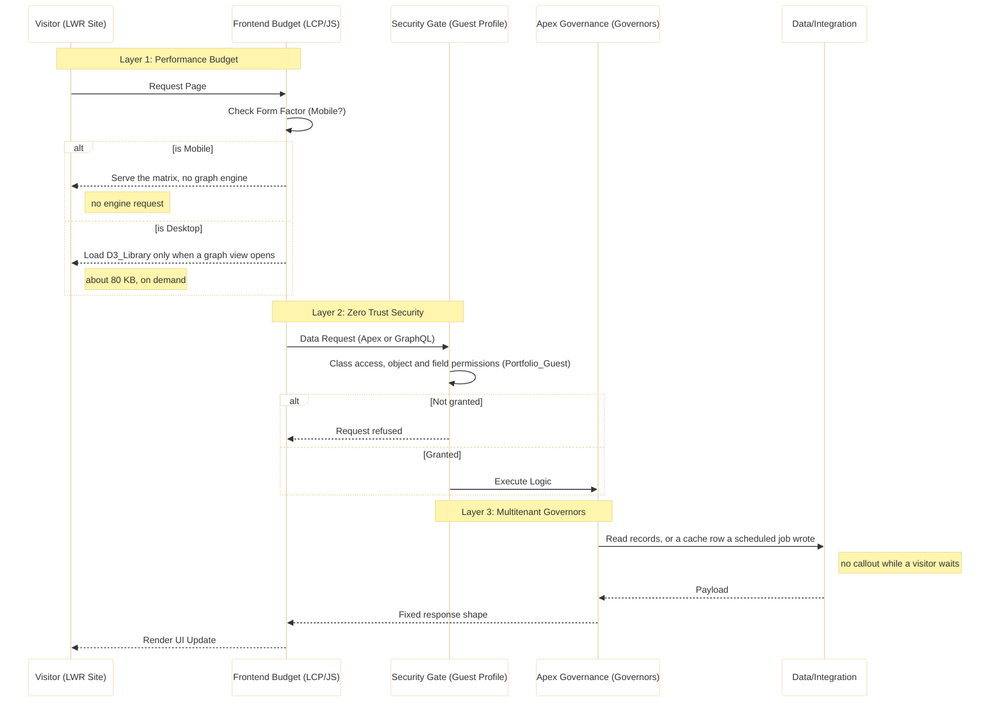

# Guardrails & Executable Governance

**Table of Contents**

- [1. Strategic Intent: Constraint-Based Design](#1-strategic-intent-constraint-based-design)
- [2. The Salesforce "Governor" Rosetta Stone](#2-the-salesforce-governor-rosetta-stone)
- [3. AWS FinOps & Serverless Guardrails (Phase 8)](#3-aws-finops--serverless-guardrails-phase-8)
- [4. Quality Gates & DevOps Discipline](#4-quality-gates--devops-discipline)
- [5. Request Lifecycle & Governance Gates](#5-request-lifecycle--governance-gates)
- [6. The Three-Gate Approval Process](#6-the-three-gate-approval-process)
- [7. Business Impact of Executable Governance](#7-business-impact-of-executable-governance)

---

Project: Salesforce Platform Architect Portfolio

Owner: Ryan Bumstead

Version: 1.0

Launch target: Q1 2027

This document outlines the governance framework and constraint-based design principles that let the portfolio run on a zero budget while it keeps to enterprise quality, security and performance habits. Where a performance target is not met, the measured number is given.

## 1. Strategic Intent: Constraint-Based Design

This portfolio is built on a "Zero-Dollar Budget" requirement. That is not a limitation. It is an architectural challenge. We demonstrate **Constraint-Based Design** by building a resilient, observable system that runs within the strict limits of a Salesforce Developer Edition (free tier). The AWS Always-Free design in section 3 is for a later phase and is not built: the repository holds no AWS code.

> [!TIP]
> **Why Constraint-Based Design Matters**: Many architects treat free tiers as temporary scaffolding. This portfolio shows a production system built within zero-budget constraints, a skill that translates directly to cost optimization in enterprise environments where every dollar of cloud spend requires justification.

## 2. The Salesforce "Governor" Rosetta Stone

**What are Governor Limits?** Salesforce runs on shared infrastructure (multitenant), so it enforces strict limits per transaction to prevent one customer from monopolizing resources. Think of it like apartment building rules: no playing loud music after 10pm so everyone can sleep. These "governors" force developers to write efficient code.

We treat these limits as a blueprint for building high-performance systems.

| Salesforce Constraint                | What It Means                                                                                                                                    | Enterprise Pattern Applied               | Portfolio Implementation                                                                                                                                                                                                                                                                                                                                                                                                                                                                                                                                                                                  |
| :----------------------------------- | :----------------------------------------------------------------------------------------------------------------------------------------------- | :--------------------------------------- | :-------------------------------------------------------------------------------------------------------------------------------------------------------------------------------------------------------------------------------------------------------------------------------------------------------------------------------------------------------------------------------------------------------------------------------------------------------------------------------------------------------------------------------------------------------------------------------------------------------- |
| **100 SOQL Queries per transaction** | SOQL (Salesforce Object Query Language) is like SQL for databases. You get 100 database queries per page load. Exceed this and your app crashes. | **Bulkification** (batch processing)     | A `SAPI*` list read runs a fixed number of queries whatever the record count: one page query and one `COUNT()` query through `QueryDefinitions` (for example `SAPIContact.cls` lines 36 and 43), plus the rate limit read in `RateWindowLimiter`.                                                                                                                                                                                                                                                                                                                                                         |
| **10 second CPU timeout**            | Your code gets 10 seconds of processing time. After that, Salesforce kills it to protect other customers.                                        | **Async Strategy** (offload work)        | No heavy work runs in Apex while a visitor waits. The resume PDF is drawn in the browser with jsPDF ([ADR-023](../adr/023-client-side-pdf-generation-jspdf-for-mvp.md)), and GitHub and Jira are read by scheduled Queueable jobs, so a page view never makes a callout. Moving PDF generation to AWS Lambda is a Phase 8 design and is not built.                                                                                                                                                                                                                                                        |
| **6MB Heap Size**                    | Your code can only use 6MB of memory per transaction. For context, a single high-res image is ~5MB.                                              | **Lazy Loading** (load only when needed) | The D3.js graph engine (`D3_Library`, 81,482 bytes, with pan, zoom and drag) loads only when a visitor opens a graph view, and never on a phone.                                                                                                                                                                                                                                                                                                                                                                                                                                                          |
| **Guest User Security**              | Anonymous visitors have restricted permissions by default. They can't see sensitive data without explicit grants.                                | **Zero Trust** (deny by default)         | `Portfolio_Guest` grants read on six portfolio objects, create and read on `Testimonial__c`, and no permission on Account, Contact or any other standard object apart from read on `UserExternalCredential`. The few records a page needs beyond that, such as my Contact for the resume header, are read by Apex in system mode through `without sharing` selectors that select a fixed list of public fields and never an email, phone or address (`ResumeController.ResumeSelector`, `PortfolioGroundingService.Selector`). The guest reaches that data only through the shape the controller returns. |
| **Real-time Telemetry**              | Salesforce provides APIs to check how close you are to hitting limits.                                                                           | **Glass Box Telemetry** (show your work) | Governor limits (SOQL count, heap usage, CPU time) displayed in site footer so visitors can see the system is healthy.                                                                                                                                                                                                                                                                                                                                                                                                                                                                                    |

**Key Insight:** These aren't arbitrary restrictions. They force the same discipline required in any high-scale system (database query optimization, memory management, async processing).

## 3. AWS FinOps & Serverless Guardrails (Phase 8)

| Phase       | Status                  | Rationale                                                                   |
| :---------- | :---------------------- | :-------------------------------------------------------------------------- |
| **Phase 8** | **Designed, not built** | Designed to show how the site would scale out, deferred until after launch. |

> [!IMPORTANT]
> **Nothing about AWS in this section is built.** The repository holds no AWS code, and no Lambda function, storage bucket or CloudWatch log group serves the portfolio. The Lambda, VPC and CloudWatch parts below are the Phase 8 design. The Gemini quota part describes what runs today.

> [!NOTE]
> **Architectural Reference:** For the detailed system diagrams and component specifications of the Phase 8 architecture, please refer to the **[Systems Architecture Specification (SAS)](./03-SAS.md#11-architectural-north-star)**.

**What is FinOps?** Financial Operations (FinOps) is the practice of making cloud costs visible and controllable. AWS charges for everything (compute time, network traffic, log storage), so architectural decisions directly impact the monthly bill.

To keep the design at $0.00 a month, the architecture avoids common "cost traps":

### Lambda Function URLs vs API Gateway

**The Problem:** AWS Lambda (serverless functions) needs a way for the internet to reach it. The "official" way is API Gateway, which is billed per request once its 12 month free tier ends.

**Our Solution:** Lambda Function URLs (direct HTTP access) are free forever and sufficient for this use case. We sacrifice advanced features (request throttling, API keys) to stay within the free tier.

**Trade-off:** In production, we'd use API Gateway for better security controls. For a portfolio, Function URLs prove we understand cost architecture.

---

### The "No-VPC" Rule

**The Problem:** A VPC (Virtual Private Cloud) is AWS's isolated network. Running Lambda inside a VPC is considered "best practice" for security, but it requires a NAT Gateway to reach the internet. A NAT Gateway is billed by the hour just to exist, even with zero traffic.

**Our Solution:** Run Lambda functions outside a VPC. They can still call public APIs (Salesforce, GitHub) securely via HTTPS without the NAT Gateway tax.

**Trade-off:** Can't access private databases (RDS, private subnets). For this portfolio, all data lives in Salesforce, so we don't need VPC isolation.

---

### Gemini API Quota Management

**The Problem:** The Gemini API key's free tier allowed Gemini 2.5 Flash 5 requests per minute and 20 requests per day when it was read on 2026-10-20 (a recorded reading, not a live one). Flash reasons before it answers and spends most of its tokens on that, so only a few cover letters a minute fit and few a day. Past the limit, Google answers HTTP 429.

**Our Solution:** No quota counter is stored and no Platform Cache is used (the org has no partition). The bounds are:

- The `papi-ai` rate tier of `RateWindowLimiter`: 10 requests a minute on `POST /papi/v1/ai/generate`, and a separate 10 a minute for the site's cover letter page, shared by every visitor (`papi-ai:site-cover-letter`).
- When Google refuses or fails, the cover letter falls back to the Local Template, so the visitor still gets a letter (`ContentGenerationController.dispatch`).
- The footer shows "AI requests today", the sum of today's `papi-ai` counts in `API_Rate_Window__c`. It counts requests, not Gemini calls, and a Local fallback counts too, so it is never labelled as a Gemini quota (my decision, 2026-10-21).

---

### CloudWatch Logs Retention

**The Problem:** AWS charges for log storage beyond its free allowance. Lambda functions generate logs every time they run.

**Our Solution:** Set retention to 1 day (minimum allowed). Production environments would use 30-90 days for incident investigation, but this portfolio prioritizes cost over long-term debugging.

## 4. Quality Gates & DevOps Discipline

**What are Quality Gates?** Automated checks that block bad code from reaching production. Think of them as airport security scanners for software.

We enforce "Green Builds" through automated gatekeeping in our GitHub Actions pipelines:

### Test Coverage (90% Required)

**What it measures:** Percentage of code executed by automated tests.  
**Our standard:** a pull request fails when any Apex test fails or when org wide coverage is under 90%. `pr.yml` deploys the branch to a fresh scratch org, runs every local test with coverage, and passes the result to `scripts/coverage-gate.js --min 90` (`pr.yml`, "Deploy & Test (Scratch Mode - FULL)"). The same script runs locally with `npm run sf:coverage -- --target-org <alias>` and as a step of `npm run pre-launch-check`. The threshold is also listed in the **[Program Charter: Success Criteria](./02-Program-Charter.md#22-success-criteria-definition-of-done)**.  
**Why it matters:** Untested code fails in production. High coverage catches bugs before customers see them.

---

### Static Analysis (Salesforce Code Analyzer)

**What it does:** Scans code for common mistakes (unused variables, SOQL injection risks, performance anti-patterns) with PMD and ESLint rules.  
**Our rule:** `npm run scan` runs `sf code-analyzer` over `packages` with `--severity-threshold 2`, so any violation at severity 1 (Critical) or 2 (High) fails the run. The `quality-check` job of `pr.yml` runs it on every pull request.

---

### LCP Target (2.5 seconds)

**What is LCP?** Largest Contentful Paint: the time until the main content appears on screen. Google uses this for search ranking.  
**Our target:** 2.5 seconds (Google's "good" threshold). On mobile, render delay in the LWR framework's own script keeps LCP above it, so the gate is the best the LWR shell allows: mobile LCP medians of 7.5 to 9.6 s on the six main routes, measured with Lighthouse 11 mobile on a scratch copy of the site ([Technical Guide §2.11](./04-Technical-Guide.md#211-mobile-performance)). In October 2026 I measured production at 7.6 to 10.6 s. The first site component renders at about 5 s, after about 850 KB of framework scripts, so site changes alone cannot reach 2.5 s.  
**How we enforce:** Lighthouse runs on demand (`performance.yml`, started by hand with a target URL, which runs `npm run test:lighthouse`) and as a launch gate. It does not run on every commit, and no build fails on it automatically.  
**Why it matters:** Slow sites lose users, and LCP is one of the signals Google uses for search ranking.

---

### Delta Deployment Strategy

**What it does:** Instead of deploying every metadata file on every change, the production deploy sends only what changed since the previous push.  
**Strategic Value:** A small change deploys as a small package, so a release is quicker and touches less of the org. No timing has been measured, so none is claimed.  
**Implementation:** For the technical configuration of `sfdx-git-delta` in the pipeline, see **[Maintenance Guide: Delta Deployment](./05-Maintenance-Guide.md#33-pipeline-strategy-delta-deployment)**.

---

### Scratch Org Validation

**What is a Scratch Org?** A temporary, isolated Salesforce environment created from source control. Think "Docker container for Salesforce."  
**Our process:** Every pull request that touches `packages/**` creates a one day scratch org, deploys the whole of `packages` to it, runs every local test through the coverage gate above, then validates the PR's delta check only against production with `RunLocalTests` ("Validate Delta Against Production (Check Only)"), so a component or test that fails only in production stops the PR before the merge, and deletes the org. When the scratch org cannot be created, the job falls back to that delta dry run against production on its own (`pr.yml`, "Deploy & Test (Fallback Mode - DELTA)").  
**Why it matters:** Catches "works on my machine" issues. If the code can't deploy to a fresh org, it won't deploy to production.

## 5. Request Lifecycle & Governance Gates

Every interaction passes through three distinct "Gating Layers" to ensure performance and security. This diagram shows the journey of a single user request:

**Summary:** A 3-layer defense (Performance, Security, Governance). No request latency is measured, so no latency target is claimed. The measured numbers are the mobile LCP figures in [Technical Guide §2.11](./04-Technical-Guide.md#211-mobile-performance).

Click to view Request Lifecycle Diagram

**Permission checks:** a GraphQL read is checked against the guest's object and field permissions, and a field without them makes the query fail. An `@AuraEnabled` call needs class access in `Portfolio_Guest`. Inside Apex, the controllers that read records the guest cannot see (my Contact, experience highlights, the integration caches) do so in system mode through `without sharing` selectors with a fixed field list, and return only the shape the page needs.

**Limits:** nothing switches to a cached or deferred answer when a governor limit gets close. The protections that exist are a fixed number of queries per request, the caches that keep GitHub and Jira callouts out of page views, the rate limits in `RateWindowLimiter`, and the circuit breakers on Gemini, GitHub and Jira (`CircuitBreaker`).

## 6. The Three-Gate Approval Process

Each architectural decision is meant to pass three gates before it is built. They are a working checklist, not a workflow any tool enforces:

### Gate 1: Technical Feasibility

- Apex governor limits assessed (SOQL queries, DML rows).
- Related ADR documented (for example ADR-020: why the graph engine loads only when a graph view opens).

### Gate 2: Security & Privacy

- Guest User FLS matrix updated (SAS section 4.6 and `Portfolio_Guest`).
- Credentials rotated on the schedule in the [Maintenance Guide](./05-Maintenance-Guide.md#1-security-rotation-policy-cicd).

### Gate 3: Definition of Ready (DoR)

- User Story Acceptance Criteria defined in Jira.
- Mockups I have agreed before the build.

## 7. Business Impact of Executable Governance

These guardrails aren't just technical controls. They translate directly to business outcomes:

### Zero Runtime Costs

**Technical:** The portfolio demonstrates skills that reduce cloud spend in production environments.
**Business impact:** The same "No-VPC" and "Function URLs over API Gateway" patterns avoid the fixed monthly charges of a NAT Gateway and the paid API Gateway tier described in section 3. They are a design here, so no saving has been measured.

---

### Predictable Performance

**Technical:** Hard limits prevent runaway processes that cause outages.
**Business impact:** The 90% coverage gate and the full test run on every pull request stop a change that breaks a test before it reaches production. No count of prevented failures is kept, so none is claimed.

---

### Audit-Ready Architecture

**Technical:** Every API request is gated by OAuth and the rate limiter and written as one log line (`RequestUtil.logRequest`), and every evaluator token request writes an `API_Access_Request__c` record.
**Business impact:** The guest's access lives in one permission set in source (`Portfolio_Guest`), so a security review reads one file and its history.

---

### Fast Iteration

**Technical:** Quality gates catch issues in CI/CD, not in production.
**Business impact:** Delta deployments keep each release small, so features ship in small steps without giving up the gates above.

---

### Knowledge Transfer

**Technical:** The "Governor Rosetta Stone" table translates Salesforce-specific constraints into universal patterns.
**Business impact:** Bulkification, async processing, and lazy loading apply to any cloud platform (AWS, Azure, GCP). These patterns reduce database costs, improve response times, and increase system resilience across all architectures.

---

**Key Takeaway:** Governance isn't about saying "no". It's about architecting systems that succeed within real-world constraints while maintaining enterprise-grade quality, security, and observability. The free-tier constraints in this portfolio mirror the budget, security, and performance constraints of enterprise systems at scale.
